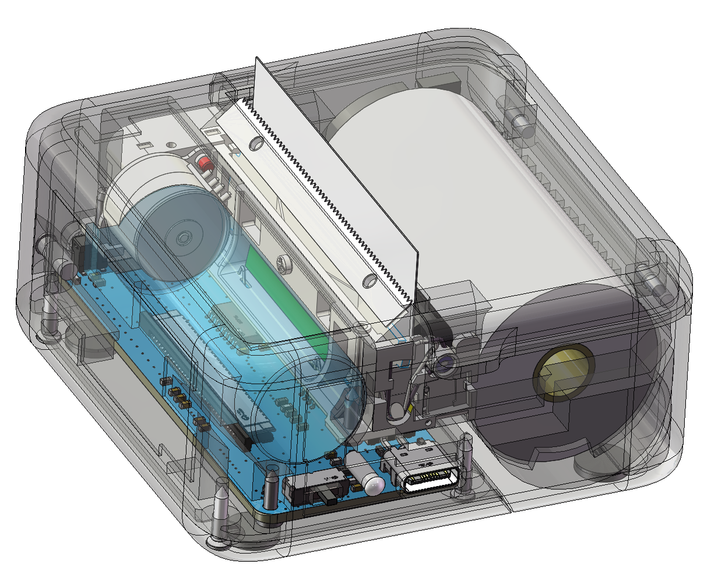

<h1 align="center">Mini Printer</h1>

<p align="center">A 384-dot thermal printer powered by ESP32</p>

<p align="center">
  
</p>

This repository contains the firmware, test client, hardware notes, and mobile
client source code.

## Project layout

| Path | Contents |
| --- | --- |
| [`firmware/`](firmware/) | PlatformIO firmware: hardware drivers, print queue, protocol parser, BLE, TCP, STA Wi-Fi with temporary setup AP, and embedded Web UI |
| [`python/`](python/) | BLE test-page client and protocol tests |
| [`docs/`](docs/) | Hardware notes, architecture, and [print protocol](docs/protocol.md) |
| [`android/`](android/) · [`ios/`](ios/) · [`wxapp/`](wxapp/) | Client source code for other platforms |
| [`www/`](www/) | Buildless Preact + HTM project website and Web Bluetooth print workbench; GitHub Pages deployment workflow |

`firmware/` is a regular directory in this repository; no Git submodule setup
is needed.

## Build and test

After installing [PlatformIO Core](https://docs.platformio.org/en/latest/core/installation/index.html):

```sh
cd firmware
pio run -e esp32dev
pio test -e native
```

To flash the firmware, replace the serial port with your device's port:

```sh
pio run -e esp32dev -t upload --upload-port /dev/cu.usbserial-XXXX
```

The BLE test client uses Python and `bleak`:

```sh
python3 -m pip install bleak
python3 python/main.py --dry-run
python3 python/main.py
python3 -m unittest discover -s python -p 'test_*.py'
```

Print data uses the project's compact `MP` frame protocol. The firmware accepts
the same protocol over BLE, raw TCP port `9100`, and HTTP `POST /api/print`.

Wi-Fi normally runs as STA only. On first boot, after a saved-network startup
failure, or after a triple click on the printer button, the temporary
`Mini-Printer-XXXX` setup AP becomes available. Open `http://192.168.4.1/`
(or use the captive portal) to select a network. The AP closes after successful
provisioning. The embedded page can rasterize images in the browser and print
through either the temporary setup AP or normal STA operation.

The TCP endpoint is not IPP or AirPrint. See [`docs/protocol.md`](docs/protocol.md)
for frame fields and status codes, and [`firmware/README.md`](firmware/README.md)
for the network and HTTP API.
