# Mini打印机资料导航

Mini打印机，这是一台可以打印你手机中任何东西的设备，学习中打印错题、单词、生活中打印标签、留言、贴纸、照片等等，可玩性非常高。

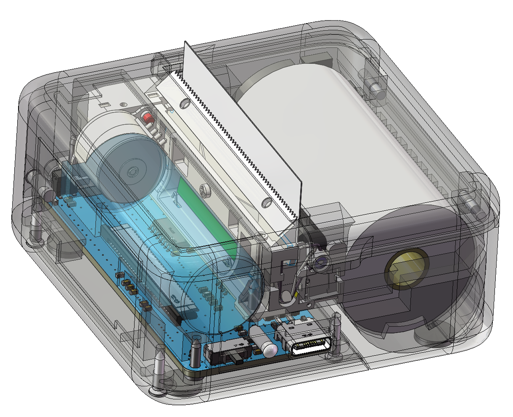
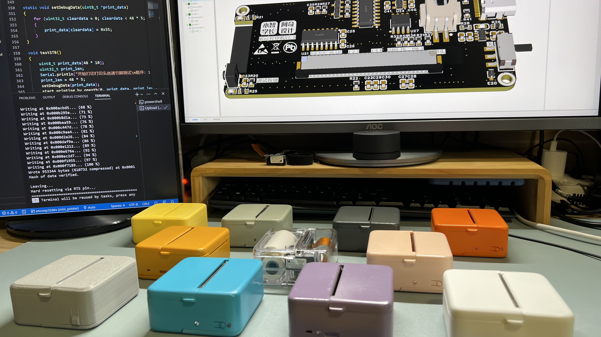

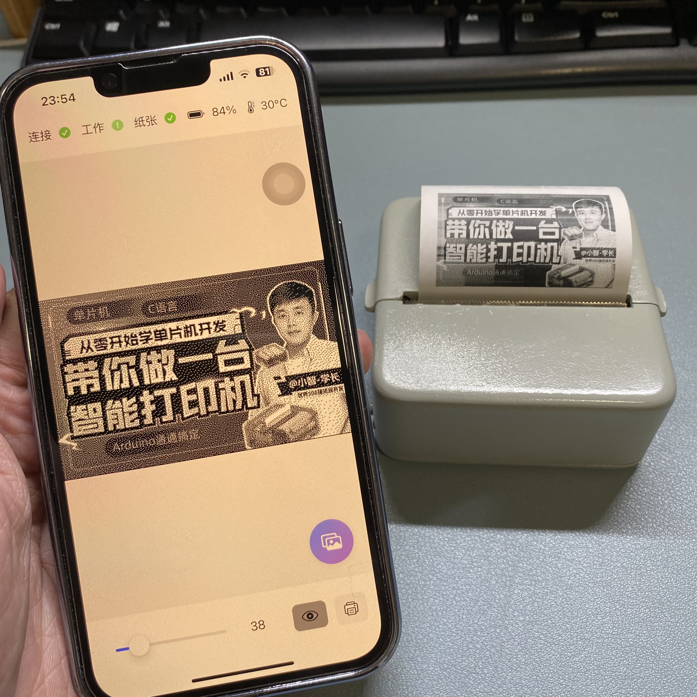

**视频课程入口：**

[【单片机嵌入式Arduino实战】手把手做打印机_哔哩哔哩_bilibili](https://www.bilibili.com/cheese/play/ss5058?csource=private_space_class_null&spm_id_from=333.999.0.0)

# 一、学习路径建议

## 1.1、**零基础，精学所有**

学习周期约：30天、1-2小时一天

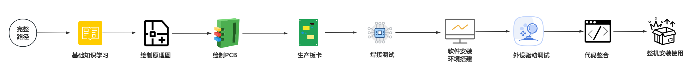

## 1.2、**零基础，只想学习硬件**

学习周期约：20天、1-2小时一天

## 1.3、**零基础，只想学习软件**

学习周期约：20天、1-2小时一天

## 1.4、有编程和单片机基础，**想快速上手完整项目**

学习周期约：15天、1-2小时一天

> [!TIP]
> 无论哪条路径，**强烈建议看视频配合文档学习，**
> 95%的问题在文档中都有记录啦，细心都能找到答案！
> 学习过程中遇到不懂的点，可以在文档添加评论、视频发弹幕、交流群进行交流。
> **最最最重要的三个点：**
> **一定要动手画图、动手写代码、动手做实验。**
> **一定要动手画图、动手写代码、动手做实验。**
> **一定要动手画图、动手写代码、动手做实验。**

## 1.4.1、关于板卡拼单

**【关于基础教程的板卡和外设实验包】**

可以看这里哦：[基础外设实验板卡](https://m.tb.cn/h.UDNTn06?tk=ahltdLLclst)

**【关于打印机项目的电路板、外壳拼单说明】**** **

**对于只想学习软件部分或者快速玩起来的小伙伴，想一起拼板的，现在可以在这里一起拼单啦！！！**

第一批数量有限，目前只有80套哦，有需要的小伙伴可以点击了解：[拼单链接](https://item.taobao.com/item.htm?spm=a213gs.success.result.1.47284831IPJzdH&id=742108783424)

**拼单板卡快速烧录使用，外壳安装请看：**[6、烧录固件&问题排查-快速玩起来](https://lsongdev.feishu.cn/docx/T1bBdP1yIo8iMixk24TcvPAdnPf) 

## 1.5、课程内容

[思维导图/MindNote](https://lsongdev.feishu.cn/docx/NWnld8dLXoatstxhNJAc8qV2nOe)

https://www.processon.com/view/link/64f2ab55817f3d0fa3ef3b75 访问密码：bjPV

# 二、基础部分资料

视频链接入口：[基础部分视频](https://www.bilibili.com/video/BV1QL411673n/?spm_id_from=333.337.search-card.all.click&vd_source=3fc954fff5945f99212c8a9631f033a1)

资料链接入口：

[AiPG（光打机三合一）项目指南 持续更新ING](https://lsongdev.feishu.cn/docx/LWnPdTtbAoOnS4x1TJdc7ub8noe) 

## 2.1、**什么是Arduino?**

*Arduino*是一个便捷灵活、方便上手的开源软硬件平台，包含硬件(各种型号的*arduino*板)和软件(*arduino* IDE开发环境)。它不仅适用于工程师进行快速原型开发，也同样适用于各行业对软硬件产品有兴趣的朋友们。

[0、课程介绍&认识Arduino](https://lsongdev.feishu.cn/docx/NkAtdptyroGgdixAsOQch3WhnZe) 

## 2.2、**开发板应该怎么选择？课程使用哪块板卡？Arduino与ESP32的关系？**

Arduino是开源的软管硬件平台，所以加入Arduino生态的芯片公司、开发板公司也非常多，所以我们在学习过程中可以选择的开发板种类也非常多。

[0-1 Arduino硬件介绍](https://lsongdev.feishu.cn/docx/DuaJdvEUyom0rwxCF8hcJmwwnpf) 

## 2.3、**应该在那里写代码？哪里编译代码？**

[1、Arduino软件环境搭建](https://lsongdev.feishu.cn/docx/OvJNd6lGiolNx4xlF36cWkdFnLe) 

## 2.4、**如何搭建一个工程，然后编译快速跑起来？**

[1-1、先跑起来（点亮LED&打印Helloworld）](https://lsongdev.feishu.cn/docx/YmCPd0V0Po2zg9xSJfEc1y74neb) 

## 2.5、**常用编程语言关键词，从这里开始学习代码基础**

[2、代码基础](https://lsongdev.feishu.cn/docx/Qyv3dvEIDozdcvxlbkRc2lDdnMc) 

## **2.6、从技术原理的角度看下，LED是怎么被点亮的？**

[3、LED进阶](https://lsongdev.feishu.cn/docx/Vq0cdsS1zouRqOx9tuXcbWLbnKc) 

## **2.7、我们已经把芯片的运行状态打印到电脑显示，但它的技术原理是怎么样的？**

[4、打印字符到电脑](https://lsongdev.feishu.cn/docx/TBuSdqVU9oBlDTx4MBbcI1t3nLh) 

## **2.8、编程语法学习的进阶**

[4-1、代码基础-进阶](https://lsongdev.feishu.cn/docx/NC51duj5aotuiax9GFicUv7Fnob) 

## **2.9、如何读取按键状态？**

[5、按键输入](https://lsongdev.feishu.cn/docx/HrdjdmclEobLNPxQvzqc29zNned) 

## **2.10、如何使用计时和定时器功能？**

[6、计时与定时](https://lsongdev.feishu.cn/docx/JwgpdAm8ooon1yxTH4WcGqnvnie) 

## **2.11、如何读取模拟量？**

[7、电位器](https://lsongdev.feishu.cn/docx/M7C2duTayocLlXxYuuQc0D5bnUh) 

## **2.12、如何驱动舵机，并让它旋转到对应角度？**

[8、舵机控制](https://lsongdev.feishu.cn/docx/T6xodSr77oAJRkxBDTpcfKfjnMc) 

## **2.13、蜂鸣器是如何驱动的？**

[9、蜂鸣器](https://lsongdev.feishu.cn/docx/HQwUdLHm5oCNjvxQfEpcjibQn4g) 

## **2.14、一个酷的应用怎么少得了一个屏幕显示呢？**

这节课，我们使用屏幕显示需要显示的内容，然后做一个Mini时钟。

[10、屏幕显示](https://lsongdev.feishu.cn/docx/N45Pd0tA1oaC4CxUWZjc8Ekyn0b) 

## **2.15、有哪些常用的电机类型？**

直流电机和步机电机的区别，直流电机的驱动原理是什么，步机电机的驱动原理是什么？

[11、直流&步进驱动](https://lsongdev.feishu.cn/docx/Plp4dyPpDoI6nvxrsx2cG62Qnac) 

# 三、Mini打印机项目部分资料

## 需求分析部分

[0、需求分析](https://lsongdev.feishu.cn/docx/F8zid9DF4ovbc3xAJfdcBKGbn0f) 

## 3.1、项目硬件部分：

### [1、嘉立创EDA-快速设计一款板卡](https://lsongdev.feishu.cn/docx/FtMNdsPNlo4jwCxe2vdcQd3bnw1) 

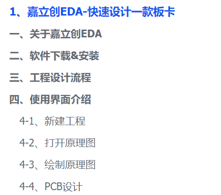

### [2、ESP32最小系统绘制](https://lsongdev.feishu.cn/docx/DHModND7GoFV2ixUKiecWkKZnbe) 

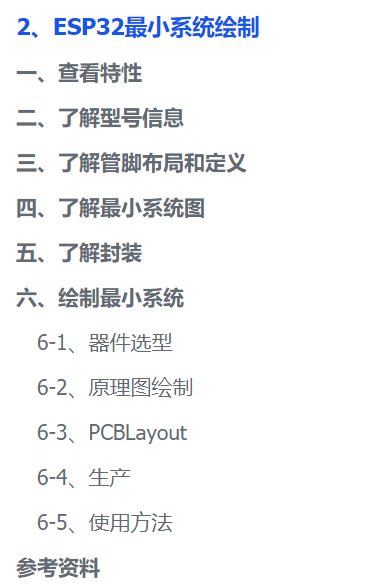

### [3、ESP32最小系统优化](https://lsongdev.feishu.cn/docx/NR9AdIcRho7hgZxG9XRcAAwhndh) 

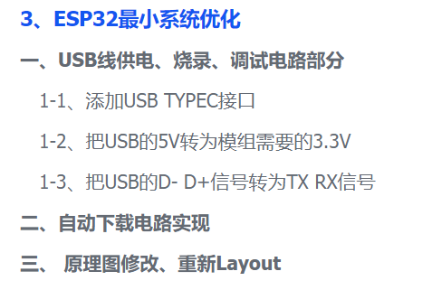

### [4、外围驱动设计](https://lsongdev.feishu.cn/docx/YKm7dz3sPoMfW9xjCVpcvskIn9c) 

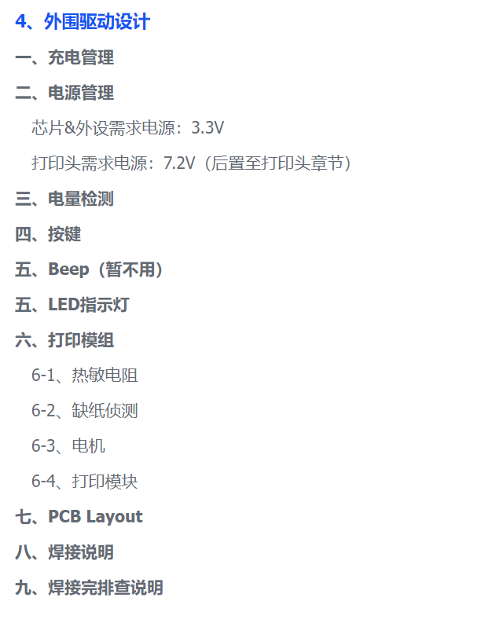

## 3.2、项目软件部分：

### [5、软件模块](https://lsongdev.feishu.cn/docx/AFjldfR3xo0pJqxZGvCcYx7Kn7b) 

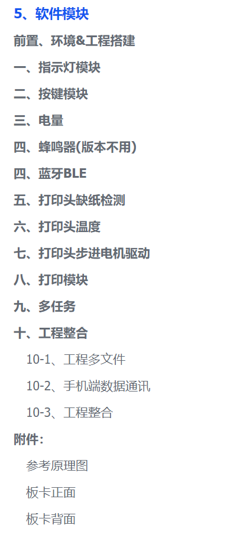

## 3.3、固件快速烧录&问题排查

[6、烧录固件-快速玩起来](https://lsongdev.feishu.cn/docx/T1bBdP1yIo8iMixk24TcvPAdnPf) 

# 四、PCB最终版本工程

## PCB工程

<!-- 不支持的块类型: View (type=33) -->

<file token="AL8kbO7PJoDfqYxbxlhcZcwknJd" name="ProProject_Mini打印机-V8_2023-09-16.zip"/>

关于出现PCB DRC检测报错问题，是立创工程导出问题导致，目前版本已修复。

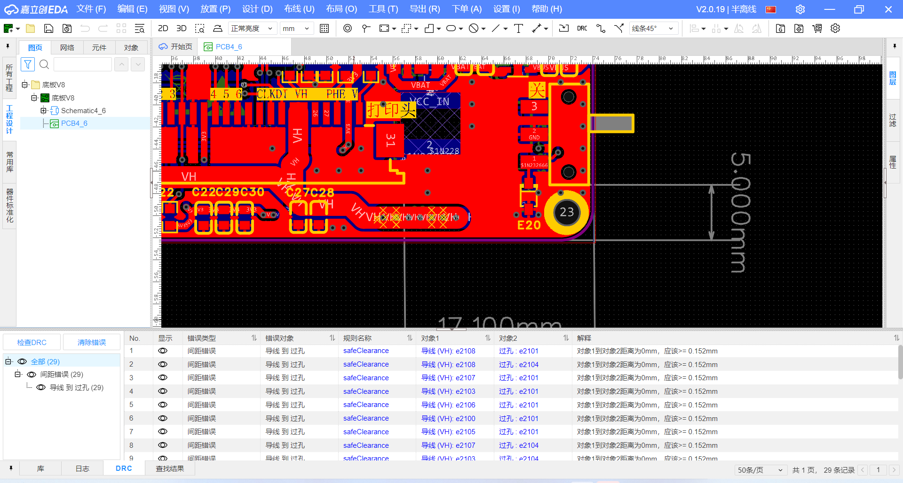

如果出现：可以选取报错的那几个过孔，在右侧的属性栏目，修改网络为VH先

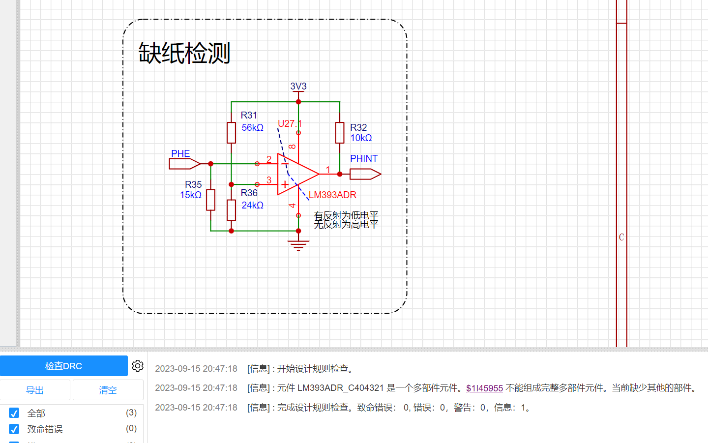

原理图DRC检测时，该信息不影响项目正常工作，原因是LM393是双通道的比较器，我们只用一个通道，这个封装的问题导致，LM393设计时是希望多加一个光电检测用于检测纸张距离的，后面大家有想法可以扩展下。

**关于SMT贴片选型：**

ESP32可以选这个型号：https://item.szlcsc.com/736349.html

也可以在淘宝乐鑫官网购买ESP32-WROOM-32E-N4

**工程如何使用？**

下载后，打开立创EDA专业版，在快速开始中，点击“导入专业版”即可，不用解压。

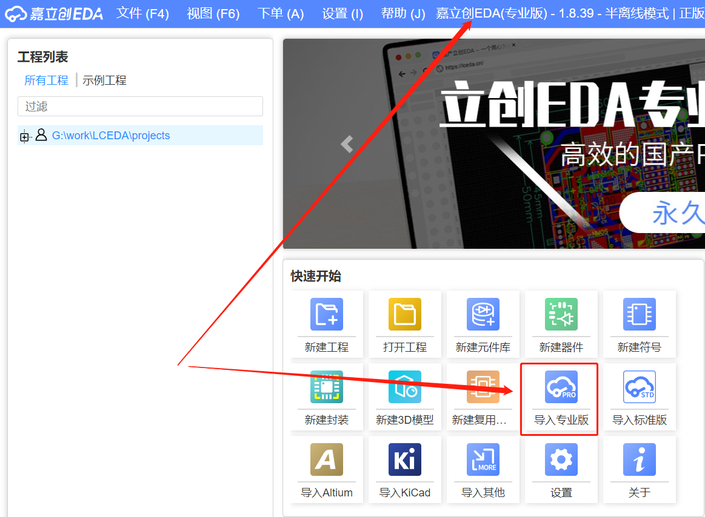

对应PCB和原理图如下：

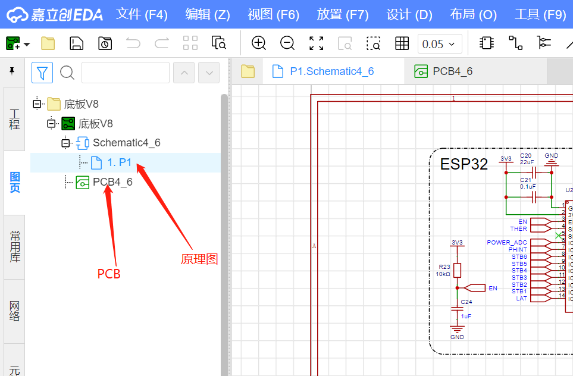

## 原理图

<!-- 不支持的块类型: View (type=33) -->

<file token="U1dPbH7LgozTpUxw508c0Io9n1b" name="SCH_Schematic4_6_2023-10-08.pdf"/>

# 五、打印机板卡软件工程

## 5.1、打印机源码

建议使用v1.0.2版本，修复了spi初始化bug

<!-- 不支持的块类型: View (type=33) -->

<file token="ZSSTbgQ2yoylK2xC4ZpcWnP6nDb" name="mini_printer_v1.0.2.zip"/>

<!-- 不支持的块类型: View (type=33) -->

<file token="LydLbhy0soiZbZxPvnNc60NEnZx" name="mini_printer.zip"/>

源码如何导入VSCode使用：[工程源码导入VSCode使用](https://lsongdev.feishu.cn/docx/T6ljd6vjIoN0vyxYSuTcl1ZAn3c) 

<grid cols="2">
<column>
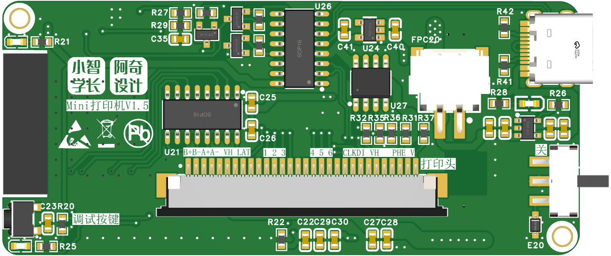
</column>
<column>
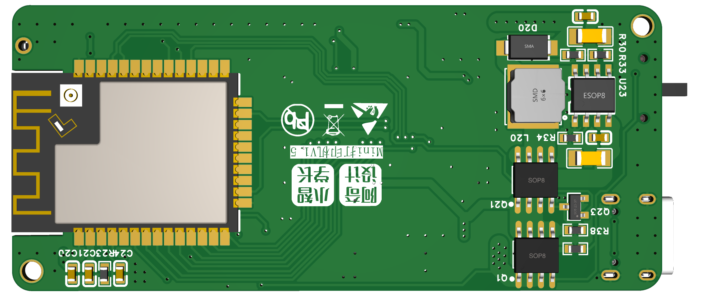
</column>
</grid>

## 5.2、打印机固件-首次使用-问题排查&快速烧录请看

[6、快速烧录验证](https://lsongdev.feishu.cn/docx/T1bBdP1yIo8iMixk24TcvPAdnPf) 

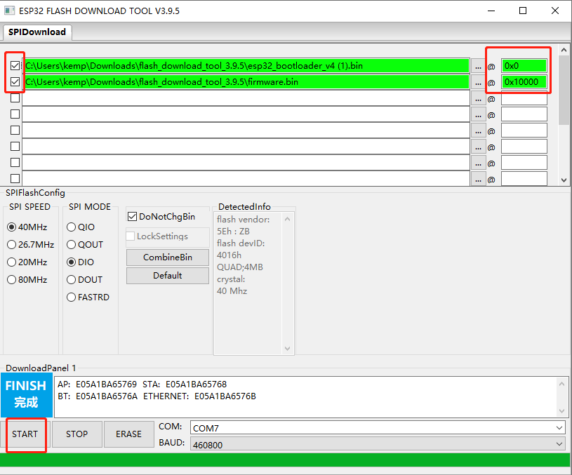

# 六、整机安装-结构外壳-零配件自行购买请看

[7、零配件&安装](https://lsongdev.feishu.cn/docx/K3lZdivCAoGM2sxamQvcVFxQnQd) 

# 七、APP源码&安装文件

[8、Mini打印机-APP开发需求说明](https://lsongdev.feishu.cn/docx/E1uWdt3oeorXTVxgsUUcMnLWnDd) 

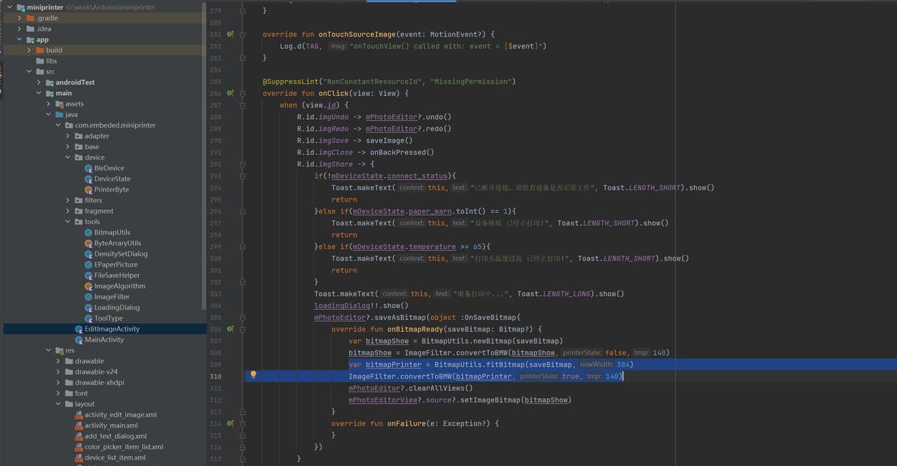

**Android源码**

<!-- 不支持的块类型: View (type=33) -->

<file token="JOxTby9Sdob6bnx2EV5cK0Enn7d" name="miniprinterV2.zip"/>

Android APK，发送到手机，然后安装（安装时注意文件后缀为.apk，如果通过微信发送到手机，注意后缀可能会被改为**MiniPrinter.apk.1**，需要自己保存到文件中，然后修改名称为**MiniPrinter.apk**再安装。）

<!-- 不支持的块类型: View (type=33) -->

<file token="NVVxbFklWoPA2WxtjH1cSj7Wn4e" name="MiniPrinter_支持stm32版本.apk"/>

-如果Android系统大于或等于12，需要开启位置权限，否则会闪退。

-默认需要蓝牙、蓝牙搜索设存储的权限。

<!-- 不支持的块类型: View (type=33) -->

[视频：Android12、13权限设置.mp4（飞书原文）](https://lsongdev.feishu.cn/docx/NWnld8dLXoatstxhNJAc8qV2nOe)

**IOS源码**

https://github.com/xinnyu/MiniPrinter

<!-- 不支持的块类型: View (type=33) -->

<file token="ErxVbno3Momt0BxGWuvcr571njd" name="MiniPrinter-main.zip"/>

**iOS应用，直接在App Store搜索迷你打印机，然后下载安装即可**

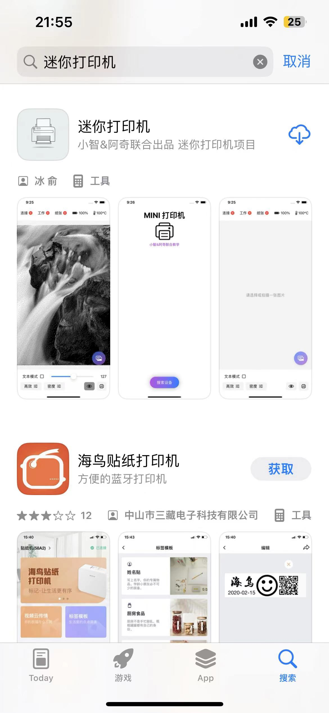
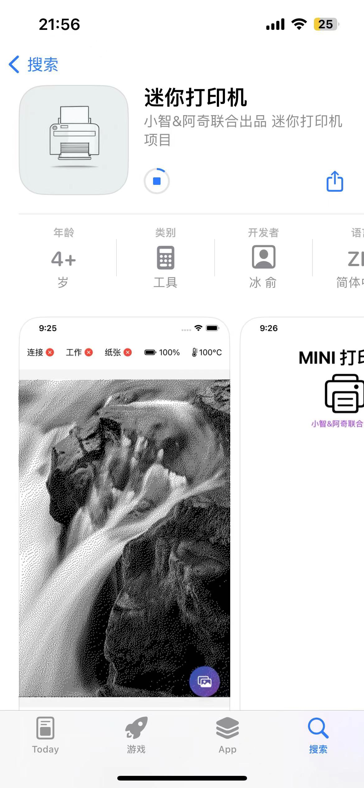

APP内容展示：

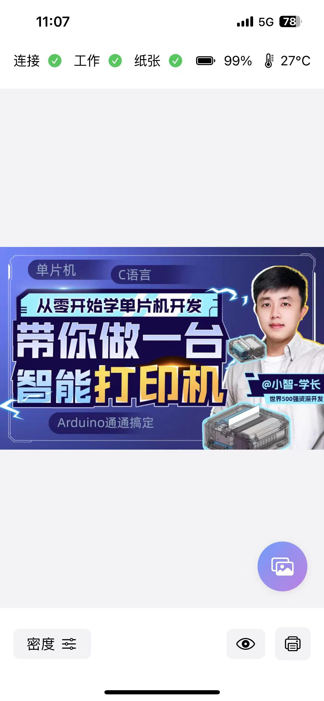
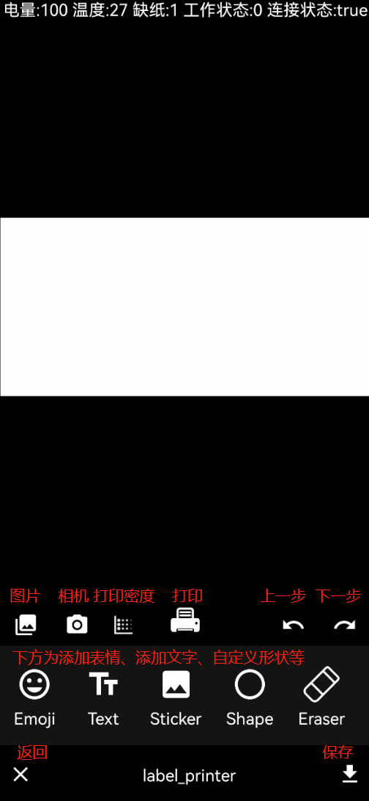

# 

# 八、附加部分：STM32版本

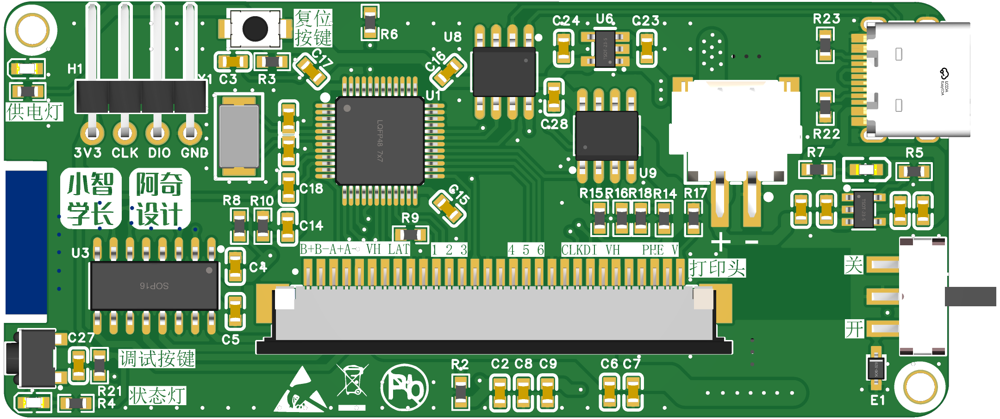
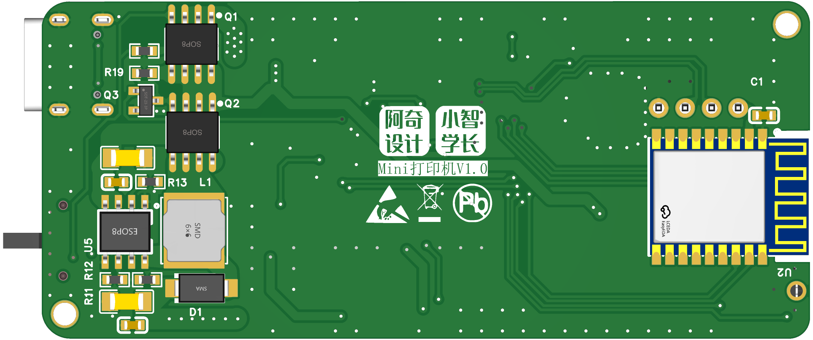

飞书链接：[Mini打印机-STM32版本](https://lsongdev.feishu.cn/docx/RWaHdWTHvoVIYaxNrGUcwCPzn0c)    密码：j^k556u7
