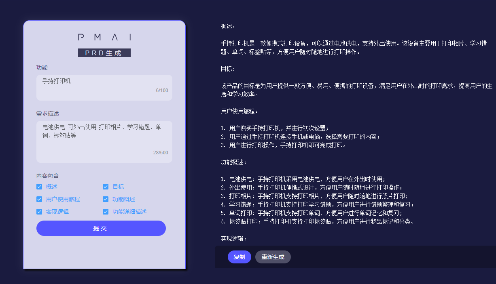
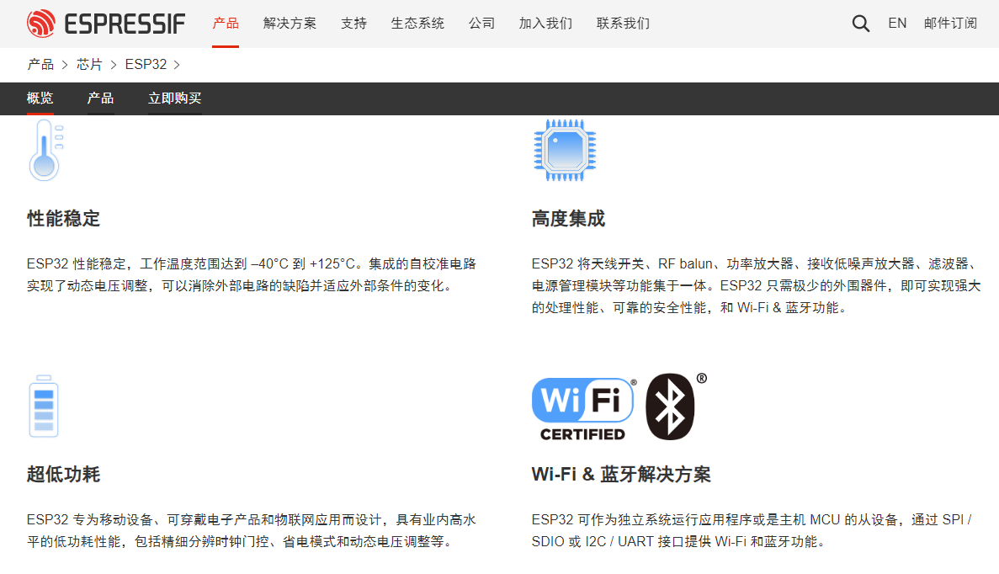

# Mini Printer

[视频链接](https://www.bilibili.com/cheese/play/ss5058)

# 产品需求：我们要做什么？

**需求关键词：**

手持打印机 电池供电 可外出使用 打印相片、学习错题、单词、标签贴等。

[PRD一键生成 __ PM-AI](https://www.pm-ai.cn/prd)



```c
目标：
该产品的目标是为用户提供一款便携、易用、功能丰富的掌上打印机，满足用户在外出时打印照片、文字、学习资料等的需求。

用户使用方法：
用户首先需要购买该产品，并下载相应的手机应用程序。用户在外出时，可以通过手机蓝牙连接该打印机，并选择需要打印的内容。用户可以选择打印相片、文字、自定义编辑内容、学习错题、单词等。用户可以在手机应用程序中进行编辑和排版，以满足个性化需求。用户可以通过打印机的电池进行供电，无需外接电源。

功能概述：
该产品的主要功能包括：
打印相片：用户可以通过手机蓝牙连接该打印机，选择需要打印的相片，并进行编辑和排版。
打印文字：用户可以通过手机蓝牙连接该打印机，选择需要打印的文字，并进行编辑和排版。
自定义编辑内容：用户可以通过手机蓝牙连接该打印机，进行自定义编辑和排版，以满足个性化需求。
学习错题、单词等：用户可以通过手机蓝牙连接该打印机，选择需要打印的学习资料，并进行编辑和排版。
电池供电：该打印机带有电池，用户可以通过电池进行供电，无需外接电源。

实现逻辑：
该产品的实现逻辑包括：
打印机硬件设计：该打印机需要设计小巧、轻便，带有电池，方便用户携带和使用。
手机应用程序开发：该打印机需要与手机应用程序进行配合，用户可以通过手机应用程序进行编辑和排版，并通过蓝牙连接打印机进行打印。
打印机驱动程序开发：该打印机需要开发相应的驱动程序，以便与手机应用程序进行配合，实现打印功能。

总结：
该产品是一款小型掌上打印机，带有电池，可外出使用，可通过手机蓝牙连接，打印相片、文字、自定义编辑内容、学习错题、单词等。该产品的目标是为用户提供一款便携、易用、功能丰富的掌上打印机，满足用户在外出时打印照片、文字、学习资料等的需求。该产品需要进行打印机硬件设计、手机应用程序开发和打印机驱动程序开发等工作。该产品的主要功能包括打印相片、打印文字、自定义编辑内容、学习错题、单词等，同时带有电池供电功能。
```

**归纳：电池供电、小型、打印机、蓝牙连接使用**

**电池供电：**充放电管理、电压转换、电量检测、开关按键

**小型：**紧凑设计、多层板卡

**打印机：**热敏打印机芯（机芯温度热敏电阻、缺纸传感器、步机电机、打印加热模块）

**蓝牙连接使用：**芯片支持蓝牙功能

> [!TIP]
> 同步分享一些AI工具，大家可以多使用提高效率，国内版本哦
> [chat.seanslk.me](https://chat.seanslk.me)
> [Redless](https://redless.chat/chat) 
> [ChatPPT_AI一键对话生成PPT_智能排版美化](https://chat-ppt.com/)
> [PandaGPT.io](https://app.pandagpt.io/chat)
> https://docs.github.com/zh/copilot

# **一、选择主控芯片**

**需求：一款支持蓝牙、Arduino、供货稳定、资源丰富的芯片**

[ESP32 Wi-Fi & 蓝牙 MCU I 乐鑫科技](https://www.espressif.com.cn/zh-hans/products/socs/esp32)

接下来，就是绘制主控芯片原理图，这部分可以参考芯片的手册进行。

在绘制原理图前，我们来了解下，硬件相关的基础知识，这里我们分为五个步骤：

1. 硬件基础知识，原理图、PCB、PCBA、电容、电阻、封装等。

1. 什么是立创EDA

1. 如何使用立创EDA快速设计一款板卡

1. 如何绘制ESP32最小系统

1. ESP32最小系统的优化



# 二、基于立创EDA快速设计一款板卡

[1、嘉立创EDA-快速设计一款板卡 Copy](01-eda-board.md) 

# 三、绘制ESP32的最小系统板卡 

[2、ESP32最小系统绘制 Copy](02-esp32-minimal-system.md) 

# 四、基于上节课的最小系统板卡，进行优化

[3、ESP32最小系统优化 Copy](03-esp32-optimization.md) 

# 五、把项目的外设驱动电路设计完

https://lsongdev.feishu.cn/docx/TKgQdZPokosjqPxozEtcnDOPnkb

# 六、进行软件相关代码编写

https://lsongdev.feishu.cn/docx/ELI6dYzNQobr3Mx7vYYc6FCCns1
