# 1、嘉立创EDA-快速设计一款板卡

## 一、关于嘉立创EDA

是一款友好易用的，强大的EDA(Electronics Design Automation: 电子设计自动化)工具。

- 设计原理图绘制、PCB设计、设计外壳。

- 支持在线&离线版本。

- 打通元器件、PCB、SMT链路。

# 二、软件下载&安装

[软件下载 - 嘉立创EDA](https://lceda.cn/page/download)

建议下载专业版本，同时下载激活文件，浏览器版本体验稍差。

<!-- 不支持的块类型: View (type=33) -->

<file token="QGU3b1EFioc3A7xEaIccwMfcn4e" name="lceda-pro-windows-x64-1.8.39.exe"/>

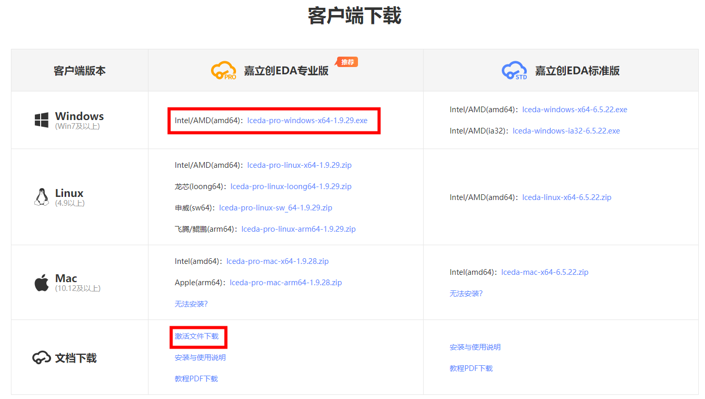

安装过程全部默认下一步即可，安装完成后使用激活文件激活。

更多安装说明可参考[立创EDA专业版-使用教程](https://prodocs.lceda.cn/cn/faq/client/index.html)

# 三、工程设计流程

确定设计需求-\>创建原理图-\>绘制-\>创建PCB-\>设计-\>检查-\>导出生产

例如：需要设计一个ESP32的最小系统，参考ESP32模组的手册

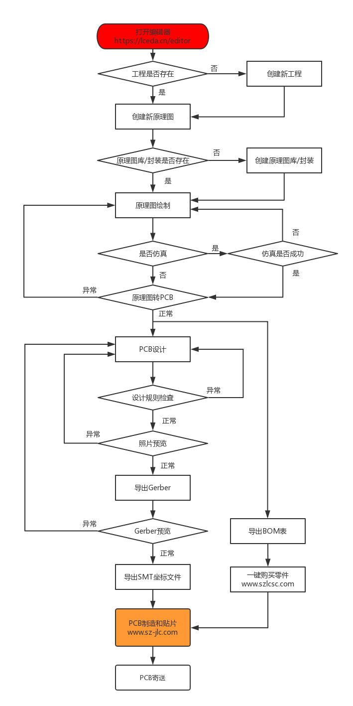

# 四、使用界面介绍

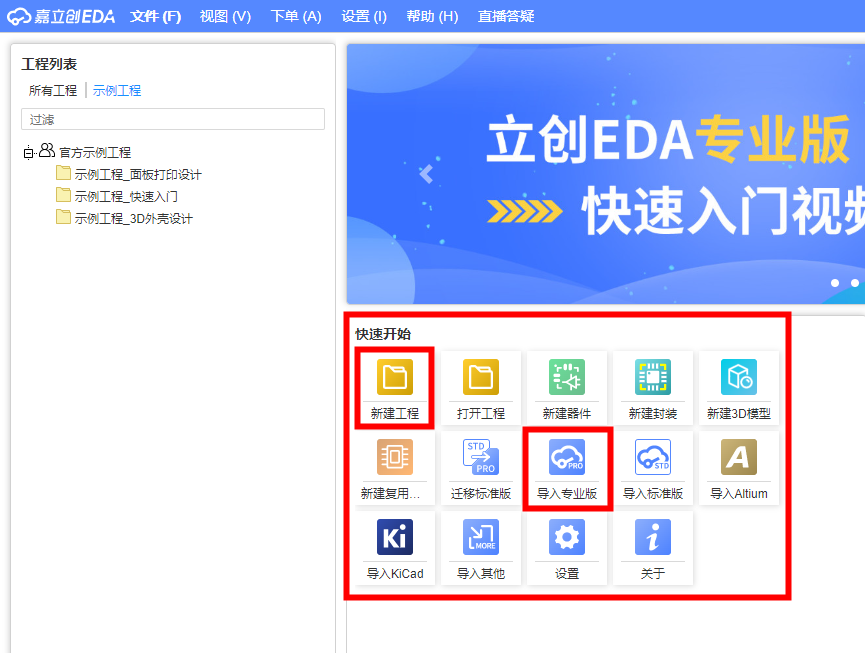

## 4-1、新建工程

1、 **顶部菜单 \> 文件 \> 新建 \> 工程** 或 **快速开始 \> 新建工程 ** 创建工程或原理图。

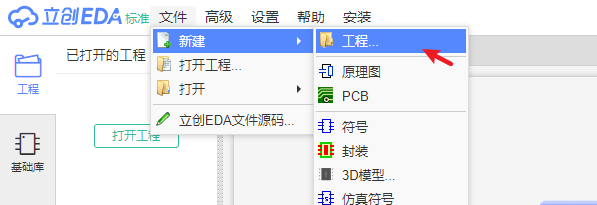

## 4-2、打开原理图

双击打开原理图设计界面，顶部菜单栏、中间图纸、左侧工程结构、右侧图纸配置

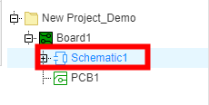

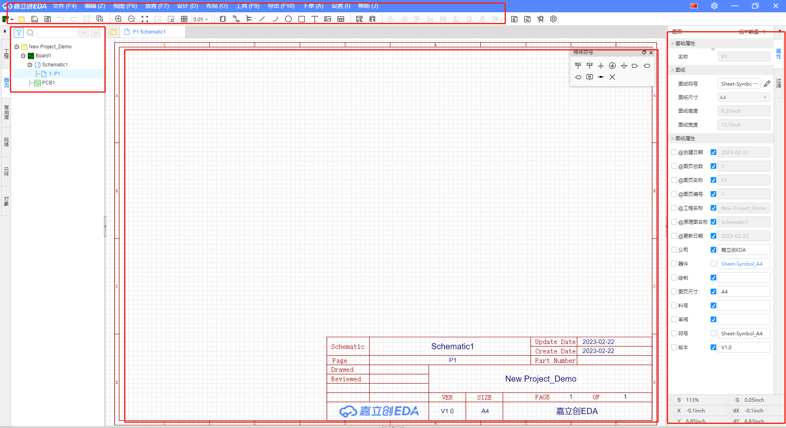

## 4-3、绘制原理图

**1、放置芯片**

底部元器件-\>搜索ESP32-S就可以看到芯片，点击放置

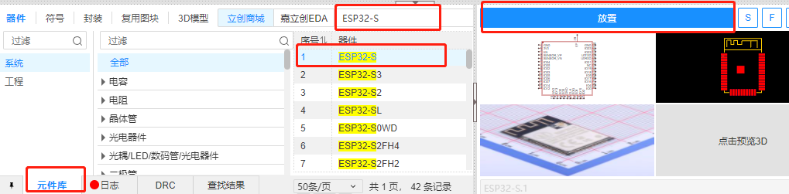

**2、放置电容 （10uf 0603）、电阻(10k 0603)**

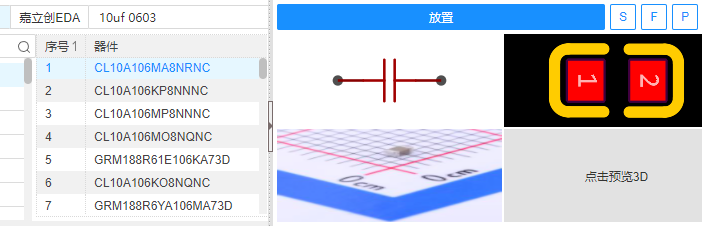

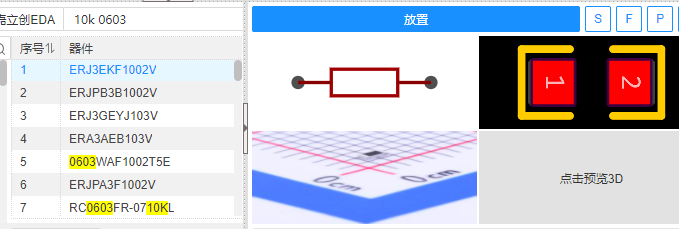

**3、连接引脚（直连&网络标签连接）**

特殊符号介绍 VCC 地  网络标签 非连接

放置菜单栏介绍

常用快捷键 W（导线） 空格键（旋转） N（网络标签）

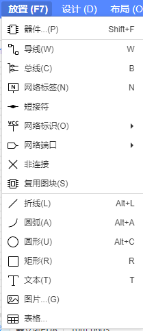

**4、检查DRC，确保导线连接成功，需要留空的引脚，添加X**

<grid cols="2">
<column>
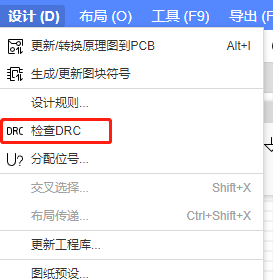
</column>
<column>
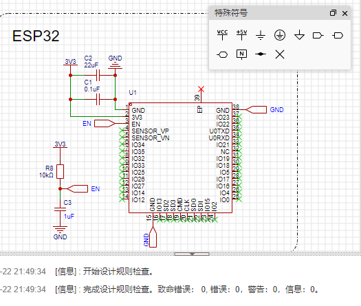
</column>
</grid>

## 4-4、PCB设计

1、点击“设计”-\>更新/转换原理图到PCB

<grid cols="2">
<column>
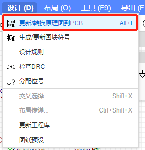
</column>
<column>
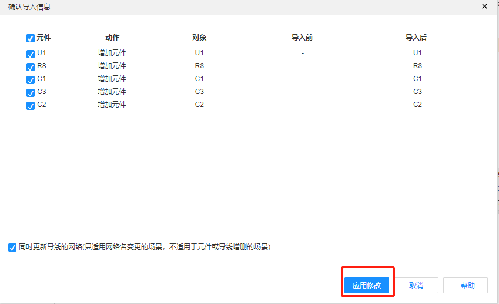
</column>
</grid>

2、PCB设计界面介绍

左侧工程，顶部菜单、右侧板层、中间PCB

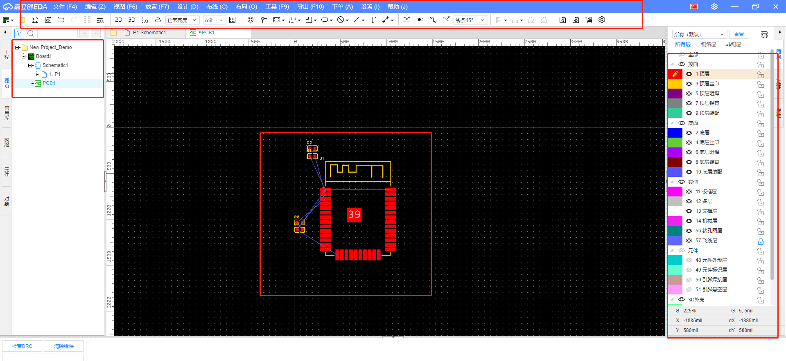

3、确定电路板的大小

添加板框

<grid cols="2">
<column>
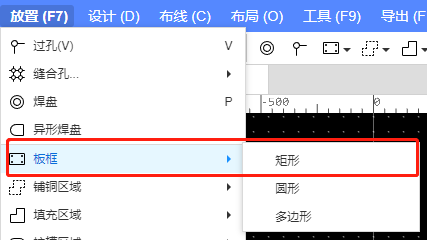
</column>
<column>
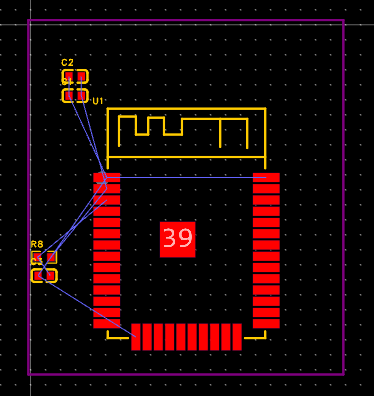
</column>
</grid>

4、调整元器件摆放位置

根据走线距离，元器件类型，结构限制等摆放好位置

快捷键：鼠标左键拖拽、空格键旋转

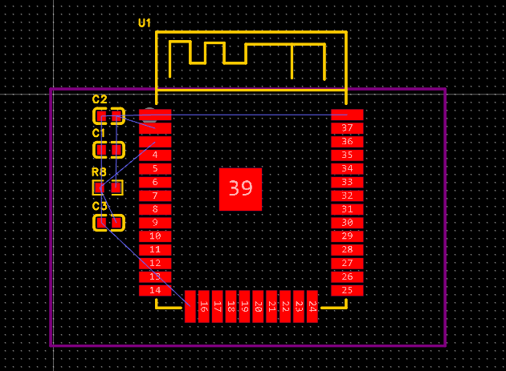

元器件摆放不下的时候，可以设置摆放在底层

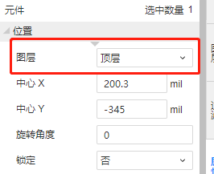

5、布线w

布线原则，尽可能短，不走直角、不走阻容中间

快捷键:W

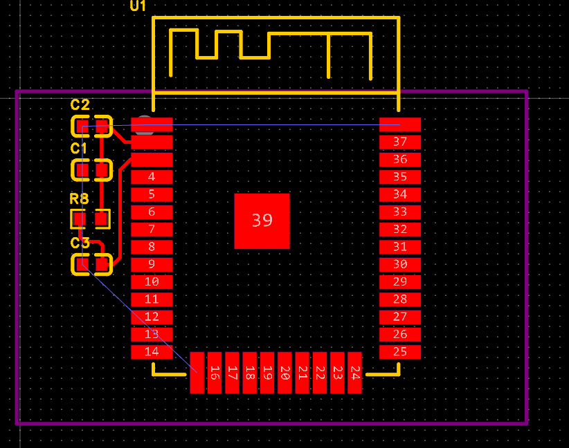

如果遇到走不过的情况，可以走线过程中按B/T添加过孔

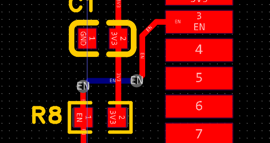

6、铺铜

信号电源线布好后，就可以进行铺铜了，一般铺铜选择和GND连接在一起，这样板卡信号更不容易被干扰。

<grid cols="2">
<column>
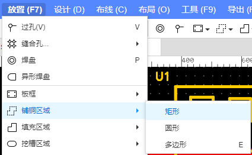
</column>
<column>
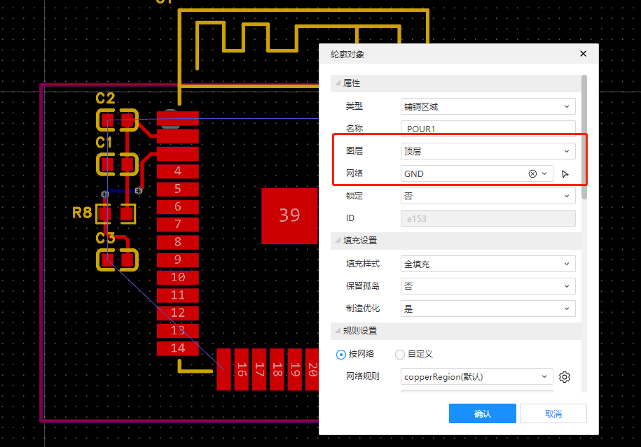
</column>
</grid>

7、检查DRC、确保没有违反设计规则

<grid cols="2">
<column>
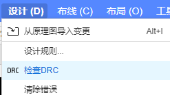
</column>
<column>
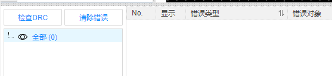
</column>
</grid>

连接、导线、过孔等规则是否符合设计要求，或者是否满足生产工艺，能够制造出来

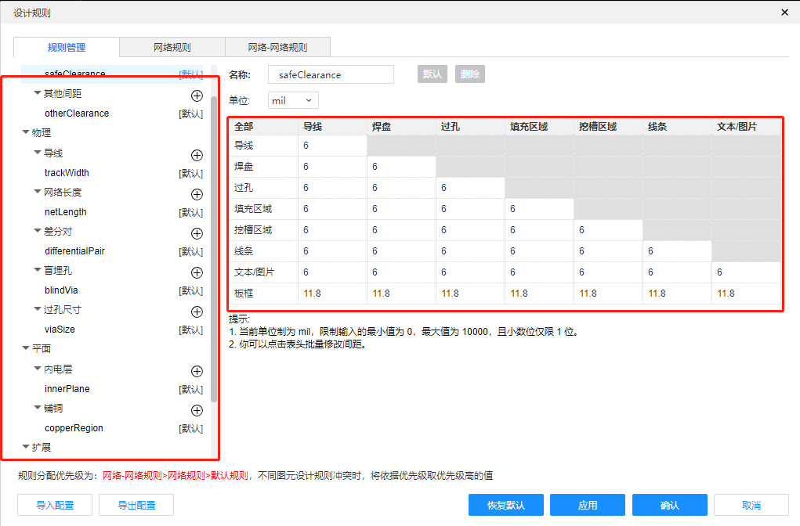

8、检查3D外观

判断是否有和结构、外壳冲突的地方

元器件是否太近难以焊接等

<grid cols="2">
<column>
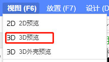
</column>
<column>
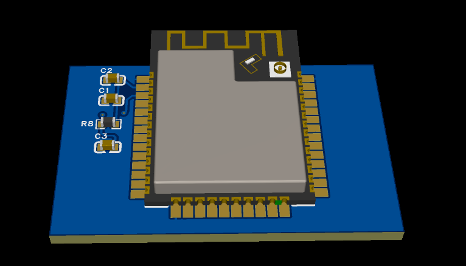
</column>
</grid>

9、导出PCB文件、BOM表、坐标文件，交给厂家生产

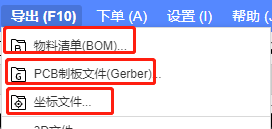

<!-- 不支持的块类型: View (type=33) -->

<file token="LvSWbFSVyong7dxxJQ1cLVxjnSh" name="ESP32最小系统板卡.zip"/>
