# 2、ESP32最小系统绘制

## 一、查看特性

了解芯片资源、工作条件、外设接口

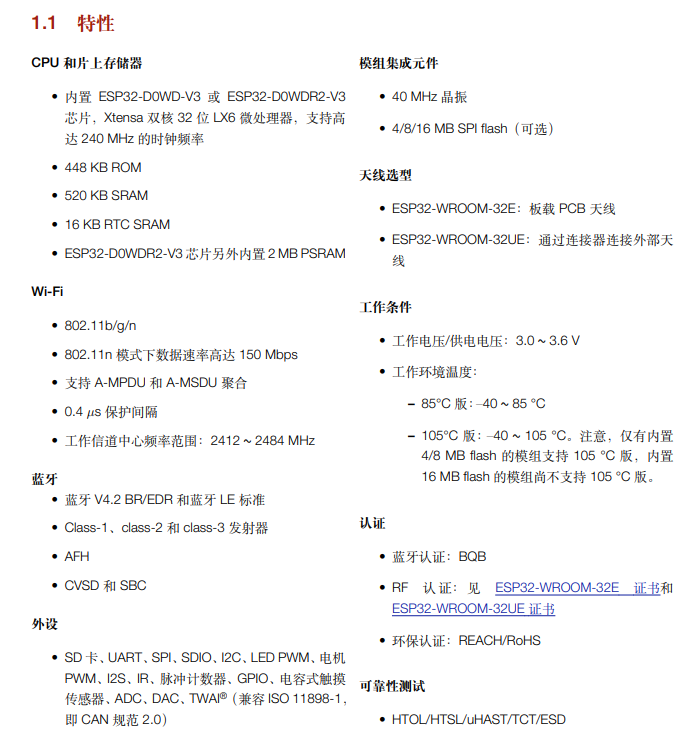

# 二、了解型号信息

知道不同型号的差异，方便选型

<grid cols="2">
<column>
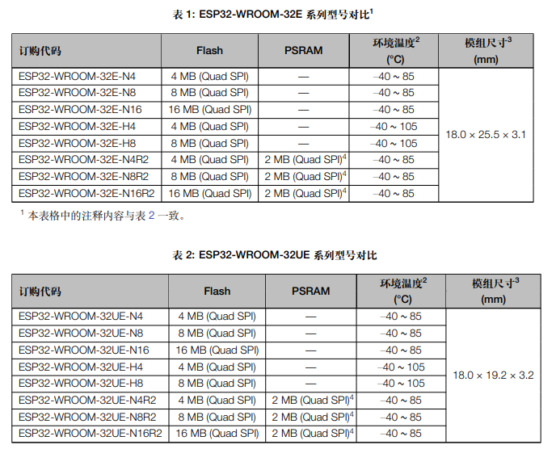
</column>
<column>
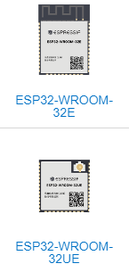
</column>
</grid>

# 三、了解管脚布局和定义

知道哪些引脚有哪些功能，怎么使用

<grid cols="2">
<column>
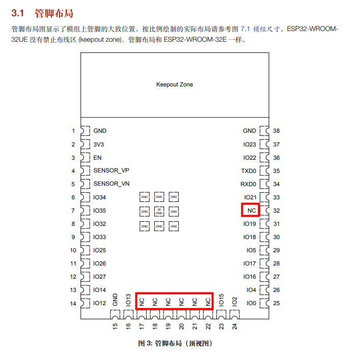
</column>
<column>
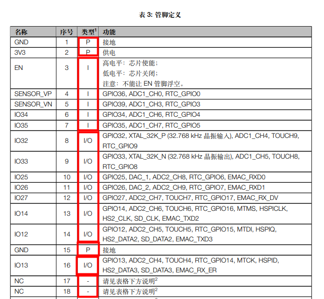
</column>
</grid>

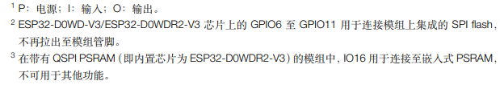

**烧录固件模式：**

GPIO0为烧录模式/正常启动切换IO，在GPIO0电平为0时，复位芯片（EN引脚由低变高），芯片将会进入烧录模式。

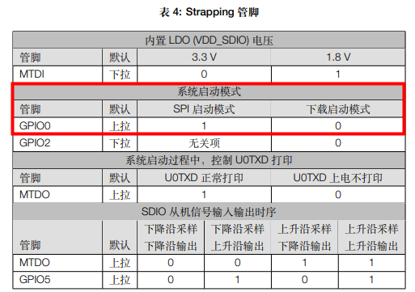

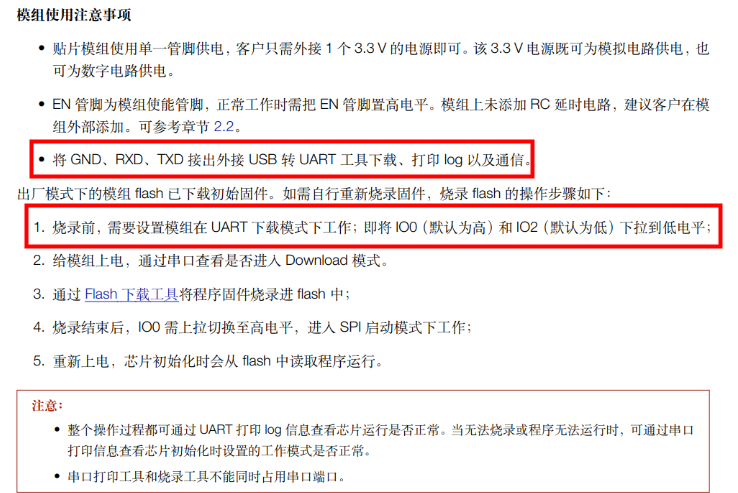

# 四、了解最小系统图

了解芯片运行起来所需的最小外围设计要求，然后就可以绘制芯片最小系统。

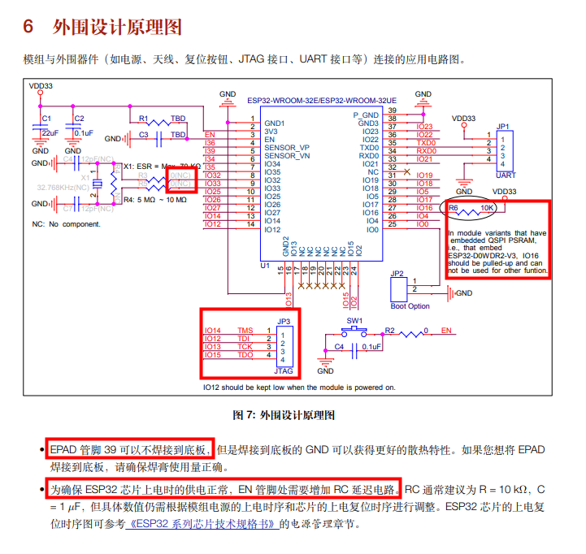

# 五、了解封装

方便绘制模组封装，或者选型时找到可以替换的模组（封装和管脚一致即可替换：例如安信可和乐鑫的模组可互相替换）。

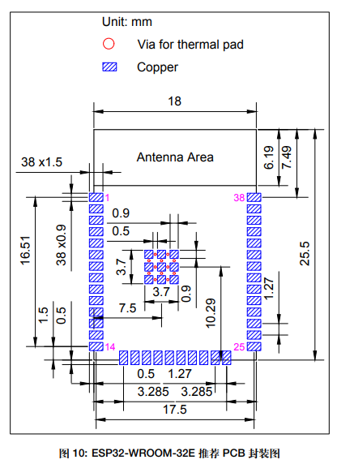

# 六、绘制最小系统

## 6-1、器件选型

ESP32S或ESP32-WROOM、电容、电阻、按键、排针（供电、烧录、通讯、IO引出）

## 6-2、原理图绘制

详见视频教程说明哦！！

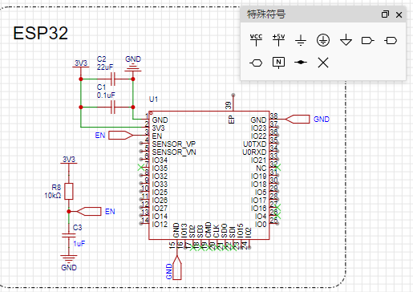

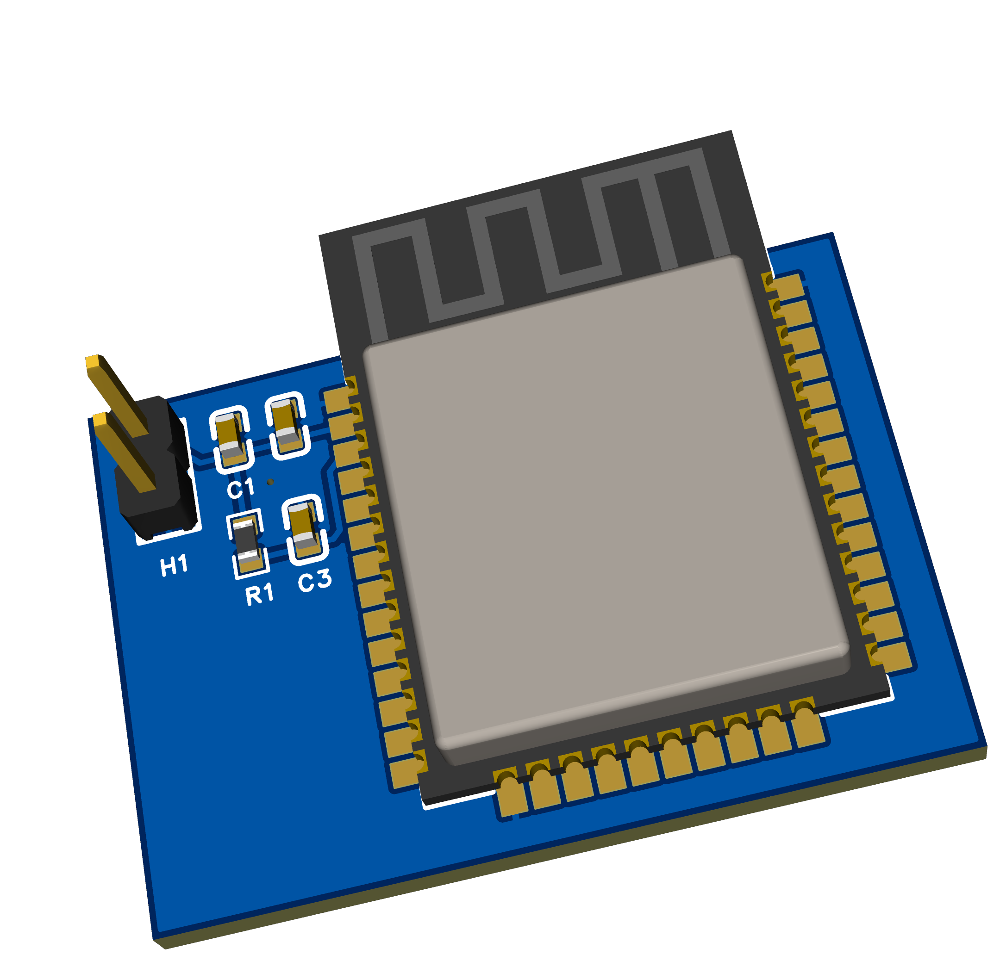

## 6-3、使用方法

USB转串口模块，杜邦线接VCC GND TX RX

-烧录时长按IO按键、轻点EN按键进入烧录模式

-烧录完成后，轻点EN按键进入正常运行模式

# 参考资料

参考官方手册：

https://www.espressif.com.cn/sites/default/files/documentation/esp32-wroom-32e\_esp32-wroom-32ue\_datasheet\_cn.pdf

如果想了解模组内部的设计，可参考：

https://www.espressif.com.cn/sites/default/files/documentation/esp32\_hardware\_design\_guidelines\_cn.pdf
