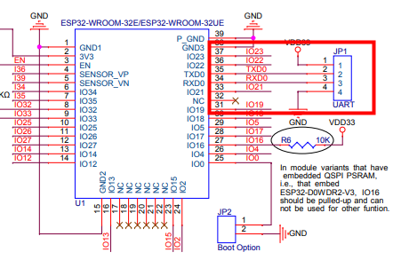
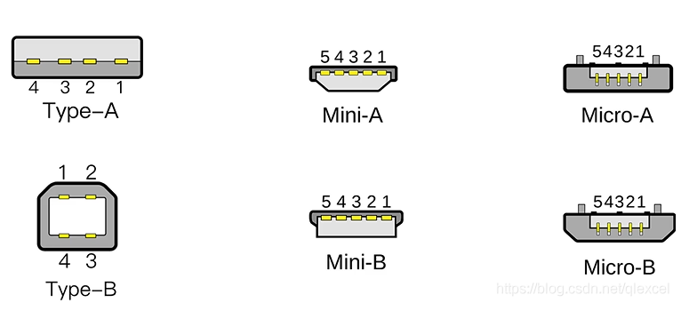
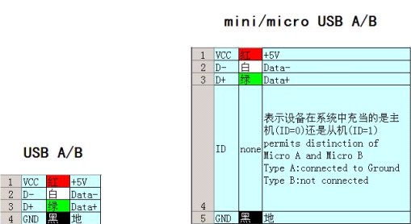
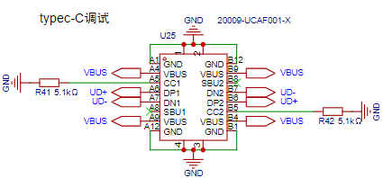
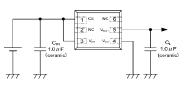
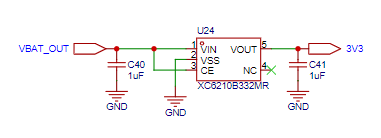
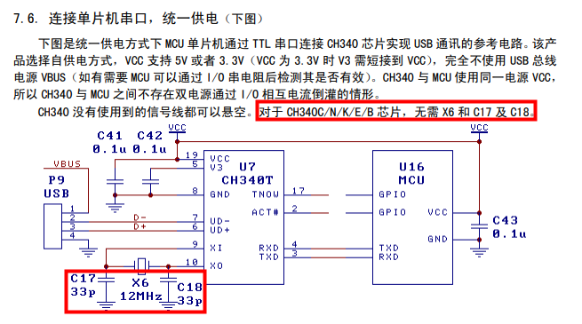
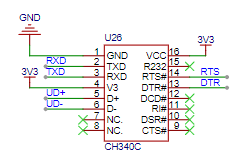
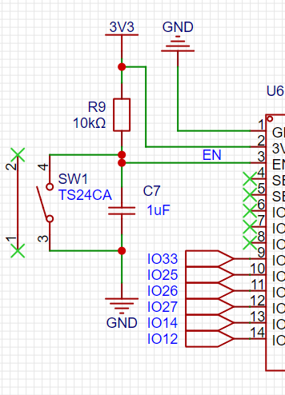
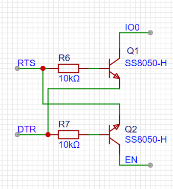

# 3、ESP32最小系统优化

在最小系统的版本中，我们的电路板仅仅能满足芯片跑起来的基本功能，如果要调试芯片，则需要购买USB转TTL模块、杜邦线，也要把IO0和EN引脚焊接出来，使用并不方便，有哪些可以优化的地方呢？

1、添加USB线供电、烧录、调试电路

2、添加自动下载电路

下方是上节课所绘制的最小系统工程，可以在专业版中直接导入zip使用：

<!-- 不支持的块类型: View (type=33) -->

<file token="WkidbdqeIo3ArHx1y4ScZZjEnod" name="ESP32最小系统板卡.zip"/>

## 一、USB线供电、烧录、调试电路部分

由于模组端的下载接口是UART口 VCC(3.3V) TX RX GND

所以我们要做三件事，添加USB TYPEC接口，添加电压转换电路，添加USB转串口模块。



## 1-1、添加USB TYPEC接口

<grid cols="2">
<column>

</column>
<column>

</column>
</grid>

TYPEC端子我们使用的是20009-UCAF001-X

https://item.szlcsc.com/3708441.html

原理图如下所示：

- CC1 CC2接电阻后接地，这是Typec口用于做接入检测和正反接识别的，如果这两个口不接悬空，接上充电器时充电器不会输出电压。

- VBUS为电源端，接电脑USB或充电器时，默认为5V

- UD+ UD-为数据线



## **1-2、把USB的5V转为模组需要的3.3V**

需求：由于TYPEC端输入电压是5V，而芯片需要3.3V供电，5V转3.3V，输出电流在500ma以上

使用稳压芯片为：XC6210B332MR

https://item.szlcsc.com/3544066.html

<!-- sheet token="OFVXsSIiEhMOHatLLWpcE9OunHh" id="YYy8he" -->

## YYy8he

| 最大输入电压 | 6V |
| --- | --- |
| 输出电压 | 3.3V |
| 压差 | 75mV@(100mA) |
| 输出电流 | 最大900mA |



电路设计非常简单，只需要在输入输出添加旁路电容，两个1μF的陶瓷电容。



这里的VBAT\_OUT我们改为VUSB即可，因为目前我们还没有添加电池部分电路。

## **1-3、把USB的D- D+信号转为TX RX信号**

因为ESP32端的下载调试引脚为串口，而TypeC端输入信号为USB信号，所以需要进行信号转换，使用CH340系列芯片：CH340C，该芯片带有RTS DTR接口，方便后续进行自动下载电路实现。

https://item.szlcsc.com/85852.html





# 二、自动下载电路实现

ESP32要进入下载模式的前提是，IO0拉低，然后复位芯片（通过EN引脚控制，EN由低电平到高电平（上升沿）时CPU复位，复位后检测到GPIO0是低电平，MCU自动进入下载启动模式！）

<grid cols="2">
<column>

</column>
<column>

</column>
</grid>

```java
根据电路原理：EN、IO0默认为高
DTR = 0; RTS = 0, 此时Q1截止，Q2截止，EN = 默认; IO0 = 默认
DTR = 0; RTS = 1，此时Q1导通，Q2截止, EN = 默认; IO0 = 0
DTR = 1; RTS = 0, 此时Q1截止，Q2导通, EN = 0; IO0 = 默认
DTR = 1; RTS = 1, 此时Q1截止，Q2截止, EN = 默认; IO0 = 默认

逻辑中一旦CPU启动后EN就被拉高了，IO0默认上拉，所以上边电路精简后
DTR RTS  EN  IO0
 0   0    1   1
 0   1    1   0
 1   0    0   1
 1   1    1   1
 
 简单总结：
 当DTR和RTS同时为0或者同时为1时，此时EN和IO0的状态由其他电路决定（内部/外部上拉电阻）。
 当不同时为0或者1时，EN  = RTS，IO0 = DTR
 
但是这种逻辑下 EN和IO0是不可能同时为0的，然而进入下载模式则需要如下的序列
1.  IO = 0; EN = 0
2.  IO = 0; EN 0 -> 1
 从逻辑表上看是根本无法正常进入下载模式的。
 
问题的答案实际在另外一部分电路，原理其实非常简单：
EN信号连接在一个电容充放电电路上，EN由于电容充电，电平并不会立马变为高电平，而是缓慢上升，我们就可以使用这个时间差。
1、设置DTR = 1; RTS = 0, 此时 EN=0 IO=1 
2、设置DTR = 0; RTS = 1, EN=0 IO=0  此时EN引脚由于电容充电，实际还是0
3、等待电容充电完成，此时 EN=1 IO=0，进入下载模式
具体的DTR、RTS就是由芯片厂家提供的esptool.py下载脚本进行设置的。

```

# 三、 原理图修改、重新Layout

添加USB端子、CH340C、LDO稳压芯片、自动下载电路实现
