# 4、外围驱动设计

下方是上节课所绘制的最小系统工程，可以在专业版中直接导入zip使用：

<!-- 不支持的块类型: View (type=33) -->

<file token="LB74bJCHdo4U5pxv04Pc9Q73nHg" name="ESP32最小系统优化.zip"/>

## 一、充电管理

**需求：希望产品可以不接电源、外出使用**

所以需要添加一颗锂电池用于供电，这里的锂电池我们选择动力电池，因为普通锂电池最大输出电流在1C左右，也就是2000mah的电池，最大输出2A电流，而动力电池可以到10C，这是由打印头的电源需求决定的。

**需求：一颗2000mah的锂电池，电压3.7-4.2V，充电电流1000ma内**

项目中使用ME4054B-N作为充电管理方案，充电电流最大500mA，而且封装较小。

https://item.szlcsc.com/485645.html

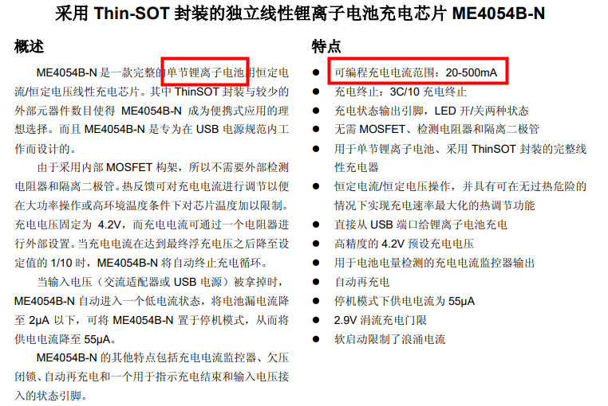

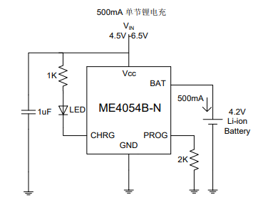

可以根据实际情况，调整PROG接口的电阻阻值，用以修改充电电流：

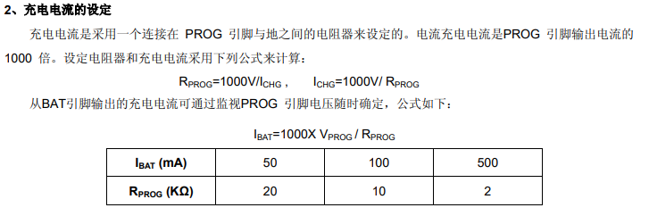

FYI:也可以使用TP4056，可以获得更大的充电电流，但是封装大，不好布局

https://item.szlcsc.com/772193.html

<grid cols="2">
<column>
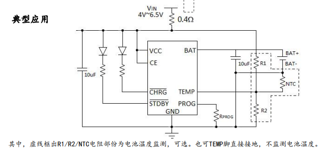
</column>
<column>
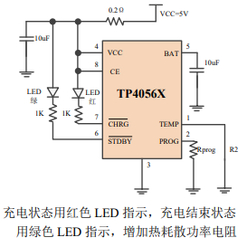
</column>
</grid>

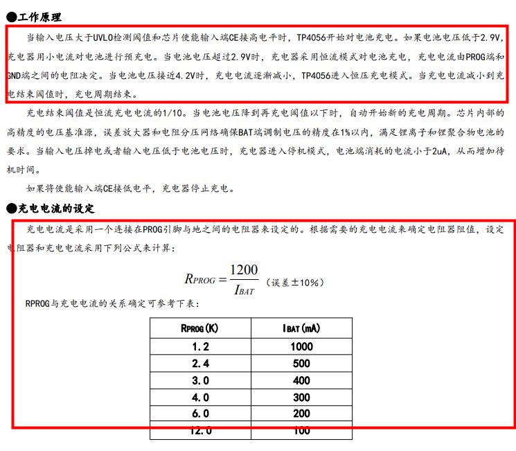

TP4056应用在大电流充电（700mA 以上），为了缩短充电时间，需增加热耗散电阻，阻值范围 0.2～0.5Ω。客户根据使用情况选取合适电阻大小。

# 二、电源管理

## **芯片&外设需求电源：3.3V**

**需求：ESP32芯片需要3.3V 500mA以上的电源进行供电。**

而单节锂电池提供的电压是3.7-4.2，并不满足电源需求，所以需要添加一个稳压电路，经典的稳压电路像AMS1117。那项目中为什么不使用AMS1117-3.3? 

如果使用AMS1117（1.3V@（1A）），电池电压在3.7V时输出的电压将会达不到3V。

XC6210B332MR压差小（100mV@(200mA)），适合电池与低压差供电的场合，输出电流大，额定电流达900mA。电池供电电压在3.7V-4.2V，

<grid cols="2">
<column>
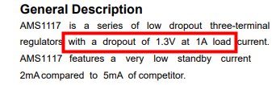

</column>
<column>
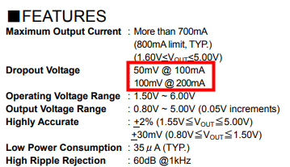
</column>
</grid>

XC6210B332MR参考：

https://item.szlcsc.com/418424.html

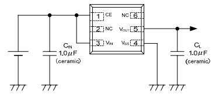

另外：也可以使用BL9110，但是封装较大，比较难布局，参考：

https://item.szlcsc.com/180631.html

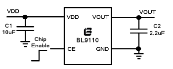

## **打印头需求电源：7.2V（后置至打印头章节）**

规格书中，打印头一行有384个点，分6个通道控制，每个通道64个点，在同一时间只能加热一个通道，所以同一时间的最大功率是0.27x64W，当供电电压在7.2V，此时电流=(0.27x64)/7.2，接近2.5A，所以需要我们提供一个7.2V，\>2.5A的电流的电源。

因为模块使用单个电池供电，电压范围在3.7-4.2V，所以需要选用升压的模块，项目中使用：AP2005

https://item.szlcsc.com/141627.html

<!-- sheet token="QVfosebhGhRABCtEtayczLkMnFh" id="w7P58W" -->

## w7P58W

| 输入电压 | 2.5V~5.5V |
| --- | --- |
| 输出电压 | 9V |
| 输出电流 | 4.5A |

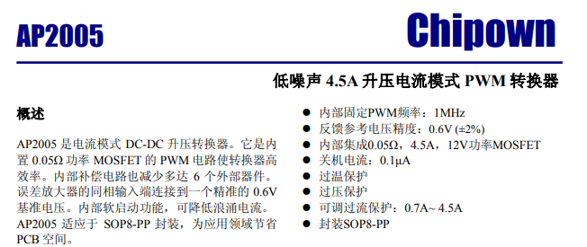

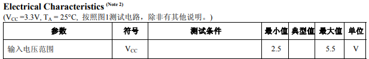

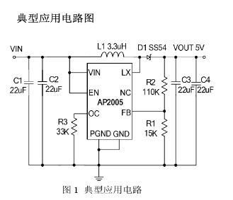

输出电压为7.2V时，旋转的R1 R2为：

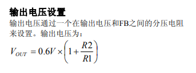

为了保证一定的电流余量，通过R3设置输出限制电流：

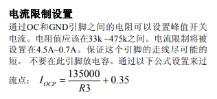

另外，DCDC类方案需要特别注意PCB Layout

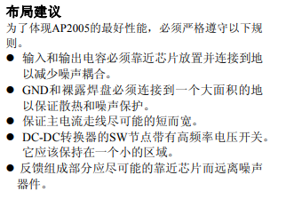

# 三、电量检测

**需求：因为是电池供电的产品，我们需要知道电池剩余电量是多少，所以需要添加一个电量检测电路。**

电量检测的技术原理是使用电阻分压原理，把电池电压分压后，通过芯片ADC进行读取，和电位器读取原理类似，最终再通过ADC值转换出电压值，电池电压在缺电3.3V，满电4.2V，这样我们就可以按比例估算出剩余的电量。

另外，为了节省功耗，可以在电池端添加一个MOS管，控制检测的开关，这样，在不需要读取电量时，就可以关闭MOS管，降低功耗，**(新版本添加了开关后，不需要MOS管开关模块，VBAT经过开关后接R13即可)**。

这里使用PMOS控制开关:当ADC\_EN为低电平，此时PMOS导通，可以读取POWER\_ADC的值。

https://item.szlcsc.com/372770.html

<grid cols="2">
<column>
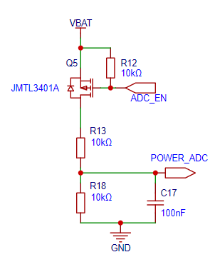
</column>
<column>
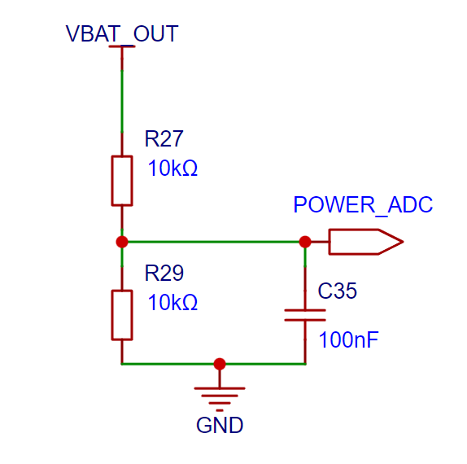
</column>
</grid>

# 四、按键

**需求：产品开发过程中，我们希望有一个输入接口，可以做一些简单的功能验证。**

项目中添加了一个按键，用来测试打印机的打印、电机的运行功能，短按时运行打印机测试代码，长按时控制电机运动。

按键：https://item.szlcsc.com/3179031.html

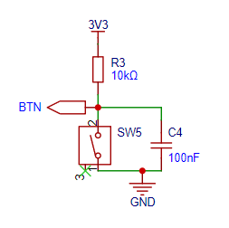

# 五、Beep（暂不用）

1N4148：C2128

蜂鸣器：C94599

8050：C2146

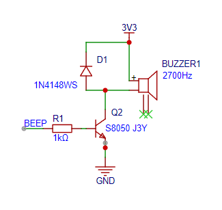

# 五、LED指示灯

**需求：因为mini printer是没有屏幕的设备，在设备工作过程中，我们想知道设备的运行状态，另外也记录有概率会产生的一些错误。**

这时候我们可以添加一颗LED灯，LED有常亮，慢闪，快闪，暗几种状态，于是我们便可以用指示灯来表达设备的工作状态。例如：

<grid cols="2">
<column>
| 状态 | 灯光 |
| --- | --- |
| 待机 | 暗 |
| 蓝牙连接 | 常亮 |
| 运行异常 | 快闪 |
| 打印中 | 慢闪 |
</column>
<column>

</column>
</grid>

# 六、打印模组

**需求：最后就是本项目的关键模块，打印模块，打印模块应该支持加热打印、缺纸检测、温度检测、移动电机等模块，逐一选型或者一体化选型。**

在项目中，打印模组选择的是精芯的一体化机芯，机芯中已经包含打印头、电机、热敏电阻、传感器，引出的就是FPC的软排线，结构紧凑且稳定。

<!-- 不支持的块类型: View (type=33) -->

<file token="XLwJbAkDLoUsRlxY5YfckOqDnrf" name="1_JX-2R-01微型热敏打印机芯规格书-V1.5.pdf"/>

<grid cols="2">
<column>
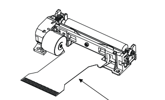
</column>
<column>
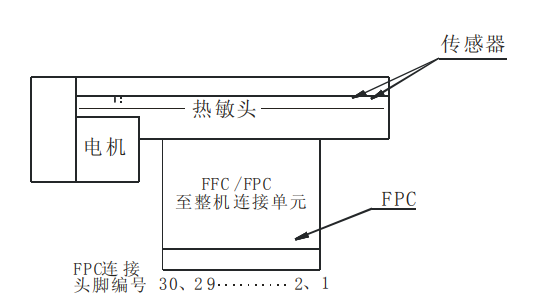
</column>
</grid>

## 6-1、热敏电阻

**需求：打印模组在工作时，原理是通过加热的方式让热敏纸变色的，如果长时间一直加热，会导致打印头有损坏风险，所以需要通过热敏电阻做温度监测。**

打印头中内置了热敏电阻来监测温度，由于不需要高精度的温度测量，那我们要做的其实就是通过串联一个电阻，然后通过分压的公式算出热敏电阻的阻值，最后通过下方计算公式或者RT表转换出实际温度即可。

所以电路特别简单，TM一端接地，另一端接THER口（10k电阻到电源），然后读取THER端的ADC值。

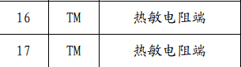

<grid cols="3">
<column>

</column>
<column>
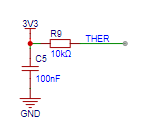
</column>
<column>
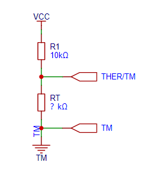
</column>
</grid>

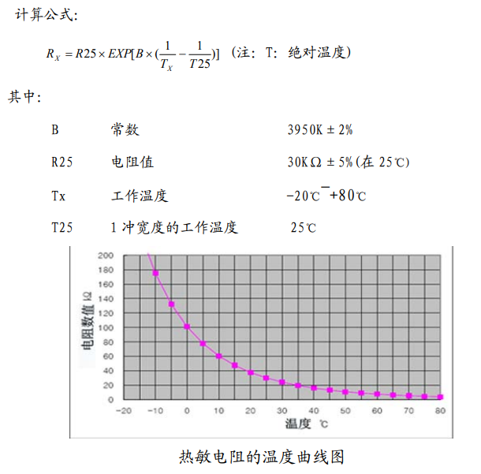

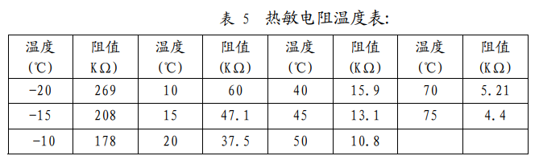

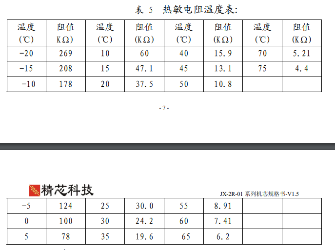

## 6-2、缺纸侦测 

**需求：打印模块在工作时，需要放入打印纸，如果没有打印纸，会导致打印异常，所以需要用到缺纸检测模块。**

打印机芯内置了一个反射性光电通断侦测传感器，用于缺纸检测。

如下图所示，左边是光电传感器、中间是比较电路、右边是输出。

当缺纸时，光电侦测发出的光无法被反射，输出高电平。当纸张正常，光电侦测发出的光被反射，由接收管接收，输出低电平，光电开关的电路驱动，如下图所示，当缺纸时，不要启动打印机加热。

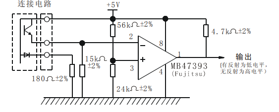

比较器使用的芯片是LM393：C404321

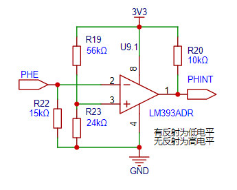

PHE接比较器、VSEN接逻辑电源、PHK接180欧后接GND。

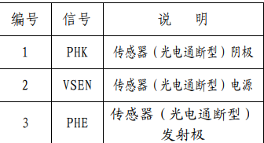

原理图DRC检测时，该信息不影响项目正常工作，原因是LM393是双通道的比较器，我们只用一个通道，这个封装的问题导致，LM393设计时是希望多加一个光电检测用于检测纸张距离的，后面大家有想法可以扩展下。

如果需要修改，可以参考工程文件添加这两个模块

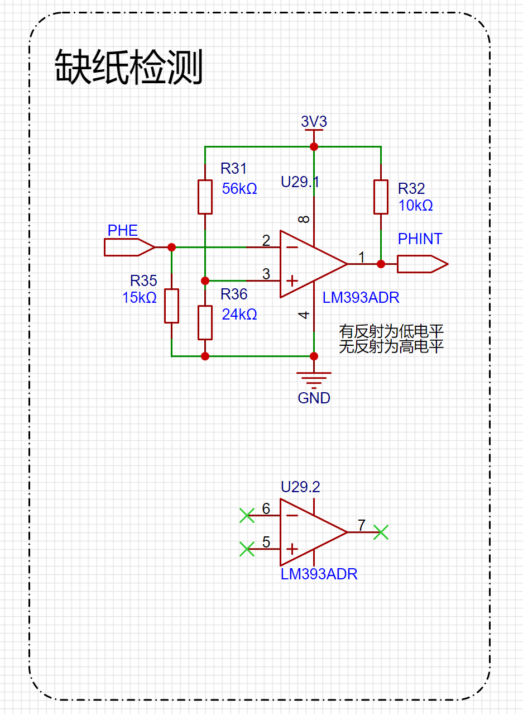

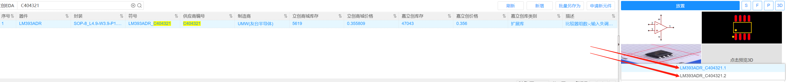

## 6-3、电机

**需求：打印机的原理是逐行打印，当打印完一行后，需要使用电机拖拽打印纸往前行进一行，以完成多行的打印任务。**

打印机芯用的是一个额定电压为3.5-8.5V的两相步机电机，不推荐使用L293D、L298进行驱动，但是因为这两款芯片太贵了，我们使用TC1508替代。

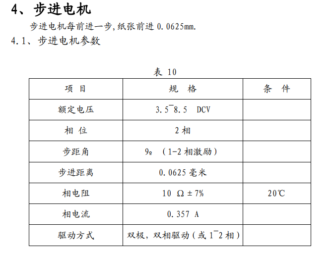

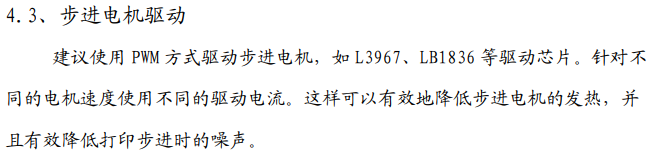

**TC1508**

https://item.szlcsc.com/90660.html

电源电压和输出电流都可以满足电机驱动，接线也特别简单，分别把电机的四根线接到OUTA B C D中即可，INA B C D接到主控芯片上，进行控制。

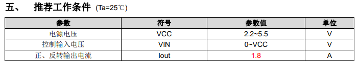

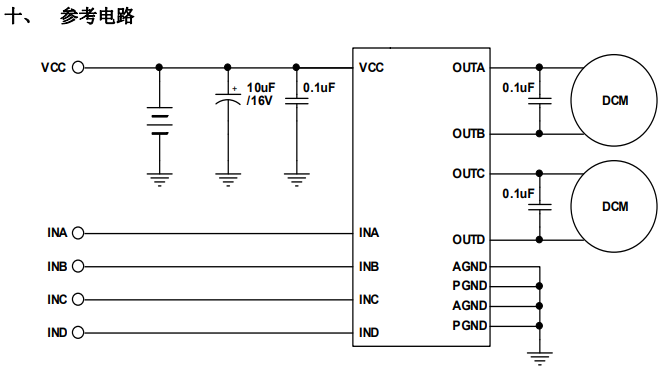

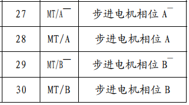

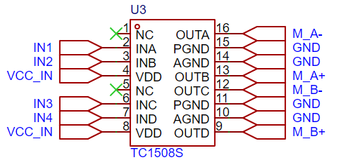

## 6-4、打印模块

**需求：打印头使用的是1mm间距30pin的的FPC连接器，满足供电、信号控制、传感器相关功能连接。**

端子：C500182

https://item.szlcsc.com/512308.html

项目中使用的是30pin FPC端子，下接式，根据打印头的信号线序，梳理处需要控制的信号有

VH：打印加热电源，需要7.2V的电源，在不打印时需要关闭电源，所以需要添加电源控制IO，7.2V电源如何生成呢？参考电源管理模块：

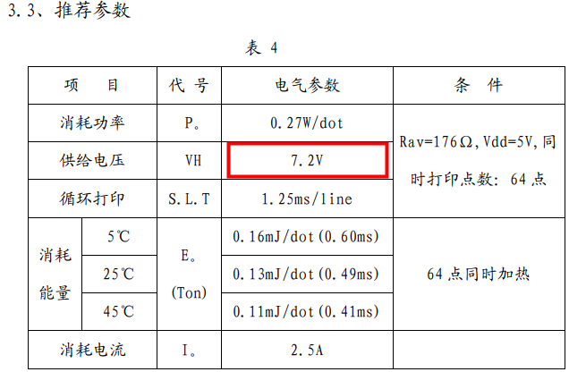

STB1-6:通道选择器，接到主控芯片的IO接口。

LAT CLK DI：锁存、时钟、数据线，接到主控的IO接口

<grid cols="2">
<column>
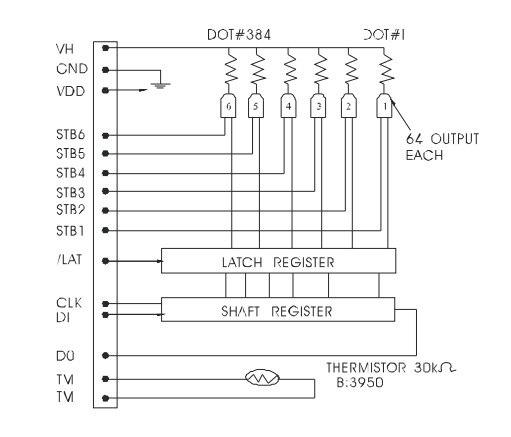
<!-- 不支持的块类型: View (type=33) -->
</column>
<column>
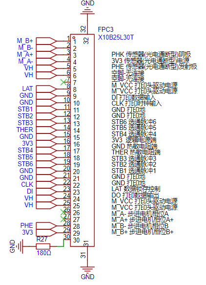
</column>
</grid>

<grid cols="2">
<column>
<!-- 不支持的块类型: View (type=33) -->
</column>
<column>

</column>
</grid>

# 七、PCB Layout

需求：在绘制完原理图后，接下来就是进行PCB的Layout的，Layout的过程包括元器件布局、走线、铺铜检查等步骤。

1. 首先，**检查原理图**，**把原理图转换为PCB**，只需要一个按键即可。

1. 然后**确定PCB尺寸**，这个需要和结构紧密配合，项目中使用的结构，给PCB预留的尺寸是这个，我们可以根据这个尺寸先绘制板框。

1. **根据结构的安装位置和信号走向，进行元器件布局**，有几个点是需要特别注意的。

-第一个是项目中的结构已经固定好**TYPEC口位置**，**打印机排线位置**，**开关位置**，**电池端子位置**以及**按键的位置**，所以如果你最终不打算重新设计结构，那你必须按工程中的位置进行摆放。除此之外，其它元器件位置可根据自己需求摆放。

-第二个**PCB的螺丝孔位置**是不能随意更改的，如果你不计划自己设计、修改结构的话。

-第三个是是要注意**模组摆放的位置**，一定要在板卡的边缘，因为模组底部需要掏空，不允许走线，否则会影响信号，所以摆放在PCB边缘，后续好处理。

-第四个是**升压模块背面**最好不要走线和摆放元器件，因为这是会产生干扰的地方，所以要预留好这部分的空间。

1. 元器件初步摆放好后，我们就可以进入**布线阶段**，布线就是让每个模块、电容、电阻之间按原理图的连接用导线连起来，在布线过程中，如果发现走线麻烦或者根本走不了，我们还是可以根据实际情况调整布局的，布线这里有几个点需要注意的。

第一个是**电源的走线**，因为打印头工作时最大功率会到20多W，所以电池到打印头部分的走线线宽要粗，满足通过电流。

第二个是升压模块下方**不允许走线**，防止受到干扰影响系统工作。

第三个是所有走线都需要**经过旁路电容**再进入模块，避免电容不起作用。

第四个是布线的顺序，一般根据实际情况，**先布置电源或难度高的线，然后再布常规线，地线最后**通过铺铜过孔连接。

1. 布线完成后，进入到**铺铜环节**，我们直接铺设GND到板卡的顶部和底部，在连接起所有地线的同时，也可以改善散热、提高EMC性能。

1. 到这里，基本的工作已经完成了，进入到检查阶段，第一个是**检查DRC**，就是设计规则，看看有没有线没连好、线宽没设计好、线距不对、过孔不对等等问题，可以通过DRC进行检测，哪里有问题改哪里即可。

1. 最后的最后，还要**检查下3D图**，确保元器件不出现干涉，预留足够的焊接调试距离等等问题。

1. 然后就可以下单生产啦。根据自己的需要选择**PCB下单和SMT下单**相关参数即可。

最终的工程在资料导航的第四章节[Mini打印机资料导航](https://lsongdev.feishu.cn/docx/NmZbd1yCdoYU1SxMEVkcm1B2nZd) 

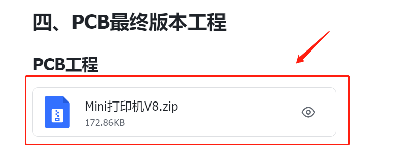

**关于板框形状修改的方法：视频教程可以点击查看**

<!-- 不支持的块类型: View (type=33) -->

[视频：2023-09-23 17-03-06.mkv（飞书原文）](https://lsongdev.feishu.cn/docx/TKgQdZPokosjqPxozEtcnDOPnkb)

https://prodocs.lceda.cn/cn/pcb/place-board-outline/index.html

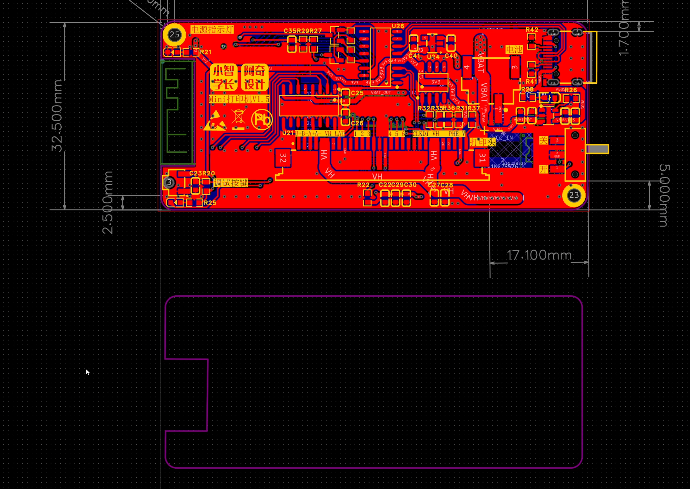

# 八、焊接说明

如果我们选择的是自己焊接，那应该如何焊接呢？大家可以参考以下的几个步骤：

1. 准备好PCB、元器件、电烙铁、焊锡、镊子、万用表。

1. 打开BOM表或者PCB工程，然后从电源模块开始，找到要焊接的元器件型号，**逐个模块焊接，切记不要一下子焊完所有模块，否则很难定位排查问题。**

1. 每个模块焊接完成后，对照原理图、PCB工程，用万用表先检查下有没有焊接错误、短路、虚焊等情况，**一个焊点一个焊点确认，确认没问题后在焊接下一个模块。**

**一般的焊接流程是：**

- 充电管理模块

- 开关

- 电源指示灯

- 稳压3.3V （先焊接模块11，才能使用开关打开电源到稳压3.3V）

- CH340

- 打印头相关

- ESP32芯片

- 升压模块

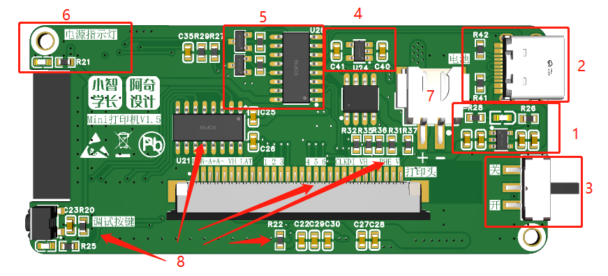

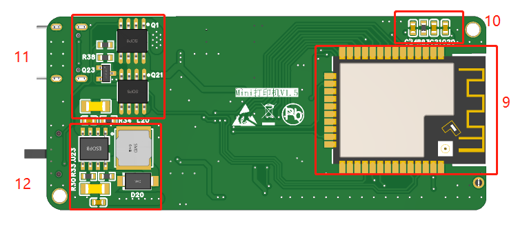

1. 按上述的步骤，完成所有元器件的焊接即可。

具体的焊接方法，大家可以回到桌面小屏幕的焊接章节了解，由于这块板卡的器件封装都比较大，所以算是比较容易焊接的。

# 九、焊接完排查说明

焊接完成后，切记不要马上上电，先目测、用万用表检测下，有没有焊接错的地方，特别是要检查各路电源有没有短路，确保没有短路后，上电第一时间也要观察下有没有异常，有异常迅速拔掉电源。

目测没有异常后，先检测下所有的电源电压是否正常，在确定所有电源电压正常后，就可以接到电脑，烧录程序啦。

遇到问题时，可以参考[6、烧录固件-快速玩起来](https://lsongdev.feishu.cn/docx/T1bBdP1yIo8iMixk24TcvPAdnPf) 第四章工作异常排查

# 十、补充设计说明

关于ESP32 IO口的选用问题，可以参考芯片手册，ESP32大多数IO都是可以复用的，非常方便设计。

https://www.espressif.com.cn/sites/default/files/documentation/esp32\_datasheet\_cn.pdf

普通的GPIO、I2C、SPI都可以配置到任何的GPIO上，但是ADC、DAC等不能随意配置，详情可以看手册3.10

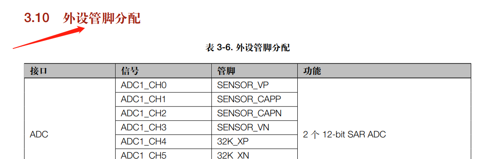

<grid cols="2">
<column>
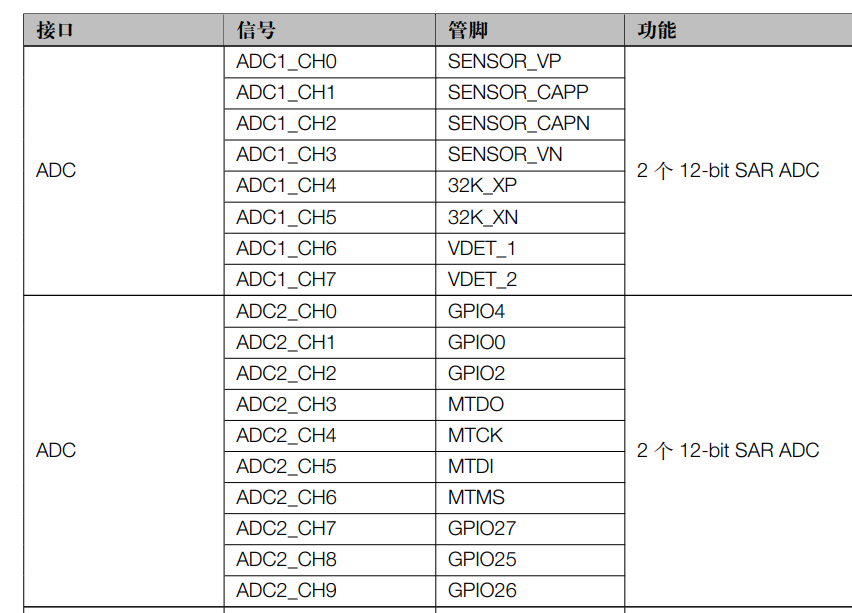
</column>
<column>
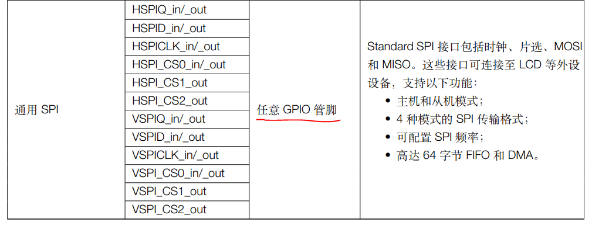

</column>
</grid>
