# 5、软件模块

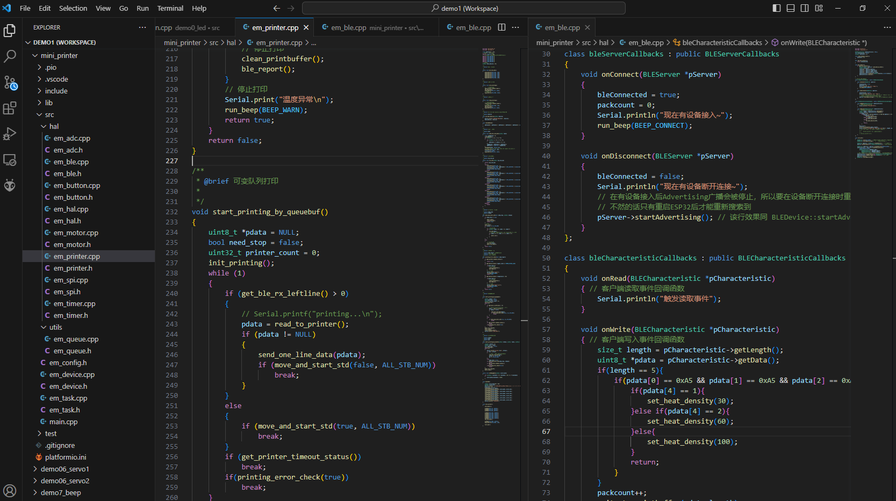

## 前置、环境&工程搭建

在拿到焊接完成的板卡后，就可以进入软件章节的学习了

**需求：在哪里编写代码？**

开发环境搭建可参考基础教程的环境搭建章节，有了VSCode+PlatformIO的环境后，我们可以新建工程，编写一个最简单的helloworld打印，确保编译、下载、运行没问题，后续我们就基于这个最简单的工程，完成所有代码的编写。

```c
#include <Arduino.h>

void setup() {
  Serial.begin(9600);
  Serial.print("init steup\n");
}

void loop() {
  Serial.print("helloworld\n");
  delay(1000);
}
```

**接线步骤：**

1. TYPEC口接电脑

1. 电池接电池端子（+接红线正 -接黑线负）

1. 打开开关，改步骤不要接打印头哦

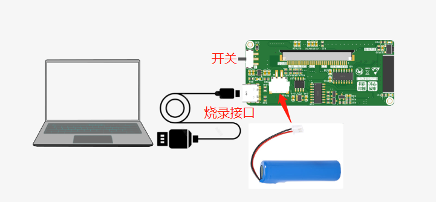

1. 在电脑的设备管理器中，就可以看到新的COM口

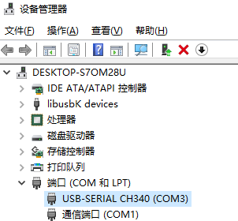

1. 然后可以点击Upload，Monitor，就可以看到代码已经在板卡上运行起来。

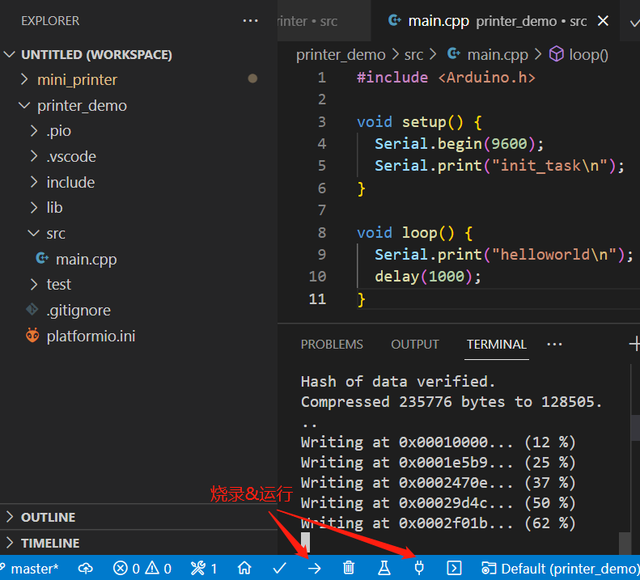

如果不明白这个章节的环境搭建和基本代码的知识，建议回到基础入门章节开始学习，通过半天的学习，你就可以掌握基础的编程知识了。

```c
/*
如果设置Serial.begin(115200);
则需要在platformio.ini中添加
[env:esp32dev]
platform = espressif32
board = esp32dev
framework = arduino
monitor_speed = 115200
*/

```

# 一、指示灯模块

注意：非打印头相关的实验，不要接打印头哦，例如LED灯，按键，电量章节，都不需要接打印头的。

需求：

**根据显示状态的要求，提供一个接口，可以控制LED灯的暗、常亮、快闪、慢闪四种状态。**

<grid cols="2">
<column>
| 状态 | 灯光 |
| --- | --- |
| 待机 | 暗 |
| 蓝牙连接 | 常亮 |
| 运行异常 | 快闪 |
| 打印中 | 慢闪 |
</column>
<column>
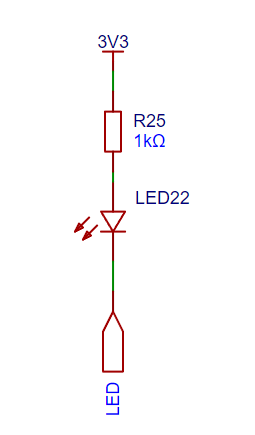
</column>
</grid>

```c
#include <Arduino.h>

#define PIN_LED 18

typedef enum
{
  LED_OFF = 0,
  LED_ON,
  LED_LOW_FLASH,
  LED_QUICK_FLASH,
} LED_STATUS;

/**
 * LED闪烁控制
 * ms-闪烁间隔
*/
void em_led_flash(int ms){
    digitalWrite(PIN_LED, LOW);
    delay(ms);
    digitalWrite(PIN_LED, HIGH);
    delay(ms);
    digitalWrite(PIN_LED, LOW);
    delay(ms);
    digitalWrite(PIN_LED, HIGH);
    delay(ms);
}

/**
 * status 0-关 1-开 2-。。。
 */
void em_led_set_status(LED_STATUS status)
{
  switch (status)
  {
  case LED_OFF:
    digitalWrite(PIN_LED, LOW);
    break;
  case LED_ON:
    digitalWrite(PIN_LED, HIGH);
    break;
  case LED_LOW_FLASH:
    em_led_flash(1000);
    break;
  case LED_QUICK_FLASH:
    em_led_flash(200);
    break;
  default:
    break;
  }
}

void setup()
{
  Serial.begin(115200);
  Serial.printf("setup\n");

  pinMode(PIN_LED, OUTPUT);
}

void loop()
{
  em_led_set_status(LED_LOW_FLASH);
}
```

# 二、按键模块

**需求：**

**驱动PCB的按键，通过IO读取按键事件，主要有短按、长按按下、长按释放三种事件。**

后期项目中，短按用于测试打印效果，长按用于开始电机转动，长按释放用于停止电机转动。

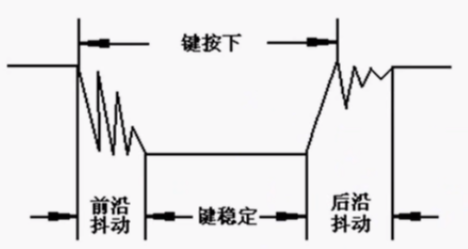

**实现原理：**

1. 初始化按键IO为输入模式

1. 间隔10ms读取IO值，当读取值为按下电平，执行去抖处理。

1. 去抖处理的逻辑为：10ms后重新读取IO值，若仍然为按下电平，则判断为触发按键按下，并且记录按下时间。

1. 然后每间隔10ms重新读取IO值，如果一直为按下电平，且按下时间大于短按时长时，判断此为**长按事件。**

1. 如果读取到按键抬起电平，计算按下时长大于短按1s时，则判断为**长按抬起事件**，否则为**短按事件**。

```mermaid
% Feishu Flowchart Diagram (type: 1)
% Note: Mermaid source code is not accessible via API
```

梳理了上方的流程图后，我们就可以编写代码了，新建按键处理文件，代码如下：

```java
#include <Arduino.h>

#define PIN_KEY 5

//短按时间为 < 1s
#define SHORT_PRESS_TIME 1000

bool keyIsPress = false;
unsigned long clicktime = 0;
bool longPressIsStart = false;

void key_check_run(){
  if(keyIsPress == false){
    if(digitalRead(PIN_KEY) == LOW){
      delay(10);
      if(digitalRead(PIN_KEY) == LOW){
        keyIsPress = true;
        clicktime = millis();
      }
    }
  }
  if(keyIsPress == true){
    if(digitalRead(PIN_KEY) == HIGH){
      if(millis() - clicktime > SHORT_PRESS_TIME){
        Serial.printf("long click free\n");
        longPressIsStart = false;
      }else{
        Serial.printf("short click\n");
      }
      keyIsPress = false;
    }else{
      if(millis() - clicktime > SHORT_PRESS_TIME){
        if(longPressIsStart == false){
          Serial.printf("long click\n");
          longPressIsStart = true;
        }
      }
    }
  }
}

void setup() {
  Serial.begin(115200);
  Serial.printf("setup\n");
  pinMode(PIN_KEY,INPUT);
}

void loop() {
  delay(10);
  key_check_run();
}
```

# 三、电量

**需求：**

**需要知道电池剩余电量，可通过读取分压电路的ADC值，转换为当前电池电量。**

实现原理:

初始化ADC引脚、ADC使能引脚，默认的ADC分辨率为12bits，这样读取IO值的范围将会在0-4095

间隔1000ms读取ADC值进行转换即可，因为电池电量满电为4.2V，没电会在3.3V左右，分压后满电在2.1V，没电在1.65V，所以我们把1.65-2.1的ADC值转换为0-100的电量值，此处使用map函数实现。

```java
#include <Arduino.h>

//电量ADC引脚
#define PIN_BATTERY_ADC 34
//分辨率为12bits (0-4095)
#define BATTERY_ADC_BIT 12

void adc_init() {
  //之前没有机械开关，
  //所以用了个IO控制mos管来打开电量检测功能，后面加了开关后，这个mos管不需要了，所以这个io可以不用啦
  //digitalWrite(PIN_ADC_EN, LOW);
  //默认分辨率也是12bit，可以不设置
  // analogReadResolution(BATTERY_ADC_BIT);
}

/**
 * @brief 获取ADC引脚电压值，可根据需要加入滤波算法
 * 
 * @return int 
 */
int get_adc_volts(){
    int data = 0;
    //根据ADC算出Vout电压ADC值，ADC值/4095 ≈ 电压值/3.3，该方式与实测电压值有误差，需校准
    //Vout = analogRead(BAT_PIN)* 3.3/ 4095.0;
    //获取IO口电压值
    data = analogReadMilliVolts(PIN_BATTERY_ADC);
    return data;
}

void read_battery()
{
    //根据公式Vout = Vbat * R2 / (R1 + R2)，可以算出Vbat电压 Vbat = Vout*(10+10)/10
    //电池满电4.2V，没电按3.3V算，就可以根据比例换算出实际的剩余电量
    //map为映射函数，把值从一个区间映射到另一个区间
    uint8_t battery = map(get_adc_volts()*2,3300,4200,0,100);
    Serial.printf("battery = %d%\n",battery);
}

void setup() {
  Serial.begin(115200);
  Serial.printf("setup\n");
  adc_init();
}

void loop() {
  delay(1000);
  read_battery();
}
```

**ADC转换**

[Analog to Digital Converter (ADC) - ESP32 - ‒ ESP-IDF Programming Guide v4.4 documentation](https://docs.espressif.com/projects/esp-idf/en/v4.4/esp32/api-reference/peripherals/adc.html#:~:text=Vref%20is%20the%20reference%20voltage%20used%20internally%20by,be%20attenuated%20before%20being%20input%20to%20the%20ADCs.)

ADC转换是将输入的模拟电压转换为数字值。要根据ADC的原始结果计算电压，可以使用这个公式：
Vout=Dout∗Vmax/Dmax
其中

<!-- sheet token="ZhjLsxUvLh0EADtMTVVcrt5DnYe" id="kiXT5f" -->

## kiXT5f

| 变量 | 作用 |
| --- | --- |
| Vout | 数字输出结果，代表的是电压。 |
| Dout | ADC原始数字读取结果 |
| Vmax | 最大可测量输入模拟电压 |
| Dmax | 输出ADC原始数字读取结果的最大值，在单次读取模式下为4095，在连续读取模式下为4095。 |

在实际计算ADC引脚读取电压数值时发现与实际电压有较大误差，查询手册，按照说明ADC1是带有出厂校准的。

对于带有eFuse ADC校准位的板子，可以使用`esp_adc_cal_raw_to_voltage()`来获得校准的转换结果，转换后的结果代表了实际电压（单位：mV），当然，也可以用analogReadMilliVolts直接读取，读取的就是实际电压(单位：mV)。

[www.espressif.com.cn](https://www.espressif.com.cn/sites/default/files/documentation/esp32_datasheet_cn.pdf)

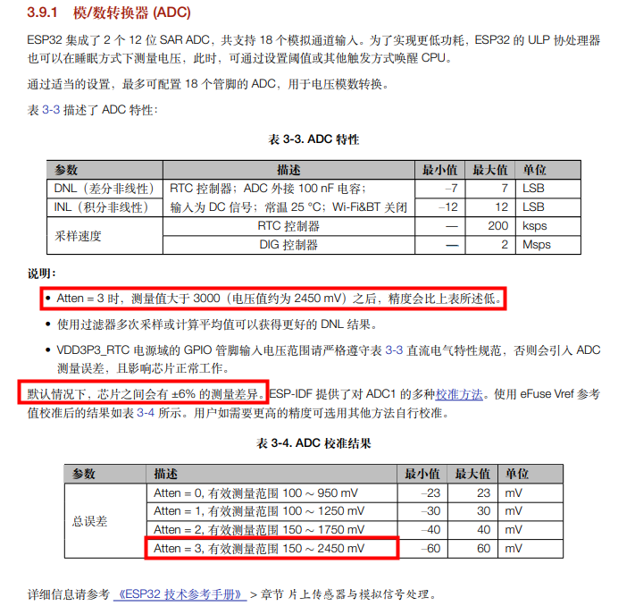

如何提高ADC准确性

1. 高精度电阻

1. 在使用中的ADC输入焊盘上连接一个旁路电容（例如，一个100nF的陶瓷电容），以尽量减少噪声。

1. 多次采样进行滤波

1. 更精细的校准算法


# 四、蜂鸣器(版本不用)

**需求：**

根据项目需求，需要支持连接提示音、报警提示音、打印提示音三种声音。其中

- 连接提示音为：滴-500ms-滴-500ms-滴-500ms

- 报警提示音为：滴-1000ms

- 打印提示音为：滴-500ms

**实现原理：**

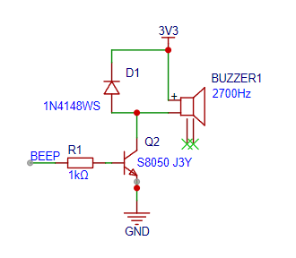

硬件中使用的蜂鸣器为无源蜂鸣器，所以需要使用PWM信号驱动。

脉冲宽度调制(PWM)，是英文“Pulse Width Modulation”的缩写，简称**脉宽调制**

**pwm的频率：**

是指1秒钟内信号从高电平到低电平再回到高电平的次数(一个周期)；

如果频率为50Hz ，也就是说1秒内来回了50次，那每次的时间就是20ms，那此信号一个周期就是20ms

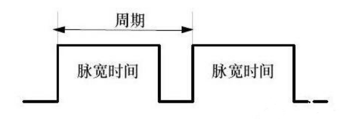

**占空比：**

是一个脉冲周期内，高电平的时间与整个周期时间的比例

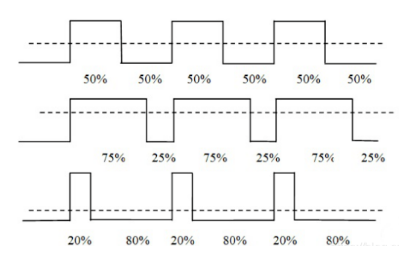

通过LEDC实现，LEDC(PWM)主要是Arduino中用于控制 LED 的亮度接口，原理是通过控制PWM波形实现亮度控制，但也可以产生 PWM 信号用于蜂鸣器控制。无源蜂鸣器发声就和信号的频率，项目中用到的滴声，频率在2000Hz左右，知道了这个原理，你其实可以用蜂鸣器演奏一首曲子啦。


1. 设置通道的pwm通道号、频率、定时器分辨率

1. 绑定通道与IO引脚

1. 设置通道输出pwm频率控制蜂鸣器的声音

```c
初始化通道
double ledcSetup(uint8_t chan, double freq, uint8_t bit_num)
功能：设置LEDC；
参数：
chan：通道，取值0~15
freq：设置频率
bit_num：计数位，取值0~20 LEDC定时器精度，该值决定后面 ledcWrite 方法中占空比可写值
该值写8，则占空比最大可写255，该值写10，则占空比最大可写1023，值写成12，则占空比最大4095

void ledcAttachPin(uint8_t pin, uint8_t chan)
功能：将指定通道绑定到指定IO端口；
参数：
pin:GPIO端口号
chan：通道，取值0~15

void ledcWrite(uint8_t chan, uint32_t duty)
功能：设置指定通道PWM占空比
参数：
chan：通道，取值0~15
duty: 占空比参数，最大值有计数位决定，如10位，10^2=1024 

double ledcWriteNote(uint8_t chan, note_t note, uint8_t octave)
功能：设置指定通道，指定音符的八度音
chan：通道，取值0~15
note: 音符名（NOTE_C, NOTE_Cs, NOTE_D, NOTE_Eb, NOTE_E, NOTE_F, NOTE_Fs, NOTE_G, NOTE_Gs, NOTE_A, NOTE_Bb, NOTE_B）
octave: 八度音符取值0~8
```

<grid cols="2">
<column>
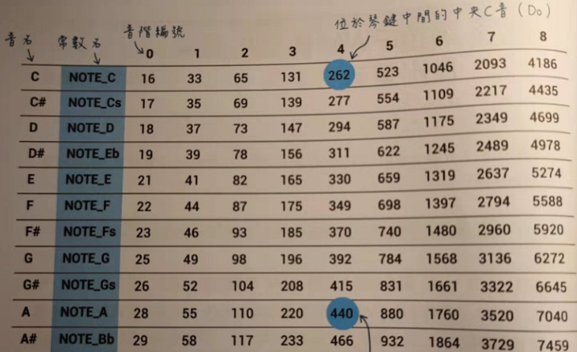
</column>
<column>

</column>
</grid>

```java
#include <Arduino.h>

//蜂鸣器
#define PIN_BEEP 18

int freq = 2000;    //LEDC频率2000kHz
int channel = 0;    //LEDC通道号，取值0 ~ 15
int resolution = 8; //LEDC定时器精度

typedef enum{
    BEEP_CONNECT = 0,
    BEEP_WARN,
    BEEP_PRINTER_START,
}beep_type_e;

void run_beep(beep_type_e type){
    switch (type)
    {
    case BEEP_CONNECT:
        ledcWriteNote(channel,NOTE_D,5);
        delay(500);
        ledcWrite(channel, 0);
        delay(500);
        ledcWriteNote(channel,NOTE_D,5);
        delay(500);
        ledcWrite(channel, 0);
        delay(500);
        ledcWriteNote(channel,NOTE_D,5);
        delay(500);
        ledcWrite(channel, 0);
        break;
    case BEEP_WARN:
        ledcWriteNote(channel,NOTE_F,5);
        delay(1000);
        ledcWrite(channel, 0);
        break;
    case BEEP_PRINTER_START:
        ledcWriteNote(channel,NOTE_D,5);
        delay(500);
        ledcWrite(channel, 0);
        break;
    default:
        break;
    }
}

void setup() {
  // 初始化按键引脚为输入模式
  Serial.begin(9600);
  Serial.printf("setup\n");

  //蜂鸣器初始化  
  //设置通道频率和分辨率
  ledcSetup(channel, freq, resolution);
  //将通道0与引脚15连接
  ledcAttachPin(PIN_BEEP, channel);   
}

void loop() {
  delay(5000);
  run_beep(BEEP_CONNECT);
}
```

# 四、蓝牙BLE

**需求：**

**把手机需要打印的图像发至打印机中，因为是近距离无线通讯，所以使用蓝牙BLE实现。**

**原理：**

打印机初始化为BLE主机，然后通过手机客户端BLE连接打印机，连接成功后，发送需要打印的图像数组到机器中，机器收到需打印的数据，就可以执行打印操作啦。

**关于BT与BLE**

经典蓝牙（BT）：一般用于数据量比较大的传输，如：语音、音乐等较高数据量的传输。

低功耗蓝牙模块（BLE)：最大的特点就是成本和功耗的降低，可应用于实时性要求较高的产品当中，比如：智能家居类（蓝牙锁、蓝牙灯）、传感设备的数据发送（血压计、温度传感器）、消费类电子（电子烟、遥控玩具）等。

**BT**和**BLE**两者物理层调制解调方式是不一样的，所以**BLE设备和BT设备两者之间是不能相互通信的。**

**关于BLE服务器与客户端？**
Mini打印机中，板卡BLE属于服务器，手机属于客户端，板卡提供打印服务，手机端扫描、绑定、进行使用。

**关于BLE协议栈：**

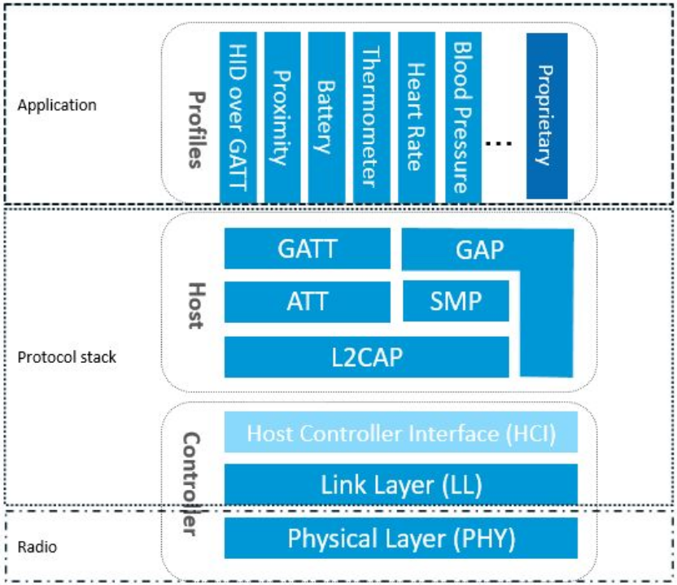

BLE协议栈是比较复杂的

<!-- 不支持的块类型: View (type=33) -->

<file token="WKQ1b9ixDocydHx5mGic9a1lnSc" name="Core_v5.3.pdf"/>

但是BLE的应用相对来说是比较简单的，BLE应用主要分为以下几步:

1. 初始化设备名称mini-printer

1. 初始化设备服务（能提供什么服务）

1. 初始化特征（一个服务下有多个特征，每个特征可以提供具体的操作，读、写、订阅）

1. 注册服务、特征回调函数，发布广播，在客户端连接后就可以通信

1. 进行数据发送/接收

**关于BLE服务（Service）、特征(Characteristic)、UUID？**
一般来说，蓝牙里面有多个Service，一个Service里面包括多个Characteristic。
一个蓝牙协议里面包含的Service和Characteristic是比较多的 ，那么这么多的同名属性用什么来区分呢？
就是UUID，每个Service或者Characteristic都有一个 128 bit 的UUID来标识。

Service可以理解为一个功能集合，而Characteristic比较重要，蓝牙设备正是通过Characteristic来进行设备间的交互的，这些Characteristic又包含一些属性Property，如读、写、订阅等操作。
汽车厂家类比为Mini打印机，4S店类比为Service，店内的车型类比为Characteristic，我们类比为打印APP，我们对设备的操作，其实就是对具体车型的操作。

**关于调试？**
可以使用LightBlue app进行调试。

有了这些知识后，你就可以使用蓝牙做很多非常酷的事情啦。

接下来，让我们看看Arduino中是如何使用BLE的吧。

打开LightBlue APP，搜索名称为Mini-Printer的设备，点击连接后，就可以进行读、写、或者订阅设备的消息了，订阅成功后，设备每5s上报一条消息。

```java
#include <Arduino.h>
#include <BLEDevice.h>
#include <BLE2902.h>

#define BLE_NAME "Mini-Printer"
#define SERVICE_UUID "4fafc201-1fb5-459e-8fcc-c5c9c331914b"         // 自定义打印服务UUID
#define CHARACTERISTIC_UUID "beb5483e-36e1-4688-b7f5-ea07361b26a8"  // 自定义打印特征UUID

bool bleConnected = false;

BLECharacteristic *pCharacteristic;

void ble_report(){
    if (bleConnected == true){
        uint8_t status[4];
        status[0] = 0;
        status[1] = 1;
        status[2] = 2;
        status[3] = 3;
        pCharacteristic->setValue((uint8_t*)&status,sizeof(status));
        pCharacteristic->notify();
    }
}

// Server回调函数声明
class bleServerCallbacks : public BLEServerCallbacks
{
    void onConnect(BLEServer *pServer)
    {
        bleConnected = true;
        Serial.println("现在有设备接入~");
    }

    void onDisconnect(BLEServer *pServer)
    {
        bleConnected = false;
        Serial.println("现在有设备断开连接~");
        // 在有设备接入后Advertising广播会被停止，所以要在设备断开连接时重新开启广播
        pServer->startAdvertising(); 
    }
};

class bleCharacteristicCallbacks : public BLECharacteristicCallbacks
{
    void onRead(BLECharacteristic *pCharacteristic)
    { // 客户端读取事件回调函数
        Serial.println("触发读取事件");
    }

    void onWrite(BLECharacteristic *pCharacteristic)
    { // 客户端写入事件回调函数
        size_t length = pCharacteristic->getLength();
        uint8_t *pdata = pCharacteristic->getData();
        Serial.printf("触发写入事件 length=%d \n", length);
    }
};

void init_ble()
{
    BLEDevice::init(BLE_NAME); // 填写自身对外显示的蓝牙设备名称，并初始化蓝牙功能

    BLEServer *pServer = BLEDevice::createServer();  // 创建服务器，板卡与手机的关系：手机是客户端，板卡蓝牙是服务器
    pServer->setCallbacks(new bleServerCallbacks()); // 绑定回调函数

    BLEService *pService = pServer->createService(SERVICE_UUID); // 创建服务
    pCharacteristic = pService->createCharacteristic(            // 创建特征
        CHARACTERISTIC_UUID,
        BLECharacteristic::PROPERTY_READ |
            BLECharacteristic::PROPERTY_NOTIFY |
            BLECharacteristic::PROPERTY_WRITE);
    pCharacteristic->setCallbacks(new bleCharacteristicCallbacks());// 绑定回调函数

    pService->start(); // 启动服务
    BLEDevice::startAdvertising();// 开启Advertising广播
}

void setup() {
  // 初始化按键引脚为输入模式
  Serial.begin(115200);
  Serial.printf("setup\n");
  init_ble();
}

void loop() {
  delay(5000);
  ble_report();
}
```

# 五、打印头缺纸检测

需求：

**打印机开始打印前，最重要的是判断之一是当前有没有缺打印纸，所以我们需要读取缺纸传感器的信号进行判断。**

**注意：**

**从这节课开始，我们需要接上打印模组，打印模组使用前有个注意点，VH电源在不打印时，需要保持关闭。**

所以我们在接上打印头前，应该烧录这么一段代码，让VH的电源一直保持关闭，后续在接打印模组的课程代码中，都需要添加该逻辑。

```c
#include <Arduino.h>

//打印头电源升压控制引脚
#define PIN_VHEN 17

void setup() {
  Serial.begin(115200);
  Serial.print("init_task\n");
  pinMode(PIN_VHEN, OUTPUT);
  digitalWrite(PIN_VHEN, LOW);
}

void loop() {
  Serial.print("setup vh en low\n");
  delay(1000);
}
```

接线如下：软排线触点向下

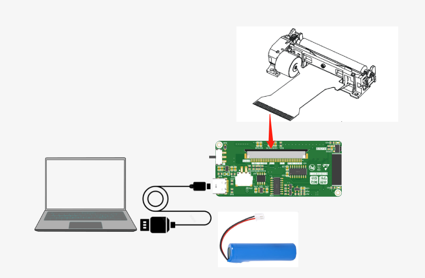

实现原理：

缺纸检测的传感器原理是一个距离传感器，通过比较器后，可以根据比较器的输出信号高/低判断，当前有没有纸卡在打印头上。

初始化缺纸检测IO为输入模式

然后每隔5s读取一次IO值，如果IO值为高，则打印缺纸信息。

当然，也可以初始化为外部中断模式，当输入为上升沿时触发中断，芯片将调用中断函数，在中断中处理事件。

关于中断

CPU在处理某一事件A时，发生了另一事件B请求CPU迅速去处理（中断发生）；
CPU暂时中断当前的工作，转去处理事件B（中断响应和中断服务）；
待CPU将事件B处理完毕后，再回到原来事件A被中断的地方继续处理事件A（中断返回），这一过程称为中断。

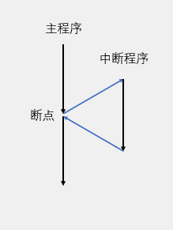

关于上升沿、下降沿


```java
#include <Arduino.h>

//缺纸检测引脚
#define PIN_PAPER 35
//打印头电源升压控制引脚
#define PIN_VHEN 17

typedef enum{
    PAPER_STATUS_NORMAL = 0,
    PAPER_STATUS_LACK,
}paper_state_e;

paper_state_e status = PAPER_STATUS_NORMAL;

void read_paper_statue()
{
    if(digitalRead(PIN_PAPER) == PAPER_STATUS_NORMAL){
      Serial.printf("PAPER_STATUS_NORMAL\n");
      status = PAPER_STATUS_NORMAL;
    }else{
      Serial.printf("PAPER_STATUS_LACK\n");
      status = PAPER_STATUS_LACK;
    }
}

void ARDUINO_ISR_ATTR paper_isr()
{
    //此处不可执行耗时操作
    //Serial.printf("PAPER_STATUS_LACK\n");
    status = PAPER_STATUS_LACK;
}
void setup() {
  // 初始化按键引脚为输入模式
  Serial.begin(115200);
  Serial.printf("setup\n");
  pinMode(PIN_VHEN, OUTPUT);
  digitalWrite(PIN_VHEN, LOW);
  //缺纸IO初始化
  pinMode(PIN_PAPER, INPUT);
  attachInterrupt(PIN_PAPER, paper_isr, RISING);
}

void loop() {
  delay(1000);
  read_paper_statue();
}
```

# 六、打印头温度

需求：

**在打印机使用过程中，如果出现打印头温度过高的情况，需要停止打印，避免损坏设备。**

实现原理：

读取热敏电阻的阻值，通过查表或公式法，转换为温度值。

1. 初始化IO36的ADC分辨率为12bit,0-4095

1. 把读取到的ADC转换为电压 vol=AD/4095\*3.3

1. 把电压转换为阻值 原理图分压电阻为10k   Vio/VCC=Rt/(R+Rt)  vol/3.3=Rt/(10000+Rt)  Rt=(vol\*10000)/(3.3-vol);

1.65/3.3 = 10000/(10000 + 10000)

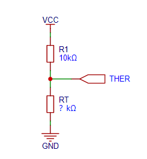

1. 通过公式法Rt = Rp \*EXP(B\*(1/T1-1/T2))计算出阻值对应的温度，该温度就是打印头的温度

**关于公式法与查表法：**

公式法代码简单，但需要在芯片中实时计算，效率偏低，而且精度会差点。

查表法为提前计算好Rt表模型，然后把数组放入代码中，需要转换时直接查找阻值最接近的温度，空间换时间的方法，效率高，而且Rt模型越精准，精度越高。

```java
#include <Arduino.h>

//打印头电源升压控制引脚
#define PIN_VHEN 17

/**
 公式法：
NTC 热敏电阻温度计算公式：Rt = Rp *EXP(B*(1/T1-1/T2))
可以得到温度T1与电阻Rt的关系T1=1/（log（Rt/Rp）/B+1/T2）

T1和T2指的是K度，即开尔文温度,K度=273.15(绝对温度)+摄氏度。
T2=(273.15+25)
Rt 是热敏电阻在T1温度下的阻值。
Rp 是热敏电阻在T2常温下的标称阻值。100K的热敏电阻25℃的值为100K（即R=100K）。T2=(273.15+25)
B值是热敏电阻的重要参数  B25/50= 3950K ±1%
最终对应的摄氏温度t=T1-273.15,同时+0.5的误差矫正。
ADC采样率12位 串联电阻R1=10K R2=热敏电阻 电压3.3V
已知
Rt = R*(3.3-VR)/VR
VR = 3.3*ADC_Value/4095
得出
ADC_Value = VR*4095/3.3 =3.3*R/(Rt+R)*4095/3.3 = R/(Rt+R)*1024
ADC_Value=3.3/(C5+10)*10/3.3*4095
最终根据Rt算处温度值
Rt=100*exp(3950*(1/(273.15+T1)-1/(273.15+25)))
*/

#define PIN_TEMPERATRUE 36
//设置分辨率为12bits (0-4095)
#define TEMPERATRUE_ADC_BIT 12
/**
 * @brief 阻值转换温度
 *
 * @param Rt 热敏电阻阻值
 * @return float 返回摄氏度温度
 */
float em_temp_calculate(float Rt)
{
    float T2 = 273.15 + 25;
    float Rp = 30000; // 30k
    float Bx = 3950000; // B值
    float Ka = 273.15;
    float temp = 0.0f;

    temp = 1 / (log(Rt / Rp) / Bx + 1 / T2) - Ka + 0.5;
    return temp;
}

/**
 * @brief Get the adc temperatrue object
 * 
 * @return float 
 */
float get_adc_temperatrue(){
  float temp = 0.0f;
  float Rt=0;
  float vol=0;
  //ADC转换为电压 vol=AD/4095*VCC
  vol=(float)((analogReadMilliVolts(PIN_TEMPERATRUE))*(3.3/4095));
  //电压转换为阻值 原理图为10k 1%精度  vol/VCC=Rt/(R+Rt)  vol/3.3=Rt/(10000+Rt)
  Rt=(vol*10000)/(3.3-vol);
  temp = em_temp_calculate(Rt);
  return temp;
}

void em_adc_test(){
  float Rt=0;
  Rt = 60000; //60k 10°C
  float temp = 0.0f;
  temp = em_temp_calculate(Rt);
  Serial.printf("temp = %f\n",temp);
}

void adc_init() {
  analogReadResolution(TEMPERATRUE_ADC_BIT);
}

void setup() {
  Serial.begin(115200);
  Serial.printf("setup\n");
  pinMode(PIN_VHEN, OUTPUT);
  digitalWrite(PIN_VHEN, LOW);
  adc_init();
  // em_adc_test();
}

void loop() {
  delay(5000);
  float temperatrue = get_adc_temperatrue();
  Serial.printf("temperature = %f\n",temperatrue);
}
```

# 七、打印头步进电机驱动

**需求：**

打印机的原理是逐行打印，具体为打印一行后，电机拖动纸张前移一行，然后接着打印第二行，再前移，重复直至内容打印完成。

这里就需要对电机进行控制，打印头中使用的是步进电机，其实就是步机电机的驱动过程。

**实现原理：**

1. 初始化步机电机IO

1. 然后按电机表逐步移动指定步数

1. 步进电机每前进一步,纸张前进 0.0625mm，每行进四步，为一个打印点的行高

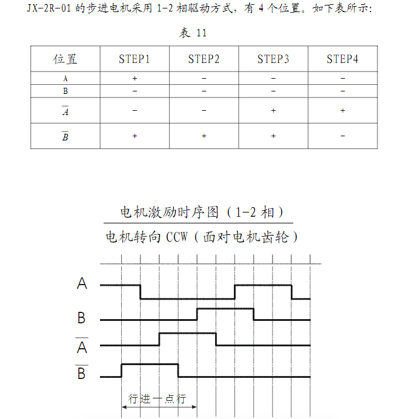

```java
#include <Arduino.h>

//电机引脚
#define PIN_MOTOR_AP 23
#define PIN_MOTOR_AM 22
#define PIN_MOTOR_BP 21
#define PIN_MOTOR_BM 19

//打印头电源升压控制引脚
#define PIN_VHEN 17

void init_motor()
{
    pinMode(PIN_MOTOR_AP, OUTPUT);
    pinMode(PIN_MOTOR_AM, OUTPUT);
    pinMode(PIN_MOTOR_BP, OUTPUT);
    pinMode(PIN_MOTOR_BM, OUTPUT);

    digitalWrite(PIN_MOTOR_AP, 0);
    digitalWrite(PIN_MOTOR_AM, 0);
    digitalWrite(PIN_MOTOR_BP, 0);
    digitalWrite(PIN_MOTOR_BM, 0);
}

//运行8步
void motor_run(){
    digitalWrite(PIN_MOTOR_AM, 1);
    digitalWrite(PIN_MOTOR_BM, 0);
    digitalWrite(PIN_MOTOR_AP, 0);
    digitalWrite(PIN_MOTOR_BP, 1);
    delay(2); //500Hz
    digitalWrite(PIN_MOTOR_AM, 0);
    digitalWrite(PIN_MOTOR_BM, 0);
    digitalWrite(PIN_MOTOR_AP, 0);
    digitalWrite(PIN_MOTOR_BP, 1);
    delay(2); //500Hz 
    digitalWrite(PIN_MOTOR_AM, 0);
    digitalWrite(PIN_MOTOR_BM, 0);
    digitalWrite(PIN_MOTOR_AP, 1);
    digitalWrite(PIN_MOTOR_BP, 1);
    delay(2); //500Hz 
    digitalWrite(PIN_MOTOR_AM, 0);
    digitalWrite(PIN_MOTOR_BM, 0);
    digitalWrite(PIN_MOTOR_AP, 1);
    digitalWrite(PIN_MOTOR_BP, 0);
    delay(2); //500Hz 
    digitalWrite(PIN_MOTOR_AM, 0);
    digitalWrite(PIN_MOTOR_BM, 1);
    digitalWrite(PIN_MOTOR_AP, 1);
    digitalWrite(PIN_MOTOR_BP, 0);
    delay(2); //500Hz 
    digitalWrite(PIN_MOTOR_AM, 0);
    digitalWrite(PIN_MOTOR_BM, 1);
    digitalWrite(PIN_MOTOR_AP, 0);
    digitalWrite(PIN_MOTOR_BP, 0);
    delay(2); //500Hz 
    digitalWrite(PIN_MOTOR_AM, 1);
    digitalWrite(PIN_MOTOR_BM, 1);
    digitalWrite(PIN_MOTOR_AP, 0);
    digitalWrite(PIN_MOTOR_BP, 0);
    delay(2); //500Hz 
    digitalWrite(PIN_MOTOR_AM, 1);
    digitalWrite(PIN_MOTOR_BM, 0);
    digitalWrite(PIN_MOTOR_AP, 0);
    digitalWrite(PIN_MOTOR_BP, 0);
    delay(2); //500Hz 
}

void setup() {
  Serial.begin(115200);
  Serial.printf("setup\n");
  pinMode(PIN_VHEN, OUTPUT);
  digitalWrite(PIN_VHEN, LOW);
  init_motor();
}

void loop() {
  motor_run();
  delay(5000);
  Serial.printf("run\n");
}

```

优化后：

```java
#include <Arduino.h>
#include <Ticker.h>

//电机引脚
#define PIN_MOTOR_AP 23
#define PIN_MOTOR_AM 22
#define PIN_MOTOR_BP 21
#define PIN_MOTOR_BM 19
//打印头电源升压控制引脚
#define PIN_VHEN 17

#define MOTOR_WATI_TIME 2    //电机运行一步的时间 2ms/500Hz 

/*
step  A  B  A- B-
      AN BN AP BP
1     1  0  0  1
2     0  0  0  1
3     0  0  1  1
4     0  0  1  0
5     0  1  1  0
6     0  1  0  0
7     1  1  0  0
8     1  0  0  0
*/
uint8_t motor_table[8][4] =
    {
        {1, 0, 0, 1},
        {0, 0, 0, 1},
        {0, 1, 0, 1},
        {0, 1, 0, 0},
        {0, 1, 1, 0},
        {0, 0, 1, 0},
        {1, 0, 1, 0},
        {1, 0, 0, 0}
     };
        
uint8_t motor_pos = 0;

Ticker timer_motor;
//持续运行-定时器回调
void timer_motor_callbackfun()
{
    digitalWrite(PIN_MOTOR_AP, motor_table[motor_pos][0]);
    digitalWrite(PIN_MOTOR_AM, motor_table[motor_pos][1]);
    digitalWrite(PIN_MOTOR_BP, motor_table[motor_pos][2]);
    digitalWrite(PIN_MOTOR_BM, motor_table[motor_pos][3]);
    motor_pos++;
    if (motor_pos >= 8)
    {
        motor_pos = 0;
    }
}
//持续运行-开始
void motor_start()
{
    if (timer_motor.active() == false)
        timer_motor.attach_ms(2, timer_motor_callbackfun);
}
//持续运行-关闭
void motor_stop()
{
    digitalWrite(PIN_MOTOR_AP, 0);
    digitalWrite(PIN_MOTOR_AM, 0);
    digitalWrite(PIN_MOTOR_BP, 0);
    digitalWrite(PIN_MOTOR_BM, 0);
    if (timer_motor.active())
        timer_motor.detach();
}
//指定步数运行
void motor_run_step(uint32_t steps)
{
    while (steps)
    {
        digitalWrite(PIN_MOTOR_AP, motor_table[motor_pos][0]);
        digitalWrite(PIN_MOTOR_AM, motor_table[motor_pos][1]);
        digitalWrite(PIN_MOTOR_BP, motor_table[motor_pos][2]);
        digitalWrite(PIN_MOTOR_BM, motor_table[motor_pos][3]);
        motor_pos++;
        if (motor_pos >= 8)
        {
            motor_pos = 0;
        }
        delay(MOTOR_WATI_TIME);
        steps--;
    }
}

void init_motor()
{
    pinMode(PIN_MOTOR_AP, OUTPUT);
    pinMode(PIN_MOTOR_AM, OUTPUT);
    pinMode(PIN_MOTOR_BP, OUTPUT);
    pinMode(PIN_MOTOR_BM, OUTPUT);

    digitalWrite(PIN_MOTOR_AP, 0);
    digitalWrite(PIN_MOTOR_AM, 0);
    digitalWrite(PIN_MOTOR_BP, 0);
    digitalWrite(PIN_MOTOR_BM, 0);
}

void setup() {
  Serial.begin(115200);
  Serial.printf("setup\n");
  pinMode(PIN_VHEN, OUTPUT);
  digitalWrite(PIN_VHEN, LOW);
  init_motor();
}

void loop() {
  delay(5000);
  Serial.printf("run\n");
  motor_run_step(50);
}
```

# 八、打印模块

需求：

**驱动打印头进行打印测试。**

打印原理：

<grid cols="2">
<column>
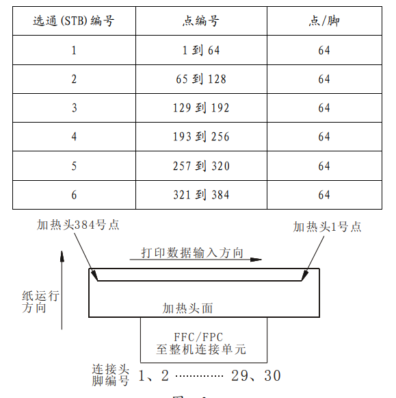
</column>
<column>
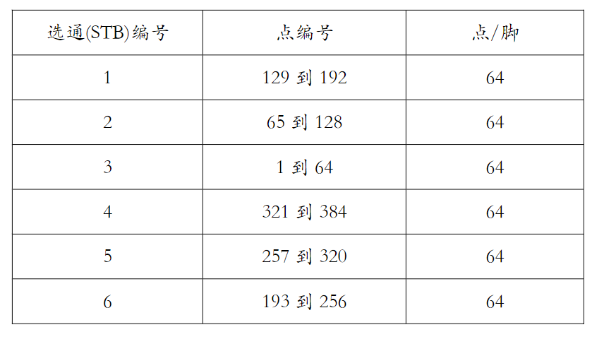
</column>
</grid>

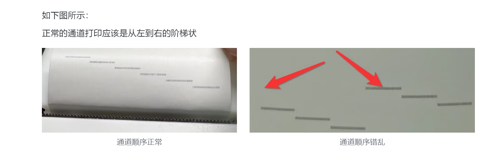

**不同的打印头通道顺序，需要在下方代码设置，否则会出现打印时，某些通道不清晰情况。**

```c
//原厂 V4
#define PIN_STB1 26  
#define PIN_STB2 27  
#define PIN_STB3 14  
#define PIN_STB4 32  
#define PIN_STB5 33  
#define PIN_STB6 25  

//原厂 V3
// #define PIN_STB1 25  
// #define PIN_STB2 33  
// #define PIN_STB3 32  
// #define PIN_STB4 14  
// #define PIN_STB5 27  
// #define PIN_STB6 26  

//拆机 V2
// #define PIN_STB1 14
// #define PIN_STB2 27
// #define PIN_STB3 26
// #define PIN_STB4 25
// #define PIN_STB5 33
// #define PIN_STB6 32
```

<!-- 不支持的块类型: View (type=33) -->

<file token="WTOmbObVhooj6VxStBac5HQOneJ" name="JX-2R-01AHL微型热敏打印机芯规格书-V1.0.pdf"/>

- 热敏纸的原理是某个区域的温度升高到一定值后，该区域就会变黑。

- 打印头的原理是，把热敏纸的一行，分割为384个点，然后用6个IO口对（每个IO管理64个点）384个点进行加热，有数据传输的点位，在IO设置为高时加热后就会变色。

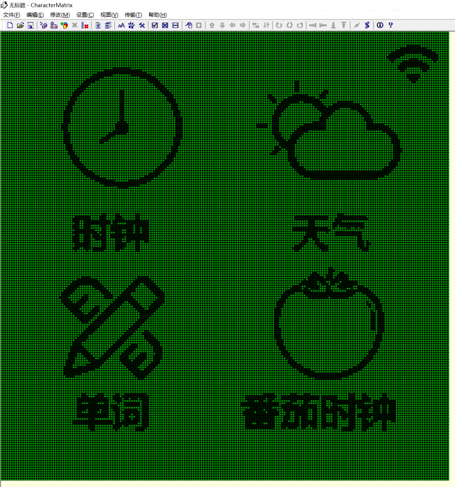

- 而图像就是由一个一个点组成的大数组，把图像的行像素点设置为384后，就可以在电机的拖拽下逐行打印拉。

<grid cols="2">
<column>
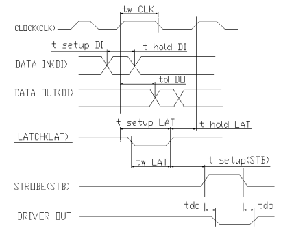
</column>
<column>
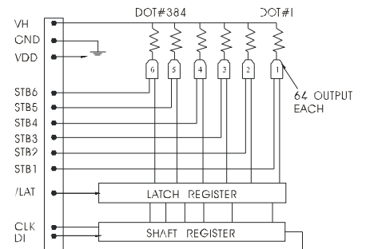
</column>
</grid>

**打印驱动时序：**

1. 初始化IO，CLK DI初始化为SPI，电机IO 选通STB1\~6 锁存LAT  VH电源开关都初始化为输出，并且把VH设置为低电平。

1. 打印前确保不缺纸且温度正常情况下，才可以进入打印模式。

1. 打印开始时，设置VH电源开关打开（高电平），然后通过SPI传输需要打印的384bit(48Byte)数据，然后LAT从低拉高1us锁存数据。

1. STB1\~6逐个开启加热，开启加热时长越长，打印颜色越深，但需要注意加热时间控制3ms左右，长时间加热容易损坏打印头。

1. 打印完成一行后，控制电机移动4步（结构的设置是移动4步等于打印行高）

1. 然后重新开始下一行的SPI打印数据传输，锁存，打印。其实就是重新执行步骤3，4，5直至所有内容打印完。

**注意事项 **

1. 打印头的电源开关时序要求: 

电源开启时序: 首先提供逻辑电源电压(VDD)，然后启动 TPH 的电源电压(VH)。 

电源关闭时序: 首先关闭 TPH 的电源电压(VH)，然后关闭逻辑电源电压(VDD)。

1. 在机器处于不打印状态,打印电源 VH 必须关闭。 

1. 当 VH电源处于开关过程或不打印时，应保持选通（STB）处于非工作状态。 

1. 当打印工作结束后，VH 的电源电压应即时给予衰减到地电压（0V），并保持到下一个 打印工作。 

1. 加热控制信号要求:在打印机芯电压打开/关闭时，保证加热控制信号处于关闭状态；

```c
//////////////////////////////////////////////////SPI部分//////////////////////////////////////////////////
//打印的内容是通过SPI接口发送给打印头的，这里用的SPI有两根线，一根时钟，一根数据线
//一行有384个点，用384bit来表示，bit为0时不加热，bit为1时加热
//一个byte有8个bit，那一行就是发送384/8=48Byte的
#define SPI_CODE
#ifdef SPI_CODE
#include <SPI.h>

//打印头数据引脚
#define PIN_SCK 15
#define PIN_SDA 13
static const int spiClk = 1000000; // 1 MHz

SPIClass hspi  = SPIClass(HSPI);
SPISettings printerSPISettings = SPISettings(1000000, SPI_MSBFIRST, SPI_MODE0);

void spiCommand(uint8_t *data_buffer, uint8_t data_len)
{
    // use it as you would the regular arduino SPI API
    hspi.beginTransaction(printerSPISettings);
    hspi.transfer(data_buffer, data_len);
    hspi.endTransaction();
}

void init_spi()
{
    // hspi = SPIClass(HSPI);
    // alternatively route through GPIO pins
    hspi.begin(PIN_SCK, -1, PIN_SDA, -1); // SCLK, MISO, MOSI, SS
    hspi.setFrequency(2000000);
}
#endif

//////////////////////////////////////////////////打印部分//////////////////////////////////////////////////
#define PRINTER_CODE
#ifdef PRINTER_CODE
//打印头数据锁存引脚
#define PIN_LAT 12
//通道引脚
//原厂 V3
#define PIN_STB1 26  
#define PIN_STB2 27  
#define PIN_STB3 14  
#define PIN_STB4 32  
#define PIN_STB5 33  
#define PIN_STB6 25 

//拆机 V2
// #define PIN_STB1 14
// #define PIN_STB2 27
// #define PIN_STB3 26
// #define PIN_STB4 25
// #define PIN_STB5 33
// #define PIN_STB6 32

#define PRINT_TIME 1700         //打印加热时间
#define PRINT_END_TIME 200      //冷却时间
#define LAT_TIME 1              //数据锁存时间
#define PIN_VHEN 17             //打印头电源升压控制引脚

/**
 * @brief 失能所有通道
 *
 */
static void set_stb_idle()
{
    digitalWrite(PIN_STB1, LOW);
    digitalWrite(PIN_STB2, LOW);
    digitalWrite(PIN_STB3, LOW);
    digitalWrite(PIN_STB4, LOW);
    digitalWrite(PIN_STB5, LOW);
    digitalWrite(PIN_STB6, LOW);
}

/**
 * @brief 打印前初始化
 *
 */
static void init_printing()
{
    set_stb_idle();
    digitalWrite(PIN_LAT, HIGH);
    // POWER ON
    digitalWrite(PIN_VHEN, HIGH);
}

/**
 * @brief 打印后停止
 *
 */
static void stop_printing()
{
    // POWER OFF
    digitalWrite(PIN_VHEN, LOW);
    set_stb_idle();
    digitalWrite(PIN_LAT, HIGH);
}

/**
 * @brief 发送一行数据
 *
 * @param data
 */
static void send_one_line_data(uint8_t *data)
{
    spiCommand(data, 48);
    /* After send one dot line, send LAT signal low pulse.*/
    digitalWrite(PIN_LAT, LOW);
    delayMicroseconds(LAT_TIME);
    digitalWrite(PIN_LAT, HIGH);
}

/**
 * @brief 通道打印运行
 *
 * @param now_stb_num
 */
static void run_stb(uint8_t now_stb_num)
{
    switch (now_stb_num)
    {
    case 0:
        digitalWrite(PIN_STB1, 1);
        delayMicroseconds(PRINT_TIME);
        digitalWrite(PIN_STB1, 0);
        delayMicroseconds(PRINT_END_TIME);
        break;
    case 1:
        digitalWrite(PIN_STB2, 1);
        delayMicroseconds(PRINT_TIME);
        digitalWrite(PIN_STB2, 0);
        delayMicroseconds(PRINT_END_TIME);
        break;
    case 2:
        digitalWrite(PIN_STB3, 1);
        delayMicroseconds(PRINT_TIME);
        digitalWrite(PIN_STB3, 0);
        delayMicroseconds(PRINT_END_TIME);
        break;
    case 3:
        digitalWrite(PIN_STB4, 1);
        delayMicroseconds(PRINT_TIME);
        digitalWrite(PIN_STB4, 0);
        delayMicroseconds(PRINT_END_TIME);
        break;
    case 4:
        digitalWrite(PIN_STB5, 1);
        delayMicroseconds(PRINT_TIME);
        digitalWrite(PIN_STB5, 0);
        delayMicroseconds(PRINT_END_TIME);
        break;
    case 5:
        digitalWrite(PIN_STB6, 1);
        delayMicroseconds(PRINT_TIME);
        digitalWrite(PIN_STB6, 0);
        delayMicroseconds(PRINT_END_TIME);
        break;
    default:
        break;
    }
}

/**
 * @brief 移动电机&开始打印
 *
 * @param need_stop
 * @param stbnum
 */
bool move_and_start_std(bool need_stop, uint8_t stbnum)
{
    if (need_stop == true)
    {
        motor_stop();
        stop_printing();
        return true;
    }
    // 4step一行
    motor_run();
    // 单通道打印
    run_stb(stbnum);
    motor_run_step(3);
    return false;
}

/**
 * @brief 单通道数组打印
 *
 * @param stbnum
 * @param data
 * @param len
 */
void start_printing_by_onestb(uint8_t stbnum, uint8_t *data, uint32_t len)
{
    uint32_t offset = 0;
    uint8_t *ptr = data;
    bool need_stop = false;
    //LAT设置为高 VH电源设置为高
    init_printing();
    while (1)
    {
        Serial.printf("printer %d\n", offset);
        if (len > offset)
        {
            // 发送一行数据 48byte*8=384bit
            send_one_line_data(ptr);
            // 每次偏移48Byte,直至所有数据发送完成
            offset += 48;
            ptr += 48;
        }
        else
            need_stop = true;
        if (move_and_start_std(need_stop, stbnum))
            break;
        //if(printing_error_check(false))
        //    break;
    }
    motor_run_step(40);
    motor_stop();
}

static void setDebugData(uint8_t *print_data)
{
    for (uint32_t index = 0; index < 48 * 5; ++index)
    {
        //0X55 = 0101 0101 0为白，1为黑
        print_data[index] = 0x55;
    }
}

void testSTB()
{
    //每行48byte 1byte=8bit 384bit
    //48*5=5行
    uint8_t print_data[48*5];
    uint32_t print_len;
    Serial.println("开始打印打印头选通引脚测试\n顺序: 1  2  3  4  5  6");
    print_len = 48*5;
    //设置打印的数据内容
    setDebugData(print_data);
    //通道0打印5行
    start_printing_by_onestb(0, print_data, print_len);
    setDebugData(print_data);
    //通道1打印5行
    start_printing_by_onestb(1, print_data, print_len);
    setDebugData(print_data);
    start_printing_by_onestb(2, print_data, print_len);
    setDebugData(print_data);
    start_printing_by_onestb(3, print_data, print_len);
    setDebugData(print_data);
    start_printing_by_onestb(4, print_data, print_len);
    setDebugData(print_data);
    start_printing_by_onestb(5, print_data, print_len);
    Serial.println("测试完成");
}

void init_printer()
{
    //初始化电机IO
    init_motor();
    //初始化数据引脚、通道引脚
    pinMode(PIN_LAT, OUTPUT);
    pinMode(PIN_SCK, OUTPUT);
    pinMode(PIN_SDA, OUTPUT);
    pinMode(PIN_STB1, OUTPUT);
    pinMode(PIN_STB2, OUTPUT);
    pinMode(PIN_STB3, OUTPUT);
    pinMode(PIN_STB4, OUTPUT);
    pinMode(PIN_STB5, OUTPUT);
    pinMode(PIN_STB6, OUTPUT);
    //加热通道全部关闭
    set_stb_idle();
    //初始化打印电源控制引脚、并关闭电源
    pinMode(PIN_VHEN, OUTPUT);
    digitalWrite(PIN_VHEN, LOW);
    //初始化SPI
    init_spi();
}
#endif

void setup() {
  Serial.begin(115200);
  Serial.printf("setup\n");
  init_printer();
}

void loop() {
  delay(5000);
  testSTB();
}
```

# 九、多任务

**需求：**

**我们开发完按键模块、电量、LED、蓝牙模块、打印模块的功能后，单个模块都能跑得很好，但你会发现，有的任务需要延时10ms，有的任务需要延时50ms，那应该如何把它们放到一起运行呢？**

方法一：基于定时器，实现状态机

方法二：使用RTOS的多任务函数（更简单，模块间耦合度低，后续也方便移植）

底层原理都是一样的，把原来的延时函数去掉，用标志位来表示代码是否执行即可。

**实现原理：**

ESP32的SDK包中内置了FreeRTOS，所以我们也可以使用操作系统的接口，这里只用到一个接口，就是任务的创建。

创建任务相当于创建分身，开启多任务后，你可以简单理解为你拥有了多个loop函数，这样每个函数就可以执行单独的功能了。

**多任务的原理：**

当操作系统使用某种任务调度策略允许多任务共享一个处理器时，虽然处理器在某一时刻只会给一件任务提供服务,因为调度机制保证不同任务之间的切换速度十分迅速，因此给人多个任务同时运行的错觉。

```java
#include <Arduino.h>

//打印头电源升压控制引脚
#define PIN_VHEN 17
/**
需求：主函数5s运行一次，上报状态1s运行一次，按键检测2s运行一次
void loop() {
  delay(5000);
  Serial.printf("main loop\n");
}
如果都把代码放到loop，则需要多余的各种状态进行计算切换，代码会很臃肿，如果遇到耗时任务，也会导致时间不准
 */

void task_report(void *pvParameters)
{
    for (;;) 
    {
        vTaskDelay(1000);
        Serial.printf("task report loop\n");
    }
}

void task_button(void *pvParameters)
{
    for (;;) 
    {
        vTaskDelay(2000);
        Serial.printf("task button loop\n");
    }
}

void init_task()
{
    xTaskCreate(
        task_report,  // 任务函数
        "TaskReport", // 任务名
        1024*10,      // 任务栈，根据任务内使用的空间评估，例如任务中有一个10000个字节的数组，那空间最好选择10000+10000*50%
        NULL,         // 任务参数
        1,            // 任务优先级, with 3 (configMAX_PRIORITIES - 1) 是最高的，0是最低的.
        NULL          // 任务句柄
    );

    xTaskCreate(
        task_button,  // 任务函数
        "TaskButton", // 任务名
        1024*5,         // 任务栈
        NULL,         // 任务参数
        0,            // 任务优先级, with 3 (configMAX_PRIORITIES - 1) 是最高的，0是最低的.
        NULL          // 任务句柄
    );
}

void setup() {
  Serial.begin(115200);
  Serial.printf("setup\n");
  pinMode(PIN_VHEN, OUTPUT);
  digitalWrite(PIN_VHEN, LOW);
  init_task();
}

void loop() {
  delay(5000);
  Serial.printf("main loop\n");
}
```

# 十、工程整合

如果你看到了这里，恭喜你，意味着你已经把所有的功能都实现啦，剩下的就是把之前实现的所有模块，放到一个工程里面，你就可以拥有一套完整的软件代码了。

当然，在整合的过程中，我们还需要学一些知识。

## 10-1、工程多文件

以往我们都是把所有代码放到一个文件中，但代码数量多起来后，你会发现看起来非常费劲，虽然也能看，但是这肯定不是一个好的工程，那怎么搭建一个好的工程呢？那就是把所有模块用单独的源文件和头文件管理好。

新建test.cpp test.h文件，并添加以下内容


test.cpp

```c
#include "test.h"

//实现一个test_run函数
void test_run(){
    Serial.printf("i am test_run\n");
}
```

test.h

```c
//判断，避免多文件来回include包含
#ifndef _TEST_H_
#define _TEST_H_

#include <Arduino.h>

//让函数在包含test.h的文件中可见
void test_run(void);

#endif
```

main.cpp

```c
#include <Arduino.h>
//引入头文件
#include "test.h"

//打印头电源升压控制引脚
#define PIN_VHEN 17

void setup() {
  Serial.begin(9600);
  Serial.printf("setup\n");
  pinMode(PIN_VHEN, OUTPUT);
  digitalWrite(PIN_VHEN, LOW);

}

void loop() {
  delay(5000);
  //应用函数
  test_run();
}
```

有了上面的基础后，现在，我们就可以按模块划分Mini打印机项目的文件名了，可以打开工程逐个模块查看下：

每个模块的代码修改比较简单，把stepup和loop函数删除，把需要操作的函数加到头文件给外部调用即可。

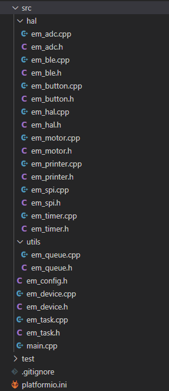

## 10-2、手机端数据通讯

**需求：需要使用手机下发打印数据，在操作设备时，设备产生的错误也需要手机端显示出来。**

实现原理：

基于BLE模块实现数据透传，主要有四种类型的数据

1. 设备状态的上报

设备的状态有四种，电量、打印头温度、缺纸状态、打印状态，只需要实现定时上报或触发上报即可，这里面没有添加包头校验码，严格来说必须要加上。常见的协议格式：包头+长度+指令类型+数据+校验码

```c
        uint8_t status[4];
        status[0] = pdevice->battery;
        status[1] = pdevice->temperature;
        status[2] = pdevice->paper_state;
        status[3] = pdevice->printer_state;
```

1. 打印数据的接收

收到APP端发送的数据后，之间使用打印函数进行打印即可。这里要注意的是，APP发送时，是逐行数据发送的，我们需要接收到**100行后**才进行打印，这里主要是因为打印的速度和APP发送的速度不一致导致，如果接收到马上打印，因为打印速度比接收速度快，就会出现一卡一卡的情况。这里的100可以根据实际调试进行修改。

1. 打印颜色深度设置

设备端收到0xA5 0xA5 0xA5 0xA5 0xnn类型的数据时，会把该数据当作颜色深度设置指令处理，0xnn为30，60，100，用于设置打印颜色深度。

同时，我们也来简单过下Android APP端的源码。

<grid cols="2">
<column>
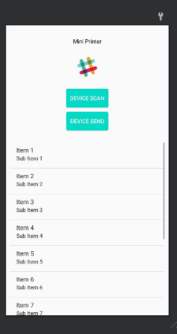
</column>
<column>
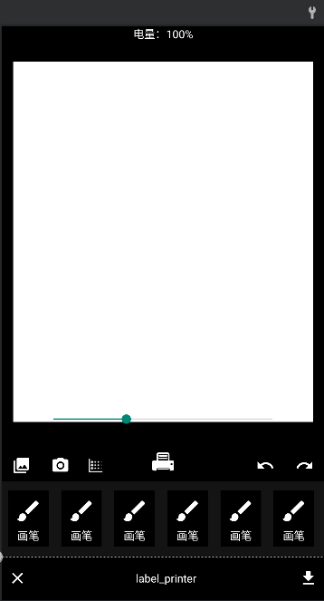
</column>
</grid>

主要是两个界面，左侧界面用于搜索蓝牙设备，进行绑定连接，右侧界面用于编辑需要打印的内容。

1. 使用开始打印指令

部分较老android手机使用的是蓝牙4.0的协议栈，数据发送速度较慢，会导致打印速度比接收数据速度快，打印不完整或者一卡一卡情况，所以增加了开始打印指令，等所以数据接收完成后，才开始打印。

开始打印的指令为0xA6 0xA6 0xA6 0xA6 0x01，设备端需要屏蔽下发逻辑，添加打印开始处理逻辑。

```c
    #ifdef START_PRINTER_WHEN_FINISH_RAED
    //接受完成时才打印
        if (pdevice->read_ble_finish == true)
        {
            if (pdevice->printer_state == PRINTER_STATUS_FINISH ||
                pdevice->printer_state == PRINTER_STATUS_INIT)
            {
                pdevice->read_ble_finish = false;
                pdevice->printer_state = PRINTER_STATUS_START;
                ble_report();
                Serial.printf("report device status : printing start %d\n",get_ble_rx_leftline());
                run_beep(BEEP_PRINTER_START);
                run_led(LED_PRINTER_START);
            }
        }
    #else
    // 接收大于100条时，才触发开始打印
    if (get_ble_rx_leftline()> 100)
    {
        if (pdevice->printer_state == PRINTER_STATUS_FINISH ||
            pdevice->printer_state == PRINTER_STATUS_INIT)
        {
            pdevice->printer_state = PRINTER_STATUS_START;
            ble_report();
            Serial.print("report device status : printing start\n");
            run_beep(BEEP_PRINTER_START);
            run_led(LED_PRINTER_START);
        }
    }
    #endif
```

Android部分的源码基于Kotlin语言编写，相对于Java会更简洁，企业中一般这部分是由Android工程师开发，学习底层部分内容，只需要实现底层的控制和通讯协议的实现即可，对这部分感兴趣想了解APP开发、修改APP功能的同学可以了解下Android Kotlin编程相关内容。

<!-- 不支持的块类型: View (type=33) -->

<file token="XgXFb4XLio3gcFxoi94cPMrWnxe" name="《Kotlin核心编程》2021版.pdf"/>

```mermaid
% Feishu Flowchart Diagram (type: 1)
% Note: Mermaid source code is not accessible via API
```

## 10-3、工程整合

需求：把所有功能代码放到一起，然后补全业务逻辑。

这节课我们将梳理下整机的状态流程图，然后过一遍整体的代码实现。

状态流程图：

```mermaid
% Feishu Flowchart Diagram (type: 1)
% Note: Mermaid source code is not accessible via API
```

# 附件：

## 参考原理图

<!-- 不支持的块类型: View (type=33) -->

<file token="NctrbhIcHonZR1x3QROczmMbn9e" name="Mini打印机原理图.pdf"/>

## 板卡正面


## 板卡背面


## **项目板卡源码和固件**

**位于下方文档的第五章：**

[Mini打印机资料导航](https://lsongdev.feishu.cn/docx/NmZbd1yCdoYU1SxMEVkcm1B2nZd) 

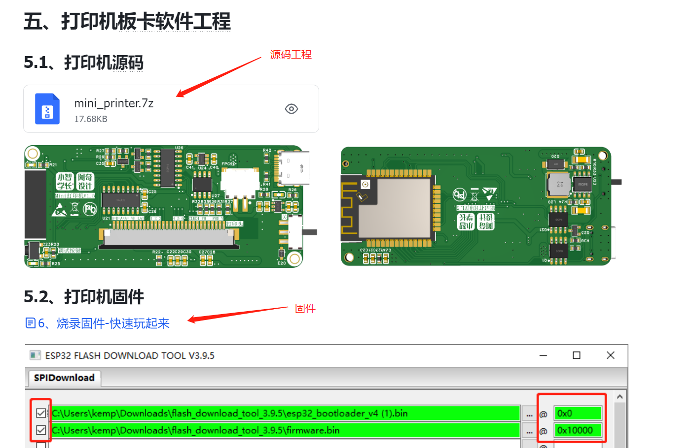

## **APP源码和应用**

**位于下方文档的第七章：**

[Mini打印机资料导航](https://lsongdev.feishu.cn/docx/NmZbd1yCdoYU1SxMEVkcm1B2nZd) 

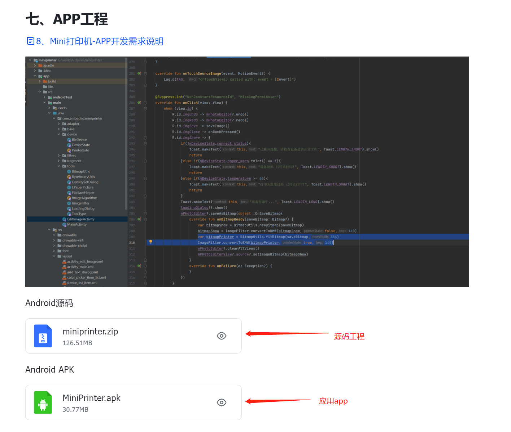

## ESP32 API手册和ESP32 SDK源码

https://docs.espressif.com/projects/arduino-esp32/en/latest/libraries.html

https://github.com/espressif/arduino-esp32
