# 6、烧录固件&问题排查-快速玩起来

## 1、安装&接线

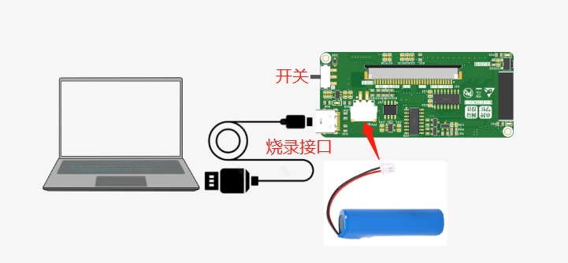

## **首次烧录时，请勿接打印头！！！！！！**

1. 接上电池，电池别接反，红线是+，黑线是-

1. 接上Typec烧录线

1. 打开开关

1. 这时候会在电脑的设备管理器中找到对应COM口，例如这里为COM22

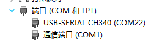

# 2、下载烧录工具

https://www.espressif.com.cn/en/support/download/other-tools

<!-- 不支持的块类型: View (type=33) -->

<file token="IVJFbp6OpoVJdax65P0cEMconKf" name="flash_download_tool_3.9.3.zip"/>

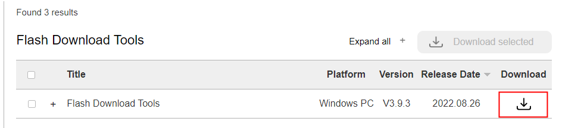

## 2.1、打开软件，选择ESP32平台

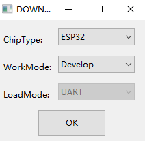

# 2.2、选择对应固件和地址

Bootloader地址0x0

<!-- 不支持的块类型: View (type=33) -->

<file token="TarLbKATkoQG64xqmmScjX1nnke" name="esp32_bootloader_v4.bin"/>

APP固件地址0x10000

<!-- 不支持的块类型: View (type=33) -->

<file token="V6VIbLEYHoG2gQxqriWchNwlnBg" name="firmware_printer_v1.0.2.bin"/>

<!-- 不支持的块类型: View (type=33) -->

<file token="PzLibXSVpoJUPVxqzEKc6lkinnc" name="firmware_printer_v1.0.3.bin"/>

```c
firmware_printer_v1.0.2.bin，修复了spi初始化bug 
建议使用firmware_printer_v1.0.3.bin，优化打印结束出纸长度和打印效果
```

**下方图中的firmware.bin和firmware\_printer\_v1.0.3.bin是一个文件哦，命名不一样而已。**

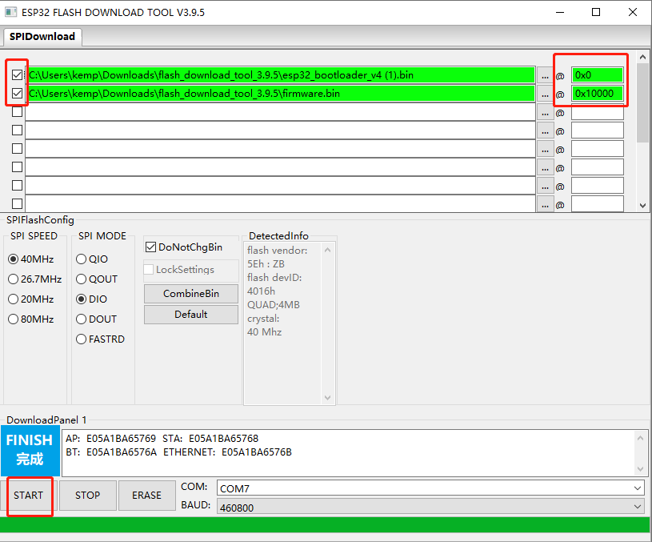

选择好固件、参数后，点击START开始烧录，等待烧录完成便可开始测试，**烧录完成后，重新上下电设备即可。**

**问题FYI:**

如果提示未能识别设备，需要安装下CH340驱动，安装完成后重启电脑。

<!-- 不支持的块类型: View (type=33) -->

<file token="IG8Tb9uwxoopQzxZqORc9gpPnxd" name="CH341SER.EXE"/>

如果接上TYPEC USB线无任何反应，请检查USB线是否为数据USB线，部分USB线仅仅有供电功能。

# 

# 3、快速使用

## 3-1、测试使用步骤

1. 设备断电

1. 安装打印头

1. 安装打印纸（**打印纸有正反面，放入打印纸时，需保证打印纸的正面接触到打印头，否则会打印不出内容**）

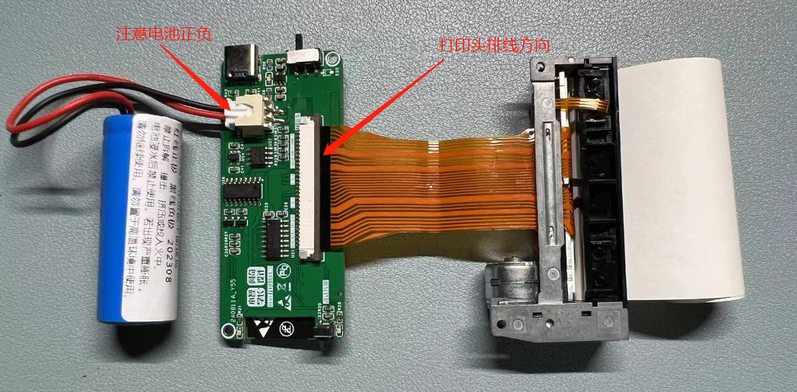

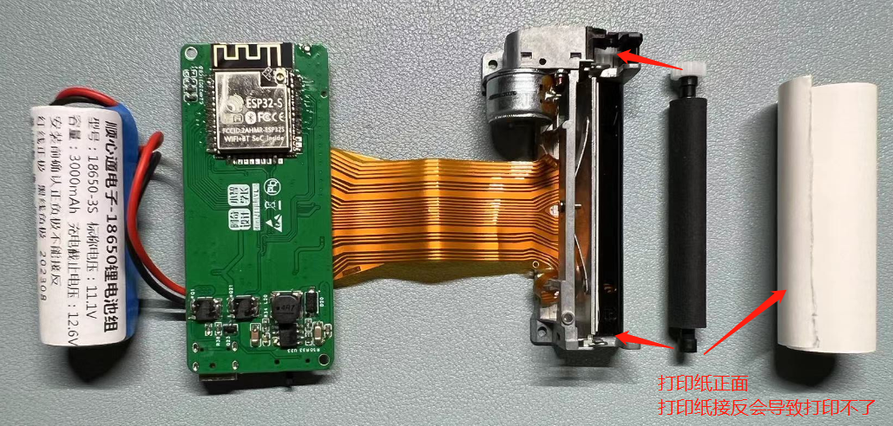

最终效果：

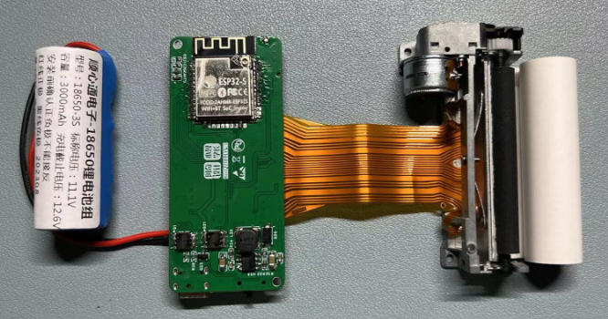

**打印纸有正反面，放入打印纸时，需保证打印纸的正面接触到打印头，否则会打印不出内容**

1. 打开开关

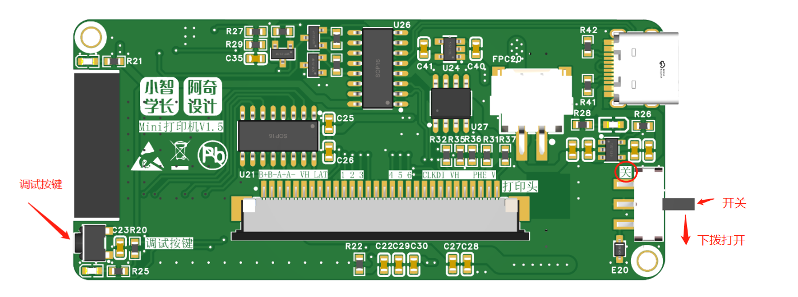

1. 开始调试

- 调试按键短按一下为每个通道单独打印测试。

- 按键长按为电机转动测试。

1. 手机安装打印机APP，安装时同意APP的权限（蓝牙、存储、位置）,APP安装参考3-2章节

1. 确保手机蓝牙已打开

1. 连接成功后设备的R21附件灯光会闪烁一下，便可以进行打印测试啦。

<grid cols="2">
<column>
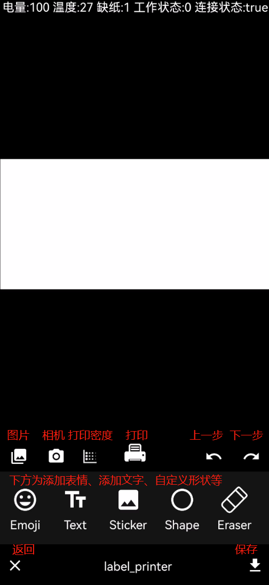
</column>
<column>
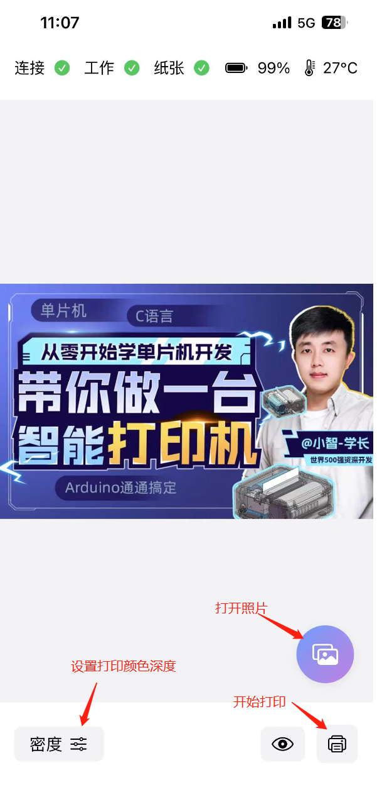
</column>
</grid>

点击**“表情”**图标，选取一个表情放到**白色区域**，然后点击中间**“打印”**图标，这时候设备就开始打印啦（注意，设备要先接上打印纸，否则会报故障打印失败）

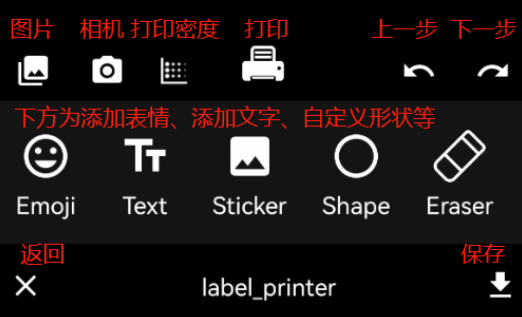

顶部状态栏会记录着设备的电量、打印头温度、状态等数据

底部第一行为功能为打开图库、打开相机、设置打印颜色深度、打印、上一步、下一步

底部第二行为表情、文字等其它编辑菜单栏

底部第三行为回退、保存相关功能。

测试图片

<grid cols="2">
<column>
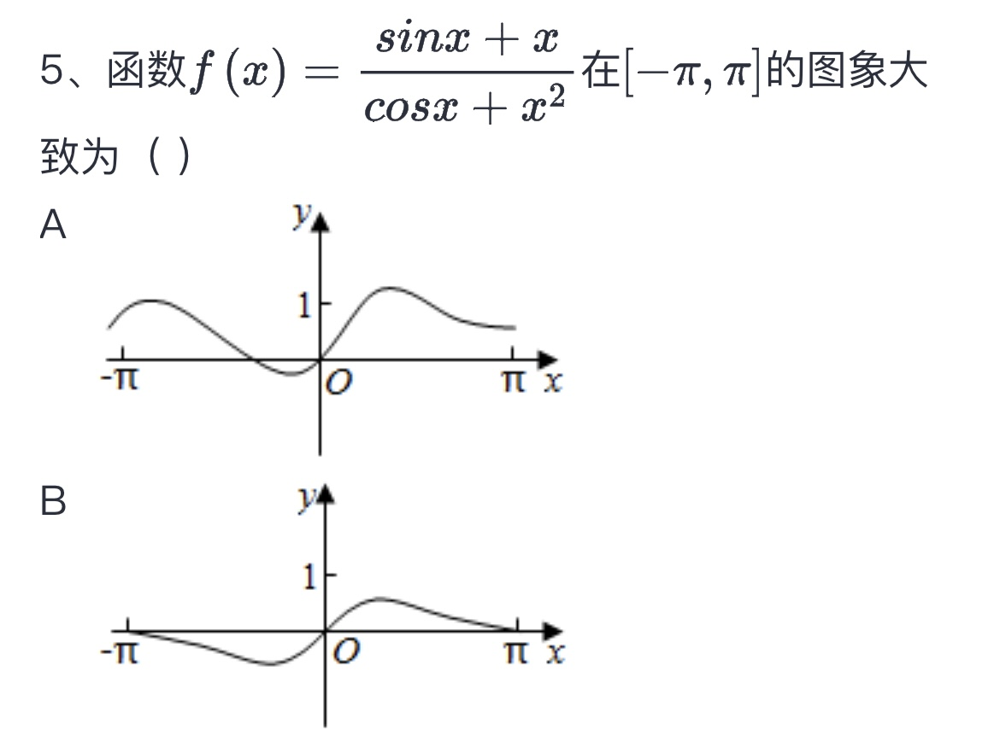
</column>
<column>

</column>
</grid>


## 3-2、打印机APP安装

查看资料导航的第七章[Mini打印机资料导航](https://lsongdev.feishu.cn/docx/NmZbd1yCdoYU1SxMEVkcm1B2nZd) 


<!-- 不支持的块类型: View (type=33) -->

[视频：手机APP使用教程.mp4（飞书原文）](https://lsongdev.feishu.cn/docx/ZA62dsdLaoiBM6x5m7NcZqnenTc)

## 3-3、灯光说明

1、接入USB线充电灯会亮，充满电后充满指示灯会亮。

蜂鸣器说明：

1、缺纸或温度异常时，会提示滴滴滴三声报警。

2、手机连接设备成功后，会提示滴一声。

# 4、结构整机安装请看

[mini打印机 结构文件与配件下载](https://lsongdev.feishu.cn/docx/Ddzkd7URcoSCksxN13ec6WZjnNe) 

# 5、工作异常排查

## 1、能够正常控制、而且出纸，但是纸上没内容

排查是否纸方向反了，**打印纸有正反面的。**

另外，排查下这几个IO的焊接，芯片和打印头端的，VH电源，还有SCK SDA LAT这三个引脚的焊接。

## 2、能够打印文字，但是颜色较深的图片打印不了

一般是电池没电、电池不是动力电池、或者自己布置的板卡过电流不够导致。

<grid cols="2">
<column>
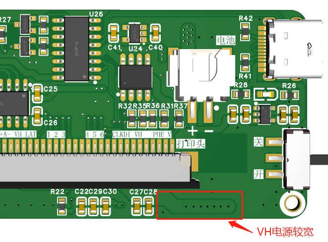
</column>
<column>
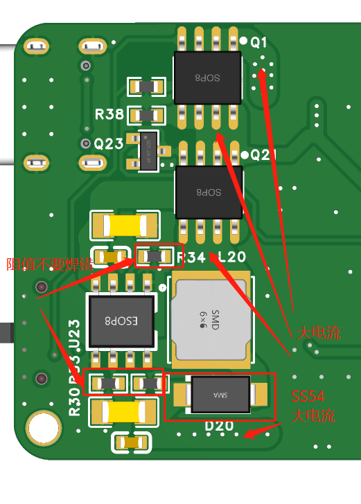
</column>
</grid>

## 3、通过打印，但是只有某些某些列有内容，某些列空白

一般是某个芯片或打印机端子某个通道的IO没焊接好导致，最坏的情况是打印机某个通道坏了，一般可能性比较小

<grid cols="2">
<column>
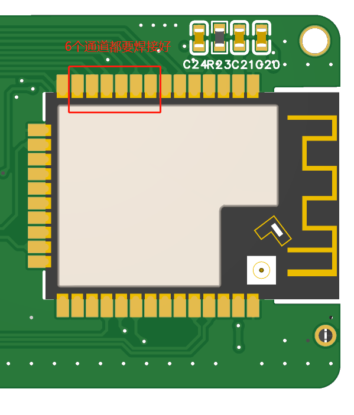
</column>
<column>
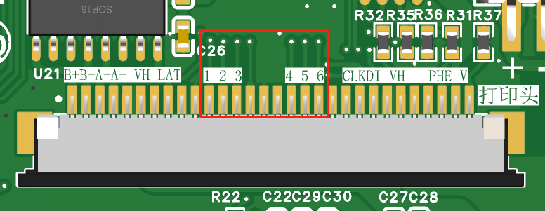
</column>
</grid>

## 4、按打印没任何反应

-接打印机日志查看是否正常跑起，接充电的typec线到电脑，下载串口调试助手，波特率115200 8 n 1，设备开机，即可看到运行日志

-查看APP是否连接到对应设备，重新连接下，看日志是否打印已连接

## 5、查找不到mini-Printer的蓝牙设备

-设备运行异常：是否烧录了固件？地址是否对？固件是否打勾？可以接日志看看板卡有没有正常运行，下载串口调试助手，波特率115200 8 n 1，设备开机，即可看到运行日志

-APP权限未打开，确保蓝牙、存储、位置权限打开

## 6、接上电脑，找不到COM口

测试下各个电源看看确保没短路后，**接上电池，打开开关**，看看电源灯有没有亮，然后测3V3是否正常，最后没问题，接上typeC线再测试

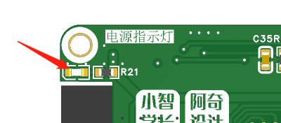

检查USBD+ D-线到CH340是否连通，检查CH340芯片供电是否正常，检查TYPEC端子是否焊接正常

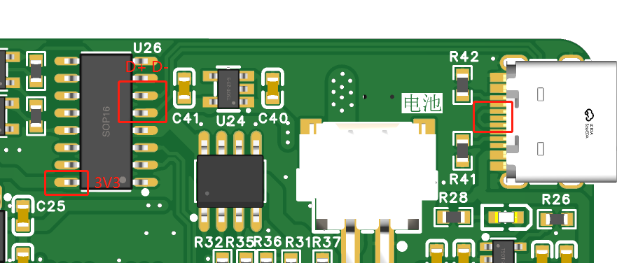

## 7、烧录超时/失败

检查ESP32端TX RX线到CH340是否焊接正常

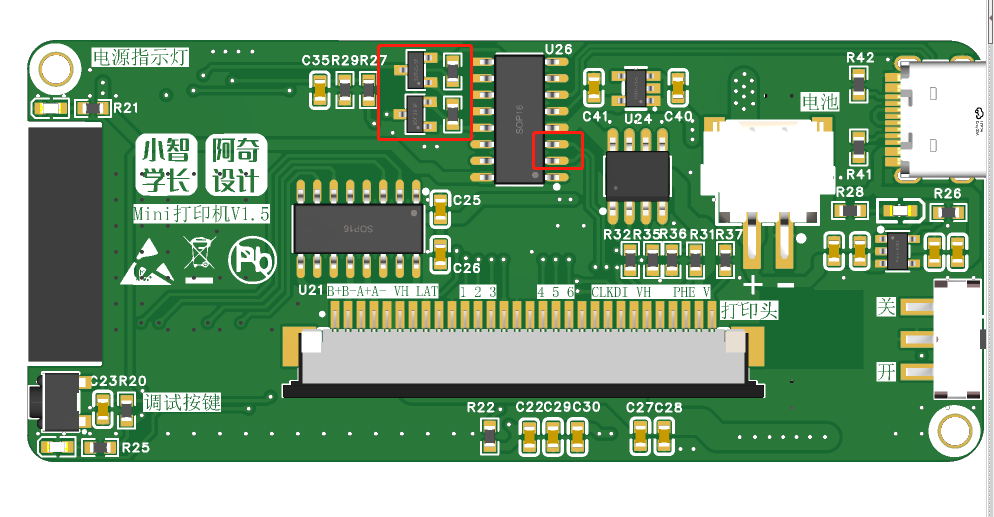

检查ESP32 IO0和EN引脚外部焊接是否正常、电平是否正常

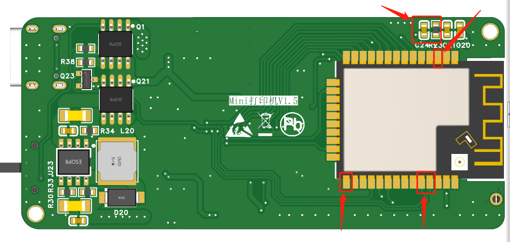

检查ESP32供电是否正常

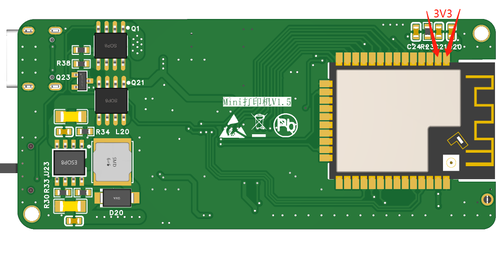

## 8、上电时电源灯不亮

灯有没有焊接反，是否已经打开开关、是否已经接上电池，电池正负是否对？

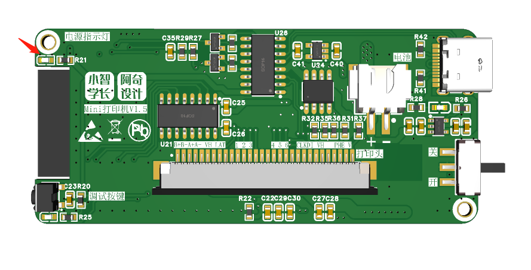

检查有没有短路

电池正负、3V3、升压模块

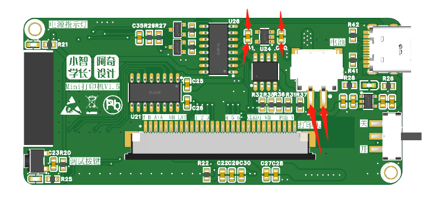

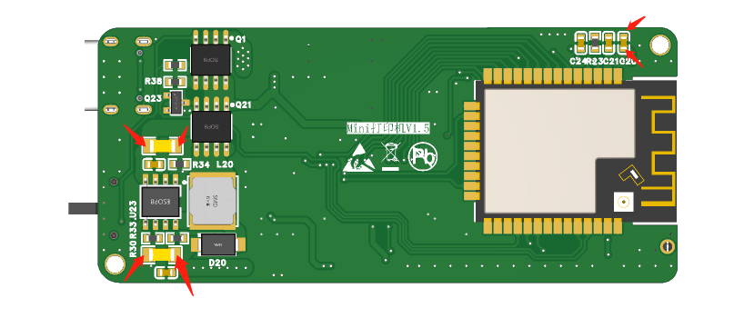

## 9、打印某些列不清晰，某些列正常

这是因为不同版本打印头通道顺序不一致导致，文档提供的固件是适配最新版本的打印头的，如果你用的是其它淘宝商家买的打印头，可以轻按侧面的调试按钮，打印下通道看顺序是否正常。

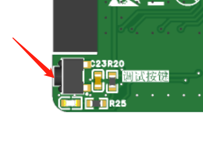

如下图所示：

正常的通道打印应该是从左到右的阶梯状

<grid cols="2">
<column>
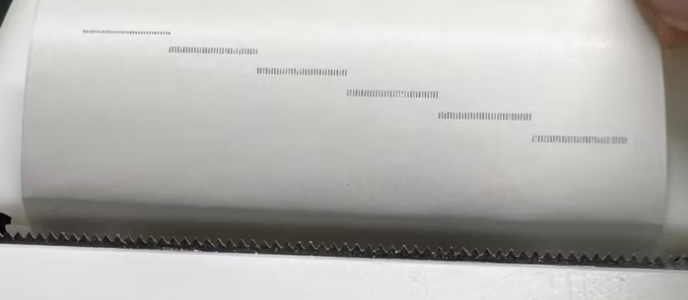
</column>
<column>
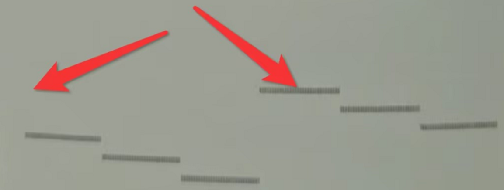
</column>
</grid>
