# 7、零配件&安装

# 全部零配件：

**包含：板卡、电池、打印头、外壳、打磨的砂纸、螺丝等**

**【关于打印机项目的电路板、外壳拼单说明】**** **

**对于只想学习软件部分或者快速玩起来的小伙伴，想一起拼板的，现在可以在这里一起拼单啦！！！**

第一批数量有限，目前只有80套哦，有需要的小伙伴可以点击了解：[拼单链接](https://item.taobao.com/item.htm?spm=a213gs.success.result.1.47284831IPJzdH&id=742108783424)

**拼单板卡快速烧录使用，外壳安装请看：**[6、烧录固件&问题排查-快速玩起来](https://lsongdev.feishu.cn/docx/T1bBdP1yIo8iMixk24TcvPAdnPf) 

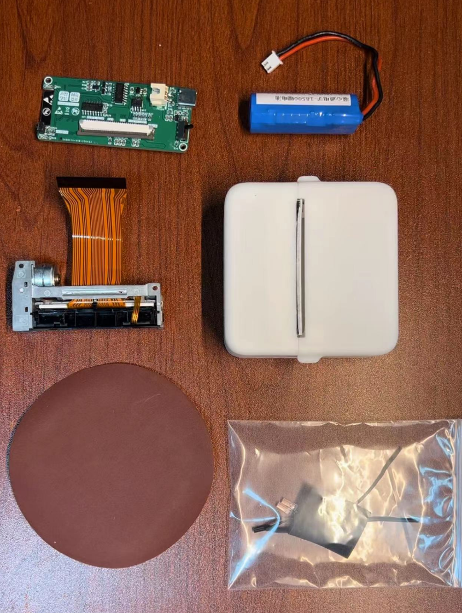

# 板卡：

板卡使用工程文件，直接在嘉立创下单即可，工程位于资料文档的第四章节：

[Mini打印机资料导航](https://lsongdev.feishu.cn/docx/NmZbd1yCdoYU1SxMEVkcm1B2nZd) 

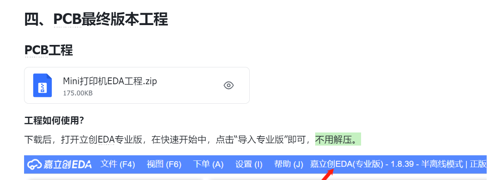

板卡正面

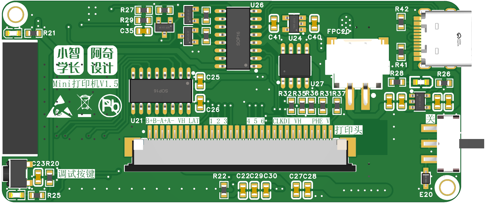

板卡背面

# 电池：

**2.54 2P XH端子 电流5C 尺寸21x50mm**

https://item.taobao.com/item.htm?spm=a1z09.2.0.0.43e52e8dMobAdE&id=617369747794&\_u=rkbg1731b45

联系店家，发上述参数即可。

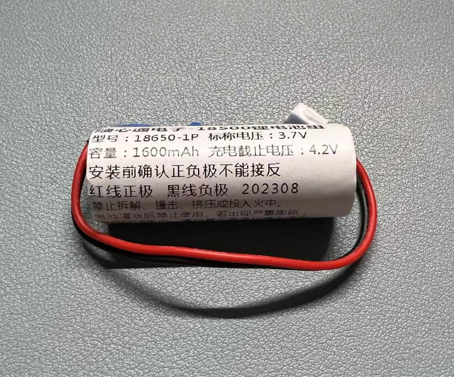

# 打印头：

**JX-2R-01 这个是拆机的打印头哦 不影响正常使用 后续会同步发原厂原装打印头**

<!-- 不支持的块类型: View (type=33) -->

<file token="WW8xbJB5JoqERFxlkh5cPrwWnvh" name="1_JX-2R-01微型热敏打印机芯规格书-V1.5.pdf"/>

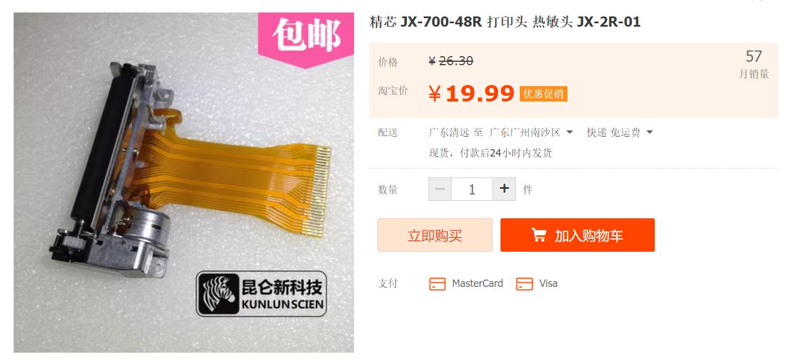

打印头目前已知有两个版本，线序不太一样，但是可通过改软件IO解决。

<grid cols="2">
<column>
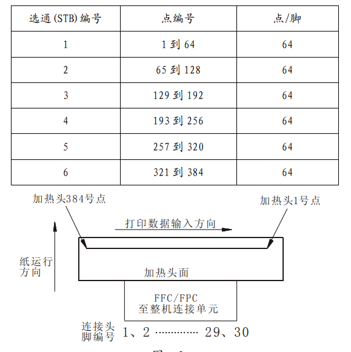
</column>
<column>
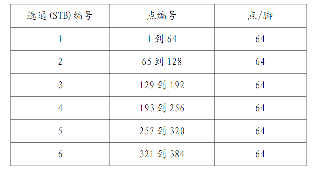
</column>
</grid>

# 外壳相关：（工程文件、打印文件、配件等）

[mini打印机 结构文件与配件下载](https://lsongdev.feishu.cn/docx/Ddzkd7URcoSCksxN13ec6WZjnNe) 

透明外壳打印：

09微心能就么个我里就然个家， https://m.tb.cn/h.5TvAYk6  CZ3457 汇通三维旗舰店

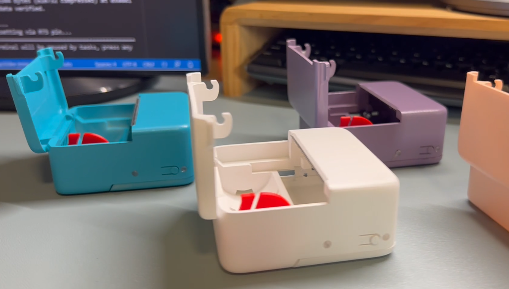

# 打印纸：

打印纸的需求是**长度57，高度是30mm**，不干胶或者铺铜热敏纸都是可以的，所以网络上选择很多。

https://detail.tmall.com/item.htm?\_u=jktr7u15f0b&id=581591277062&spm=a1z09.2.0.0.72202e8dvKekAK

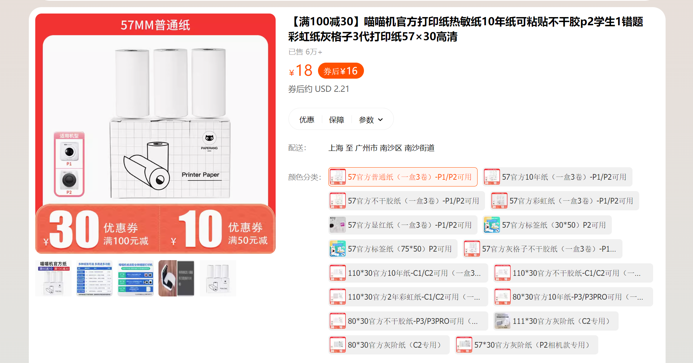

https://detail.tmall.com/item.htm?id=572711164106

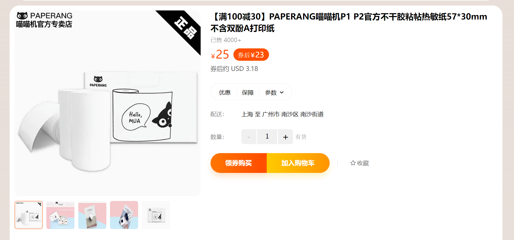

https://item.taobao.com/item.htm?spm=a21n57.1.0.0.7c28523cn200Qs&id=659225381242&ns=1&abbucket=9\#detail

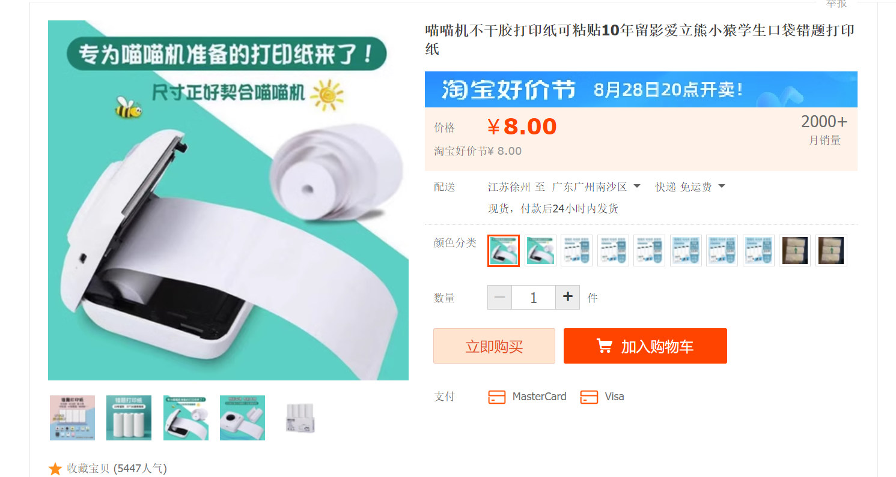

当然，其它宽度的纸也是可以的，结构预留了不同长度打印纸的卡槽，但是代码需要自行修改。
