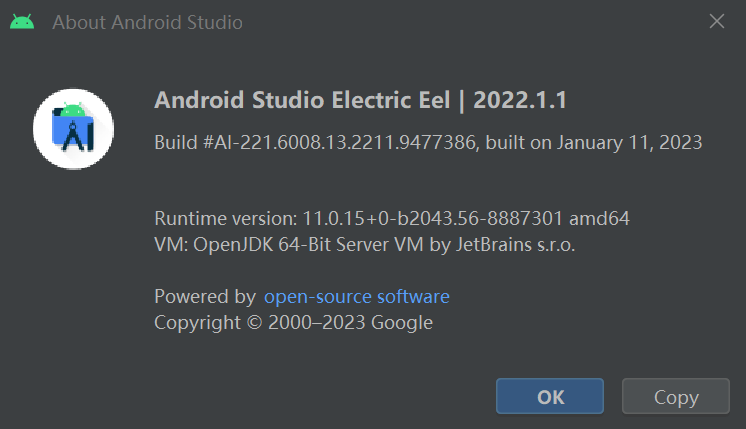
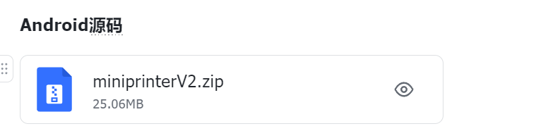
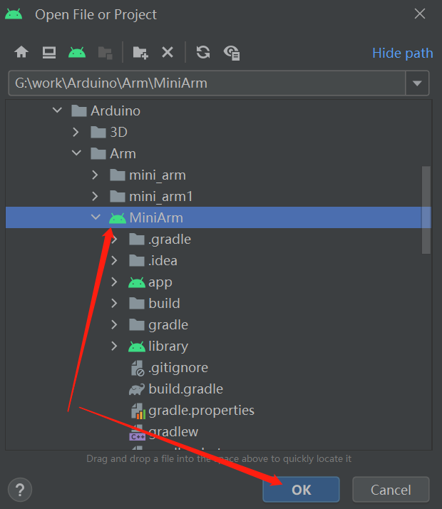
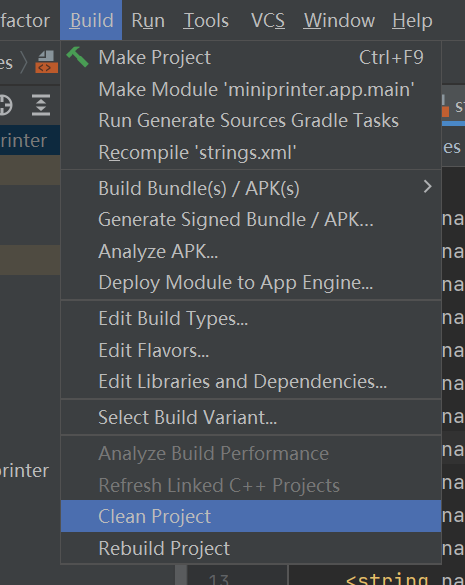
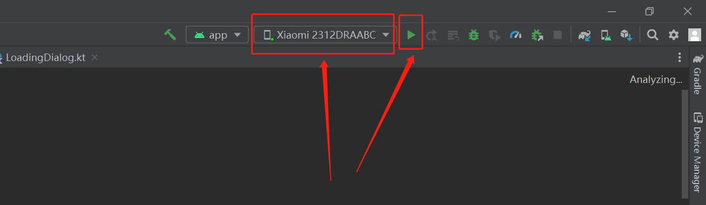
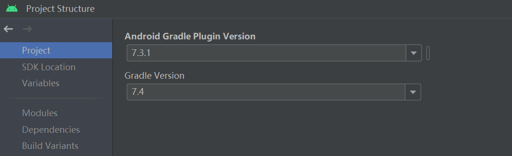
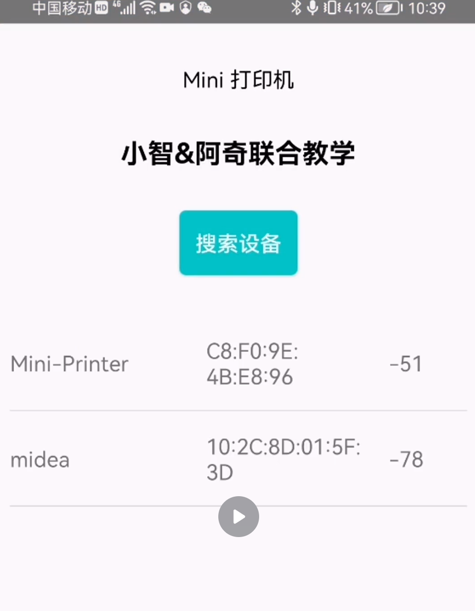
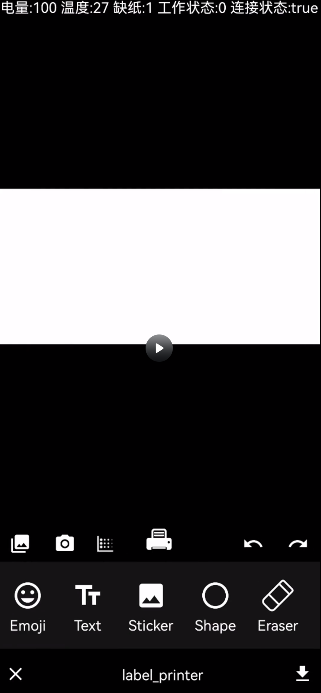
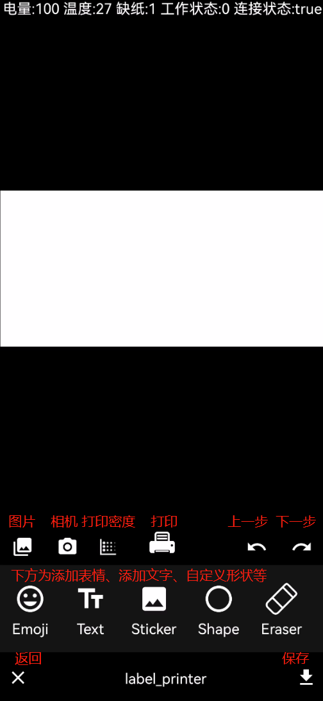
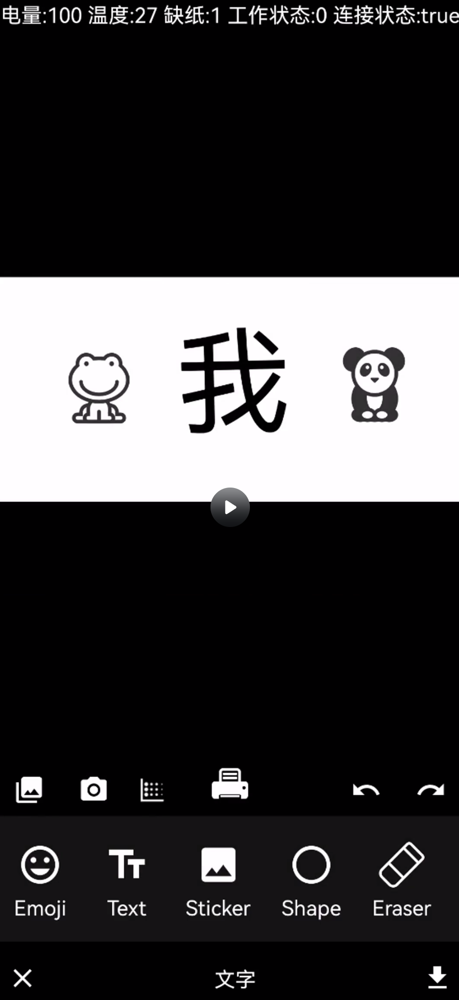

# 8、Mini打印机-APP开发需求说明&Android源码工程导入使用

## 前言：Android工程源码使用说明

## 1、Android Studio开发环境如下

Android Studio Electric Eel \| 2022.1.1，建议安装接近版本，避免环境依赖问题。

Android Studio的安装，网上文章很多，也比较简单，可自行搜索下，主要是网络依赖而已

[Android Studio 安装配置教程](https://blog.csdn.net/qq_38436214/article/details/105073213)



## 2、打开工程

安装完成Android Studio后，直接左上角File-\>Open-\>选择下载的源码文件夹（源码在资料导航第七章）-\>打开工程即可

首次打开工程，会自动下载依赖包，需要一定时间，主要看网络状况。



（源码在资料导航第七章-飞书链接：[Mini打印机资料导航持续更新ing](https://lsongdev.feishu.cn/docx/JmWhd7qThofnSvx7V87cgvoXnue)    密码：HN1b816H）



如果打开后报错，可以执行Build-\>Clean Project-\>然后重新Rebuild Project



## 3、编译调试

**最后，就可以接上手机，编译工程啦**

手机需要打开开发者USB调试模式，允许通过USB线安装应用哦



工程依赖的版本如下：



# 一、通信方式：

蓝牙BLE

# 二、通信协议：

## 手机端数据通讯

### 打印机部分：

**需求：需要使用手机下发打印数据，在操作设备时，设备产生的错误也需要手机端显示出来。**

实现原理：

基于BLE模块实现数据透传，主要有四种类型的数据

```c
#define SERVICE_UUID "4fafc201-1fb5-459e-8fcc-c5c9c331914b"         // 自定义打印服务UUID
#define CHARACTERISTIC_UUID "beb5483e-36e1-4688-b7f5-ea07361b26a8"  // 自定义打印特征UUID
#define BLE_NAME "Mini-Printer"
```

1. 设备状态的上报

设备的状态有四种，电量、打印头温度、缺纸状态、打印状态，只需要实现定时上报或触发上报即可，这里面没有添加包头校验码，严格来说必须要加上。

使用蓝牙BLE Notify实现，设备连接成功后，接收通知然后解析即可

```c
mDeviceState.battery = value[0]
mDeviceState.temperature = value[1]
mDeviceState.paper_warn = value[2]
mDeviceState.work_status = value[3]
```

1. 打印数据的发送

2-1、把需要打印的图片通过抖动算法转换为灰阶图片

https://blog.csdn.net/qq\_31057589/article/details/121209755

2-2、然后通过转换为指定宽度，二值化后下发到设备，二值化后的每个像素的只能是0或1，0代表无颜色，1代表有颜色，把八个点转换为一个Byte，例如 00010001=0x11，每行384个点，对应48个字节，也就是每条打印数据长48Byte，需要注意的是一张图片会有几十或上百行，由于蓝牙通信速率原因，每条指令发送间隔最好在1-10ms左右，根据实际调试验证。

```c
//Bitmap二值化
public static Bitmap convertToBMW(Bitmap bmp,Boolean printerState,int tmp) {
    int width = bmp.getWidth(); // 获取位图的宽
    int height = bmp.getHeight(); // 获取位图的高
    Log.i(TAG,"width = "+width + " "+height);
    int[] pixels = new int[width * height]; // 通过位图的大小创建像素点数组
    // 二值化参考值（中间比较值）二值化的域值 设定二值化的域值，默认值为100
    bmp.getPixels(pixels, 0, width, 0, 0, width, height);
    int alpha = 0xFF << 24;
    String colorBit;
    for (int i = 0; i < height; i++) {
        StringBuilder stringBuilder = new StringBuilder();    //创建一个 StringBuilder 对象，用来储存矩阵数据
        for (int j = 0; j < width; j++) {
            int grey = pixels[width * i + j];
            // 分离三原色
            alpha = ((grey & 0xFF000000) >> 24);
            int red = ((grey & 0x00FF0000) >> 16);
            int green = ((grey & 0x0000FF00) >> 8);
            int blue = (grey & 0x000000FF);
            int i1 = 0xFFFF;

            if (red > tmp) {
                red = 255;
            } else {
                red = 0;
            }
            if (blue > tmp) {
                blue = 255;
            } else {
                blue = 0;
            }
            if (green > tmp) {
                green = 255;
            } else {
                green = 0;
            }
            pixels[width * i + j] = alpha << 24 | red << 16 | green << 8
                    | blue;
            if (pixels[width * i + j] == -1) {
                pixels[width * i + j] = -1;
                colorBit = ".";
                if(printerState)
                    PrinterByte.INSTANCE.addByteArr(false,false);
            } else {
                pixels[width * i + j] = -16777216;
                colorBit = "0";
                if(printerState)
                    PrinterByte.INSTANCE.addByteArr(false,true);
            }
            stringBuilder.append(colorBit);
        }
        if(printerState)
            PrinterByte.INSTANCE.addByteArr(true,false);
        Log.i(TAG,"length="+stringBuilder.length()+" "+stringBuilder);
    }
    if(printerState)
        PrinterByte.INSTANCE.sendStartPrinter();

    // 新建图片
    Bitmap newBmp = Bitmap.createBitmap(width, height, Bitmap.Config.ARGB_8888);
    // 设置图片数据
    newBmp.setPixels(pixels, 0, width, 0, 0, width, height);
    Bitmap resizeBmp = ThumbnailUtils.extractThumbnail(newBmp, width, height);

    return resizeBmp;
}
```

1. 打印颜色深度设置

设备端收到0xA5 0xA5 0xA5 0xA5 0xnn类型的数据时，会把该数据当作颜色深度设置指令处理，0xnn为01，02，03，用于设置打印颜色深度，下发是android端实现的代码。

```c
val byteArray: ByteArray = ByteArray(5)
byteArray[0] = 0xA5.toByte()
byteArray[1] = 0xA5.toByte()
byteArray[2] = 0xA5.toByte()
byteArray[3] = 0xA5.toByte()
when (density) {
    DensitySetDialog.DENSITY.DENSITY_LOW -> {
        byteArray[4] = 0x01.toByte()
    }
    DensitySetDialog.DENSITY.DENSITY_MID -> {
        byteArray[4] = 0x02.toByte()
    }
    DensitySetDialog.DENSITY.DENSITY_HIGH -> {
        byteArray[4] = 0x03.toByte()
    }
}
PrinterByte.addSendFrames(byteArray)
```

1. 使用开始打印指令

开始打印指令较简单，固定为0xA6 0xA6 0xA6 0xA6 0x01，在发送完打印数据后发送。

```c
fun sendStartPrinter() {
    finishByteArray[0] = 0xA6.toByte()
    finishByteArray[1] = 0xA6.toByte()
    finishByteArray[2] = 0xA6.toByte()
    finishByteArray[3] = 0xA6.toByte()
    finishByteArray[4] = 0x01.toByte()
    addSendFrames(finishByteArray)
    Log.i(TAG,"----send finish ---------------------")
}
```

部分较老android手机使用的是蓝牙4.0的协议栈，数据发送速度较慢，会导致打印速度比接收数据速度快，打印不完整或者一卡一卡情况，所以增加了开始打印指令，等所以数据接收完成后，才开始打印。

开始打印的指令为0xA6 0xA6 0xA6 0xA6 0x01，设备端需要屏蔽下发逻辑，添加打印开始处理逻辑。

```c
    #ifdef START_PRINTER_WHEN_FINISH_RAED
    //接受完成时才打印
        if (pdevice->read_ble_finish == true)
        {
            if (pdevice->printer_state == PRINTER_STATUS_FINISH ||
                pdevice->printer_state == PRINTER_STATUS_INIT)
            {
                pdevice->read_ble_finish = false;
                pdevice->printer_state = PRINTER_STATUS_START;
                ble_report();
                Serial.printf("report device status : printing start %d\n",get_ble_rx_leftline());
                run_beep(BEEP_PRINTER_START);
                run_led(LED_PRINTER_START);
            }
        }
    #else
    // 接收大于100条时，才触发开始打印
    if (get_ble_rx_leftline()> 100)
    {
        if (pdevice->printer_state == PRINTER_STATUS_FINISH ||
            pdevice->printer_state == PRINTER_STATUS_INIT)
        {
            pdevice->printer_state = PRINTER_STATUS_START;
            ble_report();
            Serial.print("report device status : printing start\n");
            run_beep(BEEP_PRINTER_START);
            run_led(LED_PRINTER_START);
        }
    }
    #endif
```

# 三、页面说明

设备搜索页

只运行点击蓝牙BLE名称为Mini-Printer的设备



打印编辑页面：

使用了一个开源的照片编辑框架修改而来

添加了打印和打印密度设置两个按钮，点击打印后，把图像进行二值化，然后把二值化后的数组通过BLE发送给打印机，协议待更新。

<grid cols="2">
<column>

</column>
<column>

</column>
</grid>

编辑需要打印的图片：

打开APP时，默认的背景的比较小的，可以自己打开图片替换背景图，然后编辑上方的文字或图案



## 

# 四、演示：

打印机

<!-- 不支持的块类型: View (type=33) -->

[视频：手机APP使用教程.mp4（飞书原文）](https://lsongdev.feishu.cn/docx/UQqOdcM3koHvJ9x7VuCcIkn0nwb)
